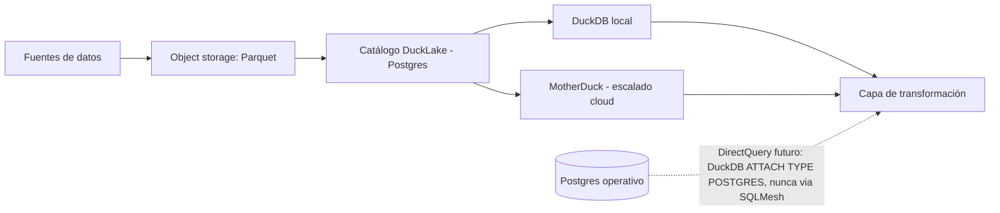

# Capa 1: Motor de Almacenamiento (el "corazón")

> Reemplazo: **VertiPaq → DuckDB (+ MotherDuck para escalar)**

---

## 1. Responsabilidad única de esta capa

Almacenar datos ya limpios en formato columnar comprimido y responder consultas analíticas (agregaciones, filtros, joins) lo más rápido posible.

**Esta capa NO debe saber:**
- Nada sobre métricas de negocio ni nombres de "medidas" (eso es la capa semántica).
- Nada sobre relaciones lógicas entre entidades de negocio (eso también es semántico).
- Nada sobre quién está consultando ni con qué permisos (eso es auth).
- Nada sobre cómo se visualiza el resultado (eso es frontend).

Si esta capa empieza a contener lógica de negocio, el diseño está roto — señal de que alguien puso una fórmula de negocio en una vista SQL "porque era más rápido" en vez de subirla a la capa semántica.

---

## 2. Qué hace VertiPaq exactamente (para saber qué estamos reemplazando)

- **Compresión columnar por diccionario** — cada columna se almacena por separado, con valores repetidos codificados como enteros contra un diccionario, no como texto repetido.
- **Ejecución en memoria** — todo el modelo (comprimido) vive en RAM del proceso de Power BI o de la capacidad Premium/Fabric.
- **Motor vectorizado** — procesa lotes de filas en paralelo, no fila por fila.
- **Import u DirectQuery** — dos modos: cargar todo el dataset comprimido a memoria (rápido, pero exige refresco completo), o consultar la fuente en vivo (lento, porque no hay compresión ni caché propia).

---

## 3. Defectos concretos de VertiPaq que eliminamos

| Defecto | Por qué es un problema real |
| --- | --- |
| Tamaño del modelo limitado por la RAM del SKU de capacidad contratado | El costo de escalar datos es directamente el costo de licenciamiento de Fabric/Premium, no el costo real de cómputo |
| Import completo obligatorio para rendimiento razonable | Refrescar un modelo grande es lento y costoso; DirectQuery como alternativa es notoriamente lento en interactividad |
| No soporta formatos abiertos nativamente | No puede leer Parquet/Iceberg/Delta directamente — todo pasa por conectores propietarios de Power Query |
| Encerrado dentro del ecosistema Power BI | No se puede usar VertiPaq como motor de otra aplicación — es una pieza no reutilizable |
| Sin ejecución client-side | No existe versión de VertiPaq que corra en el navegador — la arquitectura es intrínsecamente cliente-servidor |
| Single-node únicamente | No escala horizontalmente; el único camino de escalado es "comprar más capacidad" |

---

## 4. Por qué DuckDB gana (no solo iguala)

- **Ejecución vectorizada con SIMD** — arquitectura de motor moderna (basada en ideas de MonetDB/X100), competitiva en benchmarks de cargas OLAP típicas contra motores columnares comerciales.
- **Cero fricción de import** — puede hacer `SELECT * FROM 'datos.parquet'` directo, sin ETL previo solo para "meter los datos al motor". Lee Parquet, Iceberg, Delta Lake y CSV nativamente.
- **Embebido, no un servidor** — se instala como una librería (Python, Node, etc.), no como un proceso de infraestructura separado. Reduce drásticamente la superficie operativa comparado con levantar un cluster.
- **DuckDB-WASM** — corre compilado a WebAssembly dentro del navegador. Esto es estructuralmente imposible para VertiPaq: habilita analítica **local-first**, sin servidor, sin roundtrip de red, incluso offline.
- **Extensible** — sistema de extensiones community (geoespacial, full-text search, conectores a object storage) sin esperar a que un vendor lo priorice.
- **Sin licenciamiento** — Apache-compatible (MIT), sin costo por capacidad ni por usuario.

**Honestidad sobre los límites:** DuckDB es single-writer y pensado para cargas analíticas de lectura intensiva sobre un solo nodo. Para volumen verdaderamente masivo con muchas escrituras concurrentes, no reemplaza a un motor distribuido tipo ClickHouse o BigQuery — para eso está el escalón de MotherDuck (ver sección 6).

---

## 5. Qué agregamos que VertiPaq/Power BI no tienen

- **Ejecución client-side vía WASM** — dashboards que funcionan sin conexión, procesando datos ya cacheados localmente.
- **Zero-copy queries sobre object storage** — consultar Parquet/Iceberg directamente en S3/GCS sin duplicar los datos en un "modelo" separado.
- **Portabilidad total** — el mismo motor corre en tu laptop, en un contenedor, o embebido en la app — sin reescribir nada.
- **Interoperabilidad con el ecosistema de datos abierto** (Iceberg, Delta) en vez de un formato propietario cerrado.

---

## 6. Arquitectura interna de esta capa



### 6.1 Modo import: ¿`.duckdb` puro, Parquet suelto, o DuckLake?

| Opción | Qué es | Cuándo usarla |
| --- | --- | --- |
| Archivo `.duckdb` nativo | Datos + catálogo en un solo binario | Prototipo, desarrollo local, un solo escritor |
| Parquet suelto (sin catálogo) | Archivos en una carpeta/bucket, sin metadata centralizada | Casos simples, pero sin ACID ni time-travel |
| **DuckLake** (recomendado para producción) | Parquet como almacenamiento + **catálogo en una base SQL** (Postgres o un `.duckdb`), en vez de metadata dispersa en archivos como hacen Iceberg/Delta | Cuando hay más de un escritor, se necesita versionado/time-travel, o refrescos frecuentes con cambios pequeños |

DuckLake llegó a v1.0 producción-ready en abril 2026 — con apenas 5 meses de historial en producción al momento de este documento, vale la pena tenerlo presente como una madurez todavía joven, no la de un formato con años de uso masivo. Su ventaja central: Iceberg y Delta ya usan una base de datos para el catálogo, pero solo guardan un puntero al último snapshot — la metadata real vive en archivos por capas en object storage, y cada consulta debe leerlos secuencialmente antes de tocar el dato, agregando latencia. DuckLake mete *toda* la metadata en la base SQL, eliminando ese problema y resolviendo además el "problema de los cambios chicos" (cada insert pequeño generando un archivo nuevo) — justo el patrón de un dashboard con refrescos frecuentes.

**Regla práctica:** arrancar con `.duckdb` puro para prototipo; migrar a DuckLake (catálogo en Postgres) en cuanto haya más de un proceso escribiendo. Es un cambio de configuración, no de motor. MotherDuck ofrece DuckLake gestionado (storage, catálogo y cómputo escalables por separado) como capa de conveniencia opcional — nunca como dependencia dura, para mantener la regla de "open source primero".

### 6.2 Import (Lakehouse) vs. Live/DirectQuery — dos caminos distintos, nunca el mismo *hot path*

**Corrección de dos errores reales, señalados en una revisión posterior — uno de rol de herramienta, y uno estructural más serio.**

**Error 1 — `pg_duckdb` estaba mal ubicado.** No es un conector genérico para que *nuestro* DuckDB consulte un Postgres externo — es exactamente lo contrario: una extensión que instala DuckDB **dentro** del propio proceso de Postgres (útil solo si controlamos ese Postgres y podemos instalarle extensiones, ej. una base operativa propia). Para que nuestro DuckDB (capa 1) consulte un Postgres cualquiera, el mecanismo correcto — verificado contra la documentación oficial — es la **extensión `postgres` de DuckDB, con `ATTACH ... (TYPE POSTGRES)`**. Las funciones viejas (`postgres_attach`, `postgres_scan`) están deprecadas a favor de `ATTACH`.

**Error 2, más serio — DirectQuery estaba dibujado hacia la capa equivocada.** La versión anterior sugería que una fuente en vivo pasaba "hacia la capa de transformación" — eso implicaría que SQLMesh corre en el camino de una consulta interactiva, lo cual nunca puede pasar: **SQLMesh no está en el *hot path* de un click de usuario.** Son dos caminos completamente separados:

```
IMPORT / LAKEHOUSE (el camino normal, el único soportado oficialmente en el MVP)
Fuente ──dlt──► RAW (condicional) ──SQLMesh──► DuckLake MART ──► DuckDB ──► Cube ──► Visual

LIVE / DIRECTQUERY (capacidad futura/experimental — no del MVP)
Visual ──► Cube ──► DuckDB ──► ATTACH (TYPE POSTGRES) ──► Postgres/MySQL en vivo
```

En el camino Live, SQLMesh nunca aparece — DuckDB consulta la fuente operativa directo, en el momento de la consulta, vía `ATTACH`. Es una arquitectura genuina pero distinta, con sus propios problemas por resolver (latencia de la fuente operativa, no incrementalidad, sin *pre-aggregations* de Cube Store aplicables de la misma forma) — **por eso el MVP declara Import/Lakehouse como el camino soportado oficialmente, y DirectQuery como capacidad futura, en vez de prometer algo cuya arquitectura todavía no está terminada.**

**Los mecanismos de conexión en vivo, en orden de prioridad, para cuando DirectQuery se construya:**

1. **Extensión `postgres` de DuckDB** (`ATTACH ... TYPE POSTGRES`) cuando la fuente es Postgres estándar — el camino normal, no `pg_duckdb`.
2. **Scanners nativos de DuckDB** (`mysql_scanner`, etc.) para otras fuentes con atajo nativo.
3. **ADBC** para todo lo demás (SQL Server, Snowflake, BigQuery, Trino) — mismo mecanismo ya elegido en la capa de ingesta (`03-ingesta.md`), reutilizado acá.
4. **`pg_duckdb`** queda como optimización opcional, solo cuando controlamos el Postgres fuente y tenemos permiso de instalarle extensiones — nunca como el mecanismo por defecto.

### 6.3 Cuándo agregar ClickHouse (no en vez de, sino además)

Si el caso de uso exige cientos de usuarios concurrentes con SLA de latencia estricto sobre datasets muy grandes, ClickHouse (Apache 2.0, escala horizontal real) se agrega como motor de *serving* detrás del semántico — no reemplaza a DuckDB, convive con él para esa carga específica.

**Nota de reevaluación futura, no una decisión de arquitectura actual: DuckDB 2.0 ("Cyanoptera") puede cambiar este cálculo, pero todavía no está listo.** Verificado: DuckDB anunció el 17 de agosto de 2026 la vista previa de su versión 2.0, que agrega **modo servidor** (la extensión `Quack`, ya disponible como extensión core desde DuckDB 1.5.3, pasa de beta a protocolo 1.0 estable recién con el 2.0) y **I/O asíncrono** — el propio DuckDB Labs lo describe como "el año de DuckDB como servidor", después de "el año del lakehouse". Al momento de este documento, DuckDB 2.0 está en fase alfa, con release proyectado para la **segunda mitad de octubre de 2026** — todavía no es una versión estable.

**Por qué esto no se adopta ahora, y qué condición dispara la reevaluación:** la regla 6 de `CLAUDE.md` exige madurez verificada en producción, no software experimental — un modo servidor recién saliendo de alfa no la cumple. Además, aunque DuckDB 2.0 llegue a versión estable, **eso no significa que Cube lo soporte automáticamente**: el driver de DuckDB de Cube todavía tiene trabajo pendiente de actualización (ver `17-self-service-calculations.md`, sección 3.2.2) y no hay confirmación de que vaya a adoptar el protocolo Quack para conectarse en modo servidor en vez de embebido. **Se reevalúa esta sección cuando se cumplan las dos condiciones a la vez: DuckDB 2.0 llegue a versión estable, Y el driver de Cube confirme soporte del modo servidor** — recién ahí tendría sentido probar si DuckDB en modo servidor reduce la necesidad de ClickHouse para cargas de concurrencia media, no antes.

### 6.4 SQL Server y MariaDB: dónde encajan (y dónde no)

Ninguno de los dos es candidato a motor del corazón: SQL Server es propietario (viola la regla de código abierto) y MariaDB es un motor de filas (OLTP), no columnar. Ambos solo tienen sentido como **fuentes** a las que se les pega vía la extensión `postgres`/`mysql_scanner` de DuckDB o ADBC (sección 6.2) — nunca como el motor analítico en sí.

### 6.5 Tres escritores concurrentes (CDC, SQLMesh, Input Tables) — investigado, mayormente resuelto

**Una revisión externa marcó como riesgo no examinado que este proyecto tiene, en la práctica, procesos que pueden escribir al mismo tiempo:** el CDC de dlt (capa 3, escribiendo a `raw_*`), el `plan`/`run` de SQLMesh (capa 2, escribiendo físicamente solo a `mart_*` — `stg_*`/`int_*` son vistas lógicas por defecto, sección 6.1.1 de `02-transformacion.md`, y una vista no escribe ningún archivo, así que no participa de este problema en absoluto), y las escrituras en vivo de Input Tables (capa 2, sección 9, escribiendo a `raw_input_*`). Vale la pena separar qué de esto ya está resuelto por diseño y qué queda como pendiente real.

**Lo que ya está resuelto, y por una razón concreta:** DuckLake usa **control de concurrencia optimista a nivel de catálogo**, no a nivel de archivo — cada escritor sube sus Parquet a object storage de forma independiente y recién al final hace una transacción corta contra el catálogo para registrarlos. Los **appends nunca generan conflicto, ni siquiera sobre la misma tabla**, y los commits que no chocan (por ejemplo, escrituras a tablas distintas) se resuelven automáticamente con reintentos — DuckLake sostiene del orden de 100 transacciones por segundo a nivel de catálogo. Como los escritores físicos reales de este proyecto (CDC → `raw_*`, SQLMesh → solo `mart_*`, Input Tables → `raw_input_*`) tocan **conjuntos de tablas disjuntos**, y las vistas intermedias no escriben nada, el escenario de "escritores pisándose" descrito en la crítica casi no ocurre en la práctica.

**Lo que sí queda como riesgo genuino, y hay que diseñarlo:** un conflicto real de concurrencia optimista ocurre cuando dos escritores intentan **modificar (no agregar) la misma fila** al mismo tiempo — por ejemplo, dos usuarios editando el mismo valor de forecast en Input Tables en el mismo instante. Ese caso sí puede fallar con un error de conflicto, y la mitigación es responsabilidad de la Capa 6 (API Gateway), no de esta capa: el procedimiento de escritura de Input Tables (capa 6, sección 9.1) debe reintentar automáticamente con backoff ante un conflicto de commit, usando los parámetros que DuckLake ya expone para esto (`ducklake_max_retry_count`, `ducklake_retry_wait_ms`, `ducklake_retry_backoff`) — no hay que inventar un mecanismo de colas ni de locking propio.

### 6.6 Catálogo SQLite: límite multi-proceso medido, y su remedio

El catálogo SQLite existe para el nivel **portátil** (un solo desarrollador, un solo proceso que escribe); el catálogo **PostgreSQL** es el primario y el único para escritura concurrente real. La documentación de DuckLake dice que, con SQLite, su modo por defecto (ATTACH/DETACH por consulta más un *retry time-out* ante el bloqueo de escritura) da *"a reasonable amount of multi-processing support"*. Se midió en la Fase 0 del Paso 1 (septiembre 2026; Windows 11, DuckDB 1.5.5, extensión `ducklake` `d8a1881e`, journal por defecto de SQLite, sin reintentos de la aplicación):

| Escenario | Resultado |
| --- | --- |
| **Cadencia realista**: un escritor cada 2 s + un lector cada 1 s; o dos escritores cada 2 s | **5/5 corridas por escenario sin errores** y sin operaciones de más de 1 s — lo documentado se cumple |
| **Contención alta**: lector cada 25 ms mientras se escribe, o escritores sin pausa | Fallos `database is locked`; **el proceso que pierde puede quedar sin poder usar el catálogo** (sus reintentos y lecturas siguen fallando) hasta reiniciarse. Nunca se corrompió nada: el proceso siguiente recupera el catálogo con el *journal* de SQLite, sin datos parciales |
| **Transacción explícita larga** de varias sentencias + otro escritor | Cascada: falla también el `COMMIT` de quien tenía la transacción; el bloqueo dura hasta que termina el proceso |

**Remedio:** reiniciar el proceso afectado; si hay más de un proceso escribiendo con frecuencia, o más de un usuario, usar el catálogo **PostgreSQL**.

**Consecuencias de diseño** (Paso 1): el puerto administrativo serializa las escrituras dentro del proceso y no ofrece transacciones explícitas de varias sentencias; ante `database is locked` reintenta con un presupuesto acotado y, si se agota, falla con ese remedio en el mensaje. **No se activa el modo WAL de SQLite:** en las pruebas de contención alta eliminó los fallos, pero activarlo exige `node:sqlite` (Stability 1.1 en Node 24) y a cadencia realista no hace falta — queda como opción documentada si el uso real lo pidiera. Los scripts de la medición fueron exploratorios y no forman parte del repositorio: esta tabla es el registro de sus resultados.

---

## 7. Contrato de esta capa (qué expone, qué consume)

- **Consume**: archivos Parquet/CSV/Iceberg ya depositados en object storage por la capa de ingesta.
- **Expone**: una conexión SQL estándar (protocolo DuckDB o el conector de MotherDuck) — nada de HTTP directo al frontend. La capa de transformación y la capa semántica son las únicas que hablan directo con este motor.
- **No expone**: ninguna noción de "métrica" ni "medida" — eso vive exclusivamente en la capa semántica (documento 04).

---

## 8. Por dónde empezar a construir (paso a paso concreto)

1. Instalar DuckDB localmente (`pip install duckdb` o el binding de Node) — sin infraestructura, corre en tu máquina.
2. Tomar una fuente real tuya (un CSV o export de una fuente actual) y cargarla como Parquet en una carpeta local o un bucket de prueba.
3. Verificar que DuckDB puede leerla directo (`SELECT * FROM read_parquet('ruta')`) sin pasos de import intermedios.
4. Medir tiempos de una consulta agregada típica (la que hoy tarda en Power BI) para tener una línea base de comparación real, no teórica.
5. Solo cuando el volumen lo justifique, evaluar MotherDuck para el mismo dataset sin cambiar el SQL.

Este paso es la base de todo lo demás — la capa de transformación (documento siguiente) se construye directamente encima de esto.

---

**Siguiente documento:** `02-transformacion.md` — dbt/SQLMesh reemplazando Power Query (M).
