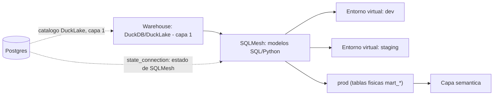

# Capa 2: Transformación (el "banco de trabajo")

> Reemplazo: **Power Query (M) → SQLMesh** (con dbt OSS como alternativa válida, no descartada — ver sección 4)

---

## 1. Responsabilidad única de esta capa

Tomar datos crudos ya disponibles en el motor de almacenamiento (capa 1) y transformarlos en tablas limpias, testeadas y listas para el modelo semántico.

**Esta capa NO debe saber:**
- Nada de métricas de negocio, nombres de "medidas" ni agregaciones de negocio (eso es la capa semántica, documento 04).
- Nada de cómo llegaron los datos crudos hasta el warehouse (eso es la capa de ingesta, documento 03).
- Nada de quién consulta ni con qué permisos (eso es auth, documento 09).
- Nada de HTTP ni de cómo se sirve el resultado al frontend.

Si esta capa empieza a calcular un KPI de negocio directamente en un modelo SQL "porque es más rápido", el diseño está roto — esa lógica sube a la capa semántica.

---

## 2. Qué hace Power Query (M) exactamente (para saber qué estamos reemplazando)

- **Lenguaje funcional propietario** (M), diseñado por Microsoft, sin uso fuera del ecosistema Power BI / Excel / Power Automate.
- **UI de "pasos aplicados"** como interfaz principal: cada transformación es un paso grabado por la UI (a veces editable en el panel de fórmulas, pero pensado para clic-y-arrastrar, no para escribir código).
- **Ejecución en el propio proceso de Power BI**, generalmente sobre datos ya cargados a memoria — no es un motor de transformación distribuido ni versionado.
- **Sin tests de datos nativos** — no hay un concepto equivalente a "verificar que esta columna no tenga nulos" antes de publicar; el error se descubre cuando el reporte ya muestra un número raro.
- **Sin lineage explícito fuera de la vista gráfica de consultas** del propio Power BI Desktop.

---

## 3. Defectos concretos de Power Query/M que eliminamos

| Defecto | Por qué es un problema real |
| --- | --- |
| Lenguaje M propietario, sin comunidad ni ecosistema fuera de Microsoft | Cero portabilidad de conocimiento o código a otra herramienta |
| La UI de "pasos aplicados" es la fuente de verdad | No hay diff legible en un pull request — dos analistas no pueden revisar un cambio de transformación como revisan código |
| Sin tests de datos como gate antes de publicar | Los errores de calidad de datos se descubren en el dashboard final, no antes |
| Sin entornos aislados reales para probar un cambio | Cambiar una consulta implica recalcular todo el modelo para ver el efecto |
| Recalculo completo como único mecanismo de refresco en la mayoría de los casos | Sin incrementalidad real, los refrescos escalan mal con el volumen |
| Lineage limitado a la vista propia de Power BI Desktop | No hay lineage a nivel de columna consultable por fuera de la herramienta |

---

## 4. Qué reemplaza a Power Query — dbt vs SQLMesh, con exigencia real

Esta es la misma pregunta que se hizo con el motor de almacenamiento: no alcanza con "dbt es el estándar, listo". Hay que revisar qué cambió en 2025-2026 y decidir con la misma vara.

### 4.1 El panorama en 2026 — actualizado dos veces desde el análisis original

**dbt** sigue siendo el estándar de facto: el ecosistema más grande, el mayor pool de gente que ya lo conoce, y una librería enorme de paquetes de la comunidad. **Corrección de un dato que quedó desactualizado (detectado por una revisión externa):** en mayo de 2025 dbt Labs lanzó Fusion (motor en Rust) bajo una licencia mixta con ELv2, y ese fue el argumento original de este documento contra dbt. Pero **el 1 de junio de 2026 dbt Labs publicó ese mismo código bajo Apache 2.0** en el repositorio de dbt-core, y desde entonces existen dos distribuciones: "dbt" (antes Fusion, la recomendada por defecto, con funciones premium detrás de login) y **"dbt OSS"** (100% Apache 2.0, instalable localmente, sin login). El argumento de licencia contra dbt tal como estaba escrito ya no es válido — hoy dbt tiene un camino genuinamente abierto con el motor rápido incluido.

**Lo que sí cambió a favor de SQLMesh, y no estaba en la versión original de este documento:** en septiembre de 2025, **Fivetran compró Tobiko Data** (la empresa que creó SQLMesh). Un mes después, Fivetran anunció su fusión con **dbt Labs** (cerrada en junio de 2026). Es decir: hoy, la empresa que creó SQLMesh y la empresa que creó dbt son la misma compañía combinada. La donación de SQLMesh a la **Linux Foundation en marzo de 2026** — antes de que esa fusión se completara — no fue un gesto simbólico: fue la jugada concreta que impidió que el proyecto SQLMesh terminara bajo el control corporativo de su propio competidor. Es el ejemplo más claro que existe en todo este proyecto de por qué la regla de gobernanza importa en la práctica, no solo en la teoría.

**SQLMesh**, entonces, no gana hoy por licencia (dbt OSS también es Apache 2.0 puro) — gana por **gobernanza de fundación neutral, en un momento donde esa neutralidad se puso a prueba de verdad**, y por el encaje técnico que ya tenía: SQL puro sin depender de Jinja para lógica condicional, modelos en Python de primera clase en el mismo DAG, lineage a nivel de columna, y un flujo `plan`/`apply` al estilo Terraform que clasifica cada cambio como *breaking* o *non-breaking* antes de aplicarlo.

### 4.2 Comparación técnica directa

| Aspecto | dbt (dbt OSS / "dbt") | SQLMesh |
| --- | --- | --- |
| Licencia | **dbt OSS**: 100% Apache 2.0, motor Rust incluido. **"dbt"** (antes Fusion, recomendada por defecto): binario más permisivo que ELv2, pero con funciones premium detrás de login/pago | 100% Apache 2.0, sin excepción, proyecto de la Linux Foundation |
| Gobernanza | Fivetran + dbt Labs, una sola empresa combinada — la misma que hoy también es dueña de Tobiko Data (el creador original de SQLMesh) | Linux Foundation — gobernanza neutral, inmune a que una sola empresa decida el rumbo |
| Sintaxis | SQL + Jinja como plantilla de texto — los errores de sintaxis solo aparecen al ejecutar | SQL puro con bloque `MODEL` de configuración; sin necesitar Jinja+YAML para lo básico. También soporta Jinja si se necesita |
| Entornos de desarrollo | Un esquema/base física completa por desarrollador — duplica cómputo y almacenamiento en cada corrida de prueba | **Entornos virtuales**: vistas lógicas sobre tablas físicas compartidas — un desarrollador prueba contra datos de producción sin copiar nada. Feedback casi instantáneo, sin recalcular |
| Gestión de cambios | Los tests corren *después* de materializar la tabla ("test after build") | `plan`/`apply` clasifica el cambio como breaking/non-breaking *antes* de tocar producción, y solo recalcula (*backfill*) lo que realmente cambió |
| Modelos en Python | Soportados, pero se sienten "injertados" sobre un sistema pensado para SQL | Ciudadanos de primera clase, en el mismo DAG y con las mismas garantías de detección de cambios que los modelos SQL |
| Lineage | A nivel de tabla, visual en dbt Cloud/dbt Docs | A nivel de **columna**, integrado en CLI y extensión de VS Code |
| Multi-dialecto | Un proyecto por dialecto de destino (vía adaptadores) | Transpila el mismo SQL a 10+ dialectos on-the-fly (basado en SQLGlot, del mismo equipo) |
| Compatibilidad con dbt existente | — | Importa un proyecto dbt existente casi automáticamente (`sqlmesh init -t dbt`), reduce el riesgo de "quedar encerrado" en la elección |
| Madurez / ecosistema | Más de 100.000 equipos combinados (Fivetran + dbt Labs), el mayor pool de talento, cientos de paquetes de comunidad | Más joven (2023), pero ya production-ready en 2026, con integración nativa documentada por el propio Tobiko con **DuckLake** — justo el formato que ya elegimos en la capa 1 |

### 4.3 Decisión para este proyecto: SQLMesh como default, dbt OSS como alternativa aceptada

Con la regla del proyecto ("open source primero, siempre", "sin SaaS propietario que reintroduzca vendor lock-in", "moderno pero con madurez probada") el fiel de la balanza sigue inclinándose a **SQLMesh**, aunque el argumento cambió de forma desde la primera versión de este documento:

1. **Ya no es una cuestión de licencia — es una cuestión de a quién le pertenece la decisión.** dbt OSS es hoy tan abierto como SQLMesh en el papel. Lo que los separa es que dbt vive bajo una sola empresa (Fivetran + dbt Labs), mientras que SQLMesh vive bajo una fundación neutral — y esa diferencia dejó de ser hipotética el día que Fivetran compró a la empresa que creó SQLMesh y se fusionó con la que creó dbt.
2. **Encaja mejor con la capa 1 ya construida.** Tobiko (ahora parte de Fivetran, pero el proyecto SQLMesh en sí ya no depende de esa empresa) publica y mantiene una integración documentada de SQLMesh sobre **DuckDB + DuckLake** — el mismo par que ya elegimos como motor. SQLMesh puede usar Postgres como *state backend* (`state_connection`), reutilizando el mismo Postgres que ya sirve de catálogo a DuckLake, sin mezclar responsabilidades (dos esquemas separados, nunca el mismo).
3. **Los entornos virtuales resuelven un problema real de este proyecto**, no teórico: al ser una plataforma self-hosteada sin presupuesto de cómputo de un data warehouse cloud, evitar duplicar físicamente los datos por cada entorno de prueba es una ventaja de costo y velocidad concreta, no cosmética.
4. **La migración no es una apuesta cerrada.** El importador de proyectos dbt de SQLMesh reduce el riesgo de la decisión: si en el futuro se necesitara volver a dbt OSS (por ejemplo, por disponibilidad de talento en el equipo), el camino de ida y vuelta existe.

**Honestidad sobre los límites:** SQLMesh es un proyecto más joven que dbt, con un ecosistema de paquetes de terceros todavía chico y una comunidad más pequeña — encontrar respuestas para un caso muy específico en Stack Overflow es más difícil hoy que con dbt. Si el equipo que construya sobre esta plataforma ya tiene experiencia profunda en dbt y necesitara escalar contratando analistas externos rápido, **dbt OSS** (la distribución 100% Apache 2.0, no la que requiere login) sigue siendo una alternativa objetivamente válida y no rompe ninguna regla del proyecto — la tabla de la sección 4.2 aplica igual en ambos sentidos. La recomendación por defecto de esta plataforma es SQLMesh; el contrato de la capa (sección 7) está diseñado para que el motor de transformación sea intercambiable sin tocar las capas de arriba.

---

## 5. Qué agregamos que Power BI no tiene

- **Entornos de desarrollo sin costo de duplicación** vía entornos virtuales — probar un cambio contra datos reales sin copiar el dataset.
- **Clasificación automática de cambios como breaking/non-breaking** antes de aplicarlos a producción, no después de romper un reporte.
- **Lineage a nivel de columna**, no solo de tabla, consultable desde CLI y editor.
- **Modelos en Python de primera clase**, para transformaciones que SQL puro no expresa bien (parsing complejo, llamadas a APIs de enriquecimiento, lógica difícil de expresar declarativamente).
- **Tests y audits de datos como gate de CI real**, versionados en Git junto con el modelo que testean.
- **Portabilidad multi-dialecto real** (vía SQLGlot): el mismo SQL puede apuntar a DuckDB en desarrollo y a otro motor en producción sin reescribir el proyecto.

---

## 6. Arquitectura interna de esta capa



### 6.1 Convención de esquemas (igual que en el borrador, confirmada)

- `stg_*` — modelos de *staging*: una tabla cruda por fuente, renombrada y tipada, sin joins de negocio. Privados al paquete `transform`.
- `int_*` — modelos intermedios: joins y agregaciones parciales reutilizadas por más de un `mart_`. Privados al paquete.
- `mart_*` — únicos modelos **públicos**: los únicos que la capa semántica puede consultar. Esquema estable, testeado, documentado.

### 6.1.1 Principio explícito: no materializar ni duplicar datos sin justificación — RAW condicional, GOLD siempre físico, todo lo del medio es lógico por defecto

**Corrección de un "siempre" que no correspondía, señalada en una revisión posterior.** RAW no se materializa en todos los casos — solo cuando la fuente en sí **no** es ya un dato crudo durable, reproducible e inmutable. Hay dos situaciones distintas:

- **Fuente volátil o mutable** (una API de Salesforce, una base operativa que cambia, un CDC): acá sí hace falta capturar y conservar una copia — la fuente de origen no te va a devolver mañana el mismo estado de hoy. `raw.*` se materializa.
- **Fuente que ya es RAW durable** (un Parquet inmutable ya versionado en un bucket, un archivo histórico que nadie va a modificar): copiarlo dentro de DuckLake sería una tercera copia sin ningún propósito nuevo — SQLMesh puede leer ese Parquet original directo (vía un scanner/vista externa) y construir `mart_*` sin pasar por un `raw.*` intermedio.

**El principio queda así, más preciso que "siempre":** persistir una copia solo cuando esa copia cumple una responsabilidad que la fuente actual no cumple por sí sola (capturar un estado que de otro modo se perdería). Si la fuente ya es ese estado capturado, no se duplica.

**Corrección de una pregunta real del usuario: la arquitectura de esta capa no es "medallion clásico" con tres copias físicas (raw, staging, gold) — es una copia física de aterrizaje, transformaciones lógicas en el medio, y una copia física final.** Esto no es una interpretación relajada de la convención de arriba, es literal: `stg_*` y `int_*` son **vistas (`kind VIEW`)** por defecto — que además es el kind por defecto de SQLMesh para modelos SQL, no algo que haya que forzar. Solo `mart_*` se materializa siempre, porque es lo único que la Capa 4 (Cube) consulta en vivo, repetidamente, y ahí sí hay una razón de rendimiento real.

**Qué se guarda físicamente, en los hechos, para una fila típica:**

| Capa | Física o lógica | Por qué |
| --- | --- | --- |
| `raw.*` (capa 3, dlt) | **Física, condicional** | Solo si la fuente es volátil/mutable (API, base operativa, CDC) y necesita capturarse — nunca si la fuente ya es un Parquet inmutable y durable, ver la corrección de arriba |
| `stg_*` | **Lógica (`kind VIEW`)** por defecto | Solo renombra/tipa columnas — no hay costo de cómputo que justifique guardarlo aparte |
| `int_*` | **Lógica (`kind VIEW`)** por defecto | Igual que `stg_*`, salvo que se cumpla uno de los cuatro criterios de abajo |
| `mart_*` | **Física, siempre** (`FULL` o incremental) | La Capa 4 la consulta en vivo repetidamente — acá sí hay una razón de rendimiento concreta |

**Resultado concreto: una fila de facturación se guarda físicamente como máximo dos veces, nunca tres** — una en `raw.facturacion` (si la fuente lo justifica) y una en `mart_facturacion`. Si la fuente ya era un Parquet durable, se guarda **una sola vez** (directo en `mart_facturacion`, `raw.*` ni existe para ese caso). Todo lo que pasa por el medio se recalcula al vuelo cada vez que se consulta, sin persistir una copia adicional.

**El criterio para materializar un `stg_*`/`int_*` (pasarlo de `VIEW` a `FULL`/incremental), y nunca "por las dudas":**

1. **Rendimiento**: el cómputo es costoso y `mart_*` lo re-ejecutaría muchas veces si quedara como vista.
2. **Reutilización**: 2 o más `mart_*` distintos dependen del mismo intermedio pesado.
3. **Incrementalidad real**: el modelo necesita mantener estado entre corridas (una deduplicación que depende de lo ya procesado, no solo del dato nuevo).
4. **Auditoría**: hace falta congelar un estado histórico específico y consultable, no solo el resultado de la última recomputación.

Si ninguna de las cuatro aplica, el modelo se queda como `VIEW` — es el default, no una excepción a pedir.

### 6.2 Entornos virtuales, en concreto

Cada entorno (`dev`, `staging`, `prod`) es una vista lógica sobre las mismas tablas físicas subyacentes cuando el modelo no cambió. Solo cuando un modelo cambia, SQLMesh calcula qué parte de los datos hay que recalcular (*backfill*) y materializa físicamente solo esa porción — nunca el dataset completo "por las dudas". Esto es lo que hace que el ciclo de "cambio → prueba → ajuste" no dependa de esperar un recálculo completo cada vez.

### 6.3 Estado de SQLMesh: mismo Postgres, esquema separado

SQLMesh necesita un *state backend* propio para llevar el registro de qué se aplicó, cuándo, y con qué plan. En vez de levantar una base nueva solo para esto, se reutiliza el Postgres que ya existe como catálogo de DuckLake (capa 1) — pero en un esquema/base lógica separada (`sqlmesh_state`, distinto de `ducklake_catalog`). Esto no rompe la regla de responsabilidad única: son dos consumidores del mismo servidor Postgres, cada uno con su propio namespace, sin que uno lea las tablas del otro.

### 6.4 Tests, audits y calidad de datos

- **Unit tests** (`tests/*.yaml`): corren contra datos de ejemplo (fixtures), antes de tocar cualquier dato real — verifican la lógica del SQL en sí.
- **Audits**: assertions que corren sobre los datos reales después de materializar (`not_null`, `unique`, `accepted_values`, custom en SQL) — el equivalente directo a `dbt test`, pero integrado al mismo flujo `plan`/`apply`.
- **Gate de CI**: un plan que falla un audit no se promueve a `prod`. Esto es lo que reemplaza la ausencia total de tests de Power Query.

---

## 7. Contrato de esta capa (qué consume, qué expone)

- **Consume**: tablas/vistas crudas expuestas por el motor de almacenamiento (capa 1) vía conexión SQL estándar. Nunca lee archivos de la capa de ingesta directamente — eso ya debe estar aterrizado en el warehouse antes de llegar acá.
- **Expone**: únicamente las tablas/vistas `mart_*`, con esquema estable, documentado y cubierto por al menos un audit por llave primaria. Todo lo demás (`stg_*`, `int_*`) es un detalle interno del paquete `transform`, no forma parte del contrato.
- **No expone**: nada de HTTP, nada de lógica de métricas de negocio (eso es la capa semántica), ninguna noción de "quién puede ver qué fila" (eso es auth + RLS, documento 09).
- **Intercambiabilidad**: si en el futuro se decide migrar SQLMesh → dbt OSS (o viceversa), el contrato no cambia — ambas herramientas producen el mismo tipo de artefacto (`mart_*` en el warehouse). La capa semántica nunca debería notar la diferencia.

---

## 8. Por dónde empezar a construir (paso a paso concreto)

1. `pip install "sqlmesh[web,duckdb]"` dentro de `packages/transform` (entorno Python propio, no mezclado con el resto del monorepo TS).
2. `sqlmesh init` apuntando al `.duckdb`/DuckLake ya creado en la capa 1 como gateway.
3. Configurar `state_connection` contra el mismo Postgres del catálogo DuckLake, en un esquema separado (`sqlmesh_state`).
4. Escribir el primer modelo `stg_` sobre una tabla real ya cargada en el warehouse — no un CSV de prueba.
5. Agregar un audit `not_null` + `unique` sobre la llave primaria de ese modelo antes de considerarlo terminado.
6. Correr `sqlmesh plan` para ver la clasificación breaking/non-breaking y aplicar contra un entorno `dev` antes de tocar `prod`.
7. Recién cuando haya 2-3 modelos `mart_*` estables y testeados, pasar a la capa semántica (documento siguiente).

---

## 9. Idea rescatada de otro líder de BI: "Input Tables" (Sigma Computing)

Power BI fue, durante años, una herramienta de solo lectura. **Corrección de precisión (señalada por una revisión externa):** desde marzo de 2026, Power BI tiene "Translytical Task Flows" — permiten agregar, modificar o borrar datos y llamar APIs desde un reporte, así que "Power BI no puede escribir" ya no es una afirmación correcta sin matices. **Sigma Computing** sigue teniendo una experiencia de escritura más madura y específica para este caso de uso ("Input Tables": una interfaz tipo planilla de cálculo para ajustes de forecast, escenarios "qué pasaría si", presupuestos, gobernado con RLS y auditoría) — vale la pena incorporarla no porque Power BI no pueda escribir en absoluto, sino porque la experiencia de Sigma para este tipo de escritura específica está mejor resuelta, y encaja con la regla 8 del proyecto (rescatar lo mejor de todos los líderes, no solo reemplazar Power BI).

**Se descartan, en cambio, dos candidatos de esta misma revisión:**
- **Tableau Prep**: ETL visual de "pasos aplicados" — mismo defecto de fondo que Power Query (sin diff real en Git). No aporta nada que SQLMesh no resuelva ya mejor.
- **Qlik Script**: lenguaje propietario de transformación — el mismo patrón de encierro que ya se descartó con DAX.

### 9.1 Qué le corresponde específicamente a esta capa

Esta funcionalidad es **transversal** (toca las capas 1, 2, 6, 8 y 9), y se retoma en detalle cuando se revisen esas capas. Lo que le corresponde a la Capa 2 es reconocer un **nuevo tipo de fuente**: hasta ahora, todo lo que llega a `stg_*` viene de un pipeline programado de la Capa 3 (dlt). Una tabla de entrada de usuario es distinta — alguien la escribe en vivo, sin pasar por ingesta programada. SQLMesh la trata igual que cualquier otra fuente cruda, sin lógica especial:

```sql
-- packages/transform/models/staging/stg_ajustes_forecast.sql
MODEL (
  name stg_ajustes_forecast,
  kind FULL
);

SELECT
    cliente_id,
    mes,
    ajuste_manual,
    usuario_que_edito,
    editado_en
FROM raw_input_ajustes_forecast  -- escrita directo por el usuario, no por dlt
```

Un modelo posterior puede cruzar el dato real con el ajuste del usuario sin ninguna lógica especial:

```sql
-- packages/transform/models/marts/mart_ventas_escenario.sql
MODEL (
  name mart_ventas_escenario,
  kind FULL
);

SELECT
    v.cliente_id,
    v.mes,
    v.monto AS ventas_reales,
    COALESCE(a.ajuste_manual, 0) AS ajuste,
    v.monto + COALESCE(a.ajuste_manual, 0) AS ventas_proyectadas
FROM mart_ventas v
LEFT JOIN stg_ajustes_forecast a
    ON v.cliente_id = a.cliente_id AND v.mes = a.mes
```

### 9.2 Lo que falta para que la funcionalidad esté completa (pendiente en otras capas)

| Falta | Capa | Qué resuelve |
| --- | --- | --- |
| Dónde vive físicamente `raw_input_ajustes_forecast` (una tabla escribible, no producida por un pipeline) | 1 | Espacio de escritura directa en el warehouse |
| Quién puede escribir y en qué filas — RLS de **escritura**, no solo de lectura | 9 | Gobernanza del writeback |
| Un endpoint que escriba, no solo que consulte | 6 | Hoy la API Gateway solo tiene procedimientos de lectura |
| La interfaz tipo planilla en sí | 8 | Ya estaba anotada como pendiente (sección 11 del documento general) |

---

**Siguiente documento:** `03-ingesta.md` — dlt/Airbyte reemplazando los conectores nativos de Power BI.
