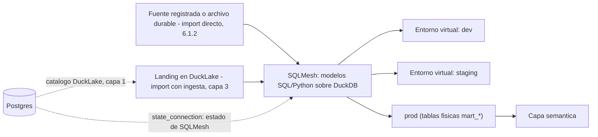

# Capa 2: Transformación (el "banco de trabajo")

> Reemplazo: **Power Query (M) → SQLMesh** (con dbt OSS como alternativa válida, no descartada — ver sección 4)

---

## 1. Responsabilidad única de esta capa

Tomar datos de origen —una fuente registrada leída directo, un archivo durable o el landing que dejó la ingesta (§6.1.1 y §6.1.2)— y transformarlos en el resultado analítico (`mart_*`), limpio, testeado y listo para el modelo semántico, persistido en DuckLake (capa 1).

**Esta capa NO debe saber:**
- Nada de métricas de negocio, nombres de "medidas" ni agregaciones de negocio (eso es la capa semántica, documento 04).
- Nada de cómo llegaron los datos crudos hasta el warehouse (eso es la capa de ingesta, documento 03).
- Nada de quién consulta ni con qué permisos (eso es auth, documento 09).
- Nada de HTTP ni de cómo se sirve el resultado al frontend.

Si esta capa empieza a calcular un KPI de negocio directamente en un modelo SQL "porque es más rápido", el diseño está roto — esa lógica sube a la capa semántica.

---

## 2. Qué hace Power Query (M) exactamente (para saber qué estamos reemplazando)

- **Lenguaje funcional propietario** (M), diseñado por Microsoft, sin uso fuera del ecosistema Power BI / Excel / Power Automate.
- **UI de "pasos aplicados"** como interfaz principal: cada transformación es un paso grabado por la UI (a veces editable en el panel de fórmulas, pero pensado para clic-y-arrastrar, no para escribir código).
- **Ejecución en el propio proceso de Power BI**, generalmente sobre datos ya cargados a memoria — no es un motor de transformación distribuido ni versionado.
- **Sin tests de datos nativos** — no hay un concepto equivalente a "verificar que esta columna no tenga nulos" antes de publicar; el error se descubre cuando el reporte ya muestra un número raro.
- **Sin lineage explícito fuera de la vista gráfica de consultas** del propio Power BI Desktop.

---

## 3. Defectos concretos de Power Query/M que eliminamos

| Defecto | Por qué es un problema real |
| --- | --- |
| Lenguaje M propietario, sin comunidad ni ecosistema fuera de Microsoft | Cero portabilidad de conocimiento o código a otra herramienta |
| La UI de "pasos aplicados" es la fuente de verdad | No hay diff legible en un pull request — dos analistas no pueden revisar un cambio de transformación como revisan código |
| Sin tests de datos como gate antes de publicar | Los errores de calidad de datos se descubren en el dashboard final, no antes |
| Sin entornos aislados reales para probar un cambio | Cambiar una consulta implica recalcular todo el modelo para ver el efecto |
| Recalculo completo como único mecanismo de refresco en la mayoría de los casos | Sin incrementalidad real, los refrescos escalan mal con el volumen |
| Lineage limitado a la vista propia de Power BI Desktop | No hay lineage a nivel de columna consultable por fuera de la herramienta |

---

## 4. Qué reemplaza a Power Query — dbt vs SQLMesh, con exigencia real

Esta es la misma pregunta que se hizo con el motor de almacenamiento: no alcanza con "dbt es el estándar, listo". Hay que revisar qué cambió en 2025-2026 y decidir con la misma vara.

### 4.1 El panorama en 2026 — actualizado dos veces desde el análisis original

**dbt** sigue siendo el estándar de facto: el ecosistema más grande, el mayor pool de gente que ya lo conoce, y una librería enorme de paquetes de la comunidad. **Corrección de un dato que quedó desactualizado (detectado por una revisión externa):** en mayo de 2025 dbt Labs lanzó Fusion (motor en Rust) bajo una licencia mixta con ELv2, y ese fue el argumento original de este documento contra dbt. Pero **el 1 de junio de 2026 dbt Labs publicó ese mismo código bajo Apache 2.0** en el repositorio de dbt-core, y desde entonces existen dos distribuciones: "dbt" (antes Fusion, la recomendada por defecto, con funciones premium detrás de login) y **"dbt OSS"** (100% Apache 2.0, instalable localmente, sin login). El argumento de licencia contra dbt tal como estaba escrito ya no es válido — hoy dbt tiene un camino genuinamente abierto con el motor rápido incluido.

**Lo que sí cambió a favor de SQLMesh, y no estaba en la versión original de este documento:** en septiembre de 2025, **Fivetran compró Tobiko Data** (la empresa que creó SQLMesh). Un mes después, Fivetran anunció su fusión con **dbt Labs** (cerrada en junio de 2026). Es decir: hoy, la empresa que creó SQLMesh y la empresa que creó dbt son la misma compañía combinada. La donación de SQLMesh a la **Linux Foundation en marzo de 2026** — antes de que esa fusión se completara — no fue un gesto simbólico: fue la jugada concreta que impidió que el proyecto SQLMesh terminara bajo el control corporativo de su propio competidor. Es el ejemplo más claro que existe en todo este proyecto de por qué la regla de gobernanza importa en la práctica, no solo en la teoría.

**SQLMesh**, entonces, no gana hoy por licencia (dbt OSS también es Apache 2.0 puro) — gana por **gobernanza de fundación neutral, en un momento donde esa neutralidad se puso a prueba de verdad**, y por el encaje técnico que ya tenía: SQL puro sin depender de Jinja para lógica condicional, modelos en Python de primera clase en el mismo DAG, lineage a nivel de columna, y un flujo `plan`/`apply` al estilo Terraform que clasifica cada cambio como *breaking* o *non-breaking* antes de aplicarlo.

### 4.2 Comparación técnica directa

| Aspecto | dbt (dbt OSS / "dbt") | SQLMesh |
| --- | --- | --- |
| Licencia | **dbt OSS**: 100% Apache 2.0, motor Rust incluido. **"dbt"** (antes Fusion, recomendada por defecto): binario más permisivo que ELv2, pero con funciones premium detrás de login/pago | 100% Apache 2.0, sin excepción, proyecto de la Linux Foundation |
| Gobernanza | Fivetran + dbt Labs, una sola empresa combinada — la misma que hoy también es dueña de Tobiko Data (el creador original de SQLMesh) | Linux Foundation — gobernanza neutral, inmune a que una sola empresa decida el rumbo |
| Sintaxis | SQL + Jinja como plantilla de texto — los errores de sintaxis solo aparecen al ejecutar | SQL puro con bloque `MODEL` de configuración; sin necesitar Jinja+YAML para lo básico. También soporta Jinja si se necesita |
| Entornos de desarrollo | Un esquema/base física completa por desarrollador — duplica cómputo y almacenamiento en cada corrida de prueba | **Entornos virtuales**: vistas lógicas sobre tablas físicas compartidas — un desarrollador prueba contra datos de producción sin copiar nada. Feedback casi instantáneo, sin recalcular |
| Gestión de cambios | Los tests corren *después* de materializar la tabla ("test after build") | `plan`/`apply` clasifica el cambio como breaking/non-breaking *antes* de tocar producción, y solo recalcula (*backfill*) lo que realmente cambió |
| Modelos en Python | Soportados, pero se sienten "injertados" sobre un sistema pensado para SQL | Ciudadanos de primera clase, en el mismo DAG y con las mismas garantías de detección de cambios que los modelos SQL |
| Lineage | A nivel de tabla, visual en dbt Cloud/dbt Docs | A nivel de **columna**, integrado en CLI y extensión de VS Code |
| Multi-dialecto | Un proyecto por dialecto de destino (vía adaptadores) | Transpila el mismo SQL a 10+ dialectos on-the-fly (basado en SQLGlot, del mismo equipo) |
| Compatibilidad con dbt existente | — | Importa un proyecto dbt existente casi automáticamente (`sqlmesh init -t dbt`), reduce el riesgo de "quedar encerrado" en la elección |
| Madurez / ecosistema | Más de 100.000 equipos combinados (Fivetran + dbt Labs), el mayor pool de talento, cientos de paquetes de comunidad | Más joven (2023), pero ya production-ready en 2026, con integración nativa documentada por el propio Tobiko con **DuckLake** — justo el formato que ya elegimos en la capa 1 |

### 4.3 Decisión para este proyecto: SQLMesh como default, dbt OSS como alternativa aceptada

Con la regla del proyecto ("open source primero, siempre", "sin SaaS propietario que reintroduzca vendor lock-in", "moderno pero con madurez probada") el fiel de la balanza sigue inclinándose a **SQLMesh**, aunque el argumento cambió de forma desde la primera versión de este documento:

1. **Ya no es una cuestión de licencia — es una cuestión de a quién le pertenece la decisión.** dbt OSS es hoy tan abierto como SQLMesh en el papel. Lo que los separa es que dbt vive bajo una sola empresa (Fivetran + dbt Labs), mientras que SQLMesh vive bajo una fundación neutral — y esa diferencia dejó de ser hipotética el día que Fivetran compró a la empresa que creó SQLMesh y se fusionó con la que creó dbt.
2. **Encaja mejor con la capa 1 ya construida.** Tobiko (ahora parte de Fivetran, pero el proyecto SQLMesh en sí ya no depende de esa empresa) publica y mantiene una integración documentada de SQLMesh sobre **DuckDB + DuckLake** — el mismo par que ya elegimos como motor. SQLMesh puede usar Postgres como *state backend* (`state_connection`), reutilizando el mismo Postgres que ya sirve de catálogo a DuckLake, sin mezclar responsabilidades (dos esquemas separados, nunca el mismo).
3. **Los entornos virtuales resuelven un problema real de este proyecto**, no teórico: al ser una plataforma self-hosteada sin presupuesto de cómputo de un data warehouse cloud, evitar duplicar físicamente los datos por cada entorno de prueba es una ventaja de costo y velocidad concreta, no cosmética.
4. **La migración no es una apuesta cerrada.** El importador de proyectos dbt de SQLMesh reduce el riesgo de la decisión: si en el futuro se necesitara volver a dbt OSS (por ejemplo, por disponibilidad de talento en el equipo), el camino de ida y vuelta existe.

**Honestidad sobre los límites:** SQLMesh es un proyecto más joven que dbt, con un ecosistema de paquetes de terceros todavía chico y una comunidad más pequeña — encontrar respuestas para un caso muy específico en Stack Overflow es más difícil hoy que con dbt. Si el equipo que construya sobre esta plataforma ya tiene experiencia profunda en dbt y necesitara escalar contratando analistas externos rápido, **dbt OSS** (la distribución 100% Apache 2.0, no la que requiere login) sigue siendo una alternativa objetivamente válida y no rompe ninguna regla del proyecto — la tabla de la sección 4.2 aplica igual en ambos sentidos. La recomendación por defecto de esta plataforma es SQLMesh; el contrato de la capa (sección 7) está diseñado para que el motor de transformación sea intercambiable sin tocar las capas de arriba.

---

## 5. Qué agregamos que Power BI no tiene

- **Entornos de desarrollo sin costo de duplicación** vía entornos virtuales — probar un cambio contra datos reales sin copiar el dataset.
- **Clasificación automática de cambios como breaking/non-breaking** antes de aplicarlos a producción, no después de romper un reporte.
- **Lineage a nivel de columna**, no solo de tabla, consultable desde CLI y editor.
- **Modelos en Python de primera clase**, para transformaciones que SQL puro no expresa bien (parsing complejo, llamadas a APIs de enriquecimiento, lógica difícil de expresar declarativamente).
- **Tests y audits de datos como gate de CI real**, versionados en Git junto con el modelo que testean.
- **Portabilidad multi-dialecto real** (vía SQLGlot): el mismo SQL puede apuntar a DuckDB en desarrollo y a otro motor en producción sin reescribir el proyecto.

---

## 6. Arquitectura interna de esta capa



### 6.1 Convención de esquemas (igual que en el borrador, confirmada)

- `stg_*` — modelos de *staging*: una vista (o CTE, o modelo efímero) por fuente o landing, que renombra y tipa, sin joins de negocio. Lógicos por defecto (§6.1.1). Privados al paquete `transform`.
- `int_*` — modelos intermedios: joins y agregaciones parciales reutilizadas por más de un `mart_`. Lógicos por defecto (§6.1.1). Privados al paquete.
- `mart_*` — únicos modelos **públicos**: el resultado analítico, lo único que la capa semántica puede consultar. Siempre físicos en DuckLake. Esquema estable, testeado, documentado.

### 6.1.1 Política de materialización — sin RAW persistente por defecto (sección canónica)

> **Esta sección es la fuente canónica de la política de materialización de todo el proyecto** — ingesta, transformación, almacenamiento y Data Studio. Los demás documentos la referencian; no la repiten.
>
> **Corrección de septiembre de 2026 (aprobada después de auditar toda la documentación):** la versión anterior de esta sección definía un "RAW condicional" que en la práctica era obligatorio para casi todo: se materializaba `raw.*` para cualquier fuente "volátil o mutable", **incluida toda base operativa**, y solo los archivos durables se lo salteaban. Además, otras secciones afirmaban que la transformación solo podía leer tablas "ya aterrizadas" en el warehouse. Las dos cosas quedan reemplazadas por lo que sigue: **RAW deja de existir como capa física de la arquitectura.**

**Principios (normativos):**

> **AtlasBI does not require a persistent RAW layer by default.**
>
> **Logical pipeline stages do not imply physical copies.**
>
> Source data is materialized only when required for durability, reproducibility, performance, incremental processing, auditing, or analytical consumption. A staging layer is logical by default and physical only when justified. Import mode persists the analytical result in DuckLake; Live/DirectQuery mode does not require analytical duplication. **dlt is an ingestion capability, not a mandatory RAW-storage architecture.**

**Vocabulario — dos cosas distintas que antes se llamaban "RAW":**

| Término | Qué es | Cuándo existe | Qué contiene |
| --- | --- | --- | --- |
| **landing** | Materialización **técnica**: existe porque el extractor la necesita (dlt siempre escribe su salida en un destino, `03-ingesta.md` §6.4) | Solo en el *import con ingesta* | Solo las filas y columnas necesarias, cuando el conector permite proyectar y filtrar en el origen; incremental cuando la fuente lo permite |
| **snapshot** | Historia conservada **a propósito** | Solo con un motivo explícito: auditoría, reproducibilidad, fuente que no se puede volver a leer, CDC (el log de cambios), regulación, recuperación, historia requerida por el negocio | Lo que el motivo exige — siempre con política de retención propia |
| **resultado analítico** (`mart_*`) | Lo que la capa semántica (Cube) consulta | Siempre, en modo Import | La forma final que necesita el modelo |

> "Snapshot" acá es historia de una **fuente**, una decisión de negocio. No confundir con las versiones que DuckLake guarda de cada tabla en cada commit (las usa para *time travel* y se rigen por la retención de `01-motor-almacenamiento.md` §6.8).

**Import — dos caminos, ninguno obligatorio para todas las fuentes:**

```
IMPORT DIRECTO
fuente registrada y certificada para lectura directa (§6.1.2)
   → SQLMesh sobre DuckDB (lee la fuente, con proyección y filtros empujados cuando el scanner lo permite)
   → DuckLake: resultado analítico
   → Cube

IMPORT CON INGESTA
fuente
   → dlt (proyecta, filtra, incremental)
   → DuckLake: landing mínimo
   → SQLMesh sobre DuckDB
   → DuckLake: resultado analítico
   → Cube

SNAPSHOT — opcional, sobre cualquiera de los dos, con motivo explícito y retención
```

**Direct transformation is preferred when the source is certified for analytical direct-read.** Una fuente que no cumple las condiciones de §6.1.2 usa el import con ingesta. La plataforma decide el camino: el autor en Data Studio nunca ve esta distinción (`20-product-ui-ux.md` §8). Cuando dlt no aporta valor —una fuente certificada, un archivo durable—, no se inserta en el pipeline.

**Ejemplo concreto — una tabla operativa de 120M filas de las que el análisis usa 60M:**

- Import directo: SQLMesh lee solo las columnas y filas necesarias y DuckLake guarda **una** copia: el resultado analítico.
- Import con ingesta: el landing guarda las 60M filas útiles con sus columnas necesarias, y el resultado analítico es la segunda copia — nunca `120M raw → 120M staging → 90M clean → 60M mart`.

**Fuentes ya durables** (Parquet o Iceberg inmutable, un CSV histórico cerrado, un archivo subido desde Data Studio): no se copian. Se registran como fuente y SQLMesh las lee directo; solo se materializa el resultado analítico.

**Intermedios (`stg_*`, `int_*`) — lógicos por defecto.** Se expresan como `VIEW` (el default de SQLMesh para modelos SQL), como CTE dentro del modelo que los usa, o como modelo efímero (`kind EMBEDDED`, que SQLMesh inyecta como subconsulta). Una etapa lógica nunca se convierte automáticamente en una copia física. Materializar un intermedio (`FULL` o incremental) exige una razón demostrable, nunca "por las dudas":

1. **Rendimiento / costo de recomputación**: el cómputo es costoso y los consumidores lo re-ejecutarían muchas veces.
2. **Reutilización**: dos o más `mart_*` dependen del mismo intermedio pesado.
3. **Incrementalidad real**: el modelo necesita estado entre corridas (una deduplicación que depende de lo ya procesado).
4. **Estabilidad o aislamiento**: un contrato estable para otros consumidores, o aislar a los consumidores de una fuente lenta o inestable.

Congelar un estado para auditoría no es un intermedio: es un **snapshot**, con su motivo y su retención.

**Partición física — solo con una razón medida, nunca por defecto.** En un modelo incremental por tiempo, SQLMesh particiona por defecto por su columna de tiempo (`partition_by_time_column`), y sobre DuckLake eso se traduce en `SET PARTITIONED BY (<columna>)`: un archivo por día. Medido en la Fase 0 del Paso 2, el mismo mart de 20.000 filas ocupa **365 archivos de ~2 KiB** particionado por día, contra **un archivo de 259 KiB** sin partición; y la compactación de DuckLake no junta archivos de particiones distintas. **Regla del proyecto: todo modelo incremental sobre DuckLake declara `partition_by_time_column false`.** Particionar (`partitioned_by`, con la granularidad que corresponda: año, mes) exige la misma evidencia que materializar un intermedio: una medición que muestre que las consultas reales se benefician más de lo que cuestan los archivos extra.

**Qué guarda DuckLake en modo Import:**

| Contenido | ¿Obligatorio? |
| --- | --- |
| Resultado analítico (`mart_*`) | **Sí** — es lo que Cube consulta en vivo, repetidamente |
| Metadata del catálogo y versiones de tabla (*time travel*) | Inherente al formato; se retienen según `01-motor-almacenamiento.md` §6.8 |
| Landing | Solo en el import con ingesta |
| Snapshot de una fuente | Solo con motivo explícito |
| Intermedios materializados | Solo con una de las razones de arriba |
| Tablas físicas internas de SQLMesh (versiones por *fingerprint*, entornos de desarrollo) | Inherentes a SQLMesh, y solo para los modelos que cambian (§6.2) |

Un pipeline puede no guardar en DuckLake nada más que su `mart_*`.

**Live/DirectQuery queda fuera de esta política: no materializa nada.** El recorrido es `Reporte → Cube → DuckDB → fuente registrada`, sin SQLMesh en el camino de la consulta, sin landing y sin DuckLake (`01-motor-almacenamiento.md` §6.2).

### 6.1.2 Fuentes registradas y lectura directa (sección canónica)

**Los modelos SQL de SQLMesh pueden consultar fuentes externas** —una base SQL, un archivo durable— a través de los mecanismos de DuckDB: los scanners `postgres`, `mysql` y `sqlite`, con proyección y filtros simples empujados a la fuente, más `read_parquet`, `read_csv` e Iceberg. **Esto reemplaza la prohibición absoluta anterior** ("la transformación solo lee tablas ya aterrizadas"), con reglas de seguridad que no se negocian:

- **Solo fuentes registradas por la plataforma.** Un modelo referencia una fuente por su nombre registrado, que la plataforma adjunta en la conexión DuckDB de SQLMesh. **Ningún modelo define su propio `ATTACH`**, ni `INSTALL`, `SET`, secrets o `COPY … TO`.
- **Conexión de solo lectura para las fuentes operacionales**: un usuario de la base con permisos de lectura, más `ATTACH … (READ_ONLY)`.
- **Credenciales siempre vía `SecretProvider`** (`11-infraestructura.md` §4.7). Ningún secreto dentro de un modelo SQL ni en el repositorio.
- **Los modelos Python siguen sin red ni APIs.** Traer datos de una API o de un SaaS es trabajo de `packages/ingestion` (dlt), en su propio entorno.

**Certificación para lectura directa — una fuente SQL usa el import directo solo si cumple todo esto:**

1. **Es accesible** para SQLMesh/DuckDB. Una fuente detrás del firewall del cliente no lo es: pasa por el Edge Connector Agent, que la extrae con dlt (`11-infraestructura.md` §4.3).
2. **Tiene una conexión de solo lectura.**
3. **La carga analítica es aceptable**, o existe una réplica adecuada. Cada `sqlmesh run`, cada *backfill* y cada `plan` en un entorno de desarrollo vuelve a leer la fuente.
4. **Se puede volver a leer lo suficiente**: los datos que un reproceso necesita siguen estando en la fuente.
5. **No hay que capturar historia ni borrados que la fuente ya no pueda reproducir.** Reprocesar un período lee el estado *actual* de la fuente, no el de entonces. Si esa historia importa, corresponde CDC o un snapshot.
6. **Está aprobada y registrada por la plataforma.**

Si falla cualquiera, la fuente usa el import con ingesta (dlt con landing mínimo). El formato concreto del registro de fuentes se diseña con la primera fuente real (Paso 7); estas reglas ya son norma. Cómo adjunta SQLMesh las fuentes en su conexión DuckDB se verifica contra la versión exacta de SQLMesh que fije el Paso 2.

### 6.2 Entornos virtuales, en concreto

Cada entorno (`dev`, `staging`, `prod`) es una vista lógica sobre las mismas tablas físicas subyacentes cuando el modelo no cambió. Solo cuando un modelo cambia, SQLMesh calcula qué parte de los datos hay que recalcular (*backfill*) y materializa físicamente solo esa porción — nunca el dataset completo "por las dudas". Esto es lo que hace que el ciclo de "cambio → prueba → ajuste" no dependa de esperar un recálculo completo cada vez.

### 6.3 Estado de SQLMesh: mismo Postgres, esquema separado

SQLMesh necesita un *state backend* propio para llevar el registro de qué se aplicó, cuándo, y con qué plan. En vez de levantar una base nueva solo para esto, se reutiliza el Postgres que ya existe como catálogo de DuckLake (capa 1) — pero en una base separada (`sqlmesh_state`, distinta de `lakehouse`, la base del catálogo de DuckLake desde el Paso 1). Esto no rompe la regla de responsabilidad única: son dos consumidores del mismo servidor Postgres, cada uno con su propio namespace, sin que uno lea las tablas del otro.

**Un state por lakehouse (implementado en el Paso 2).** Dentro de `sqlmesh_state`, cada lakehouse tiene su propio esquema, `sqlmesh_<identidad sin guiones>`, derivado de la identidad que le asignó el aprovisionamiento (`01-motor-almacenamiento.md` §6.7). Reproducido en vivo antes de corregirlo: con un solo state compartido, `plan` sobre el lakehouse SQLite respondía *No changes* porque el state decía que el mart ya existía — lo había construido el lakehouse PostgreSQL — y el mart no estaba. Con el state atado a la identidad, un lakehouse nuevo (otro catálogo, o el mismo recreado después de `pnpm reset:local` + `pnpm bootstrap`) siempre empieza con un state vacío y reconstruye todo, aunque la base `sqlmesh_state` haya sobrevivido. Los tests de integración cubren los dos casos (dos lakehouses sobre el mismo state; un lakehouse recreado en la misma ruta con el state intacto). Un esquema de state cuyo lakehouse ya no existe queda sin uso y no afecta a nadie; limpiarlo es una tarea de mantenimiento todavía no programada (candidata al Paso 8).

### 6.4 Tests, audits y calidad de datos

- **Unit tests** (`tests/*.yaml`): corren contra datos de ejemplo (fixtures), antes de tocar cualquier dato real — verifican la lógica del SQL en sí.
- **Audits**: assertions que corren sobre los datos reales después de materializar (`not_null`, `unique`, `accepted_values`, custom en SQL) — el equivalente directo a `dbt test`, pero integrado al mismo flujo `plan`/`apply`.
- **Gate de CI**: un plan que falla un audit no se promueve a `prod`. Esto es lo que reemplaza la ausencia total de tests de Power Query.

### 6.5 Cómo corre SQLMesh en la plataforma (implementado en el Paso 2)

Medido en la Fase 0 del Paso 2 (SQLMesh 0.236.2, DuckDB 1.5.5, DuckLake 1.0) antes de programarlo:

- **Solo a través de `pnpm transform <comando>`** (`packages/transform`, runner en TypeScript). **Ejecutar `uv run sqlmesh` directamente no está soportado**: SQLMesh adjunta DuckLake con `ATTACH IF NOT EXISTS` y sin `CREATE_IF_NOT_EXISTS false`, así que apuntado a un catálogo equivocado **crea en silencio un lakehouse vacío** (medido: 28 tablas nuevas en una base vacía con solo un `SELECT 1`). El runner abre antes el lakehouse con el puerto administrativo, que nunca lo crea (`01-motor-almacenamiento.md` §6.7), y recién ahí lanza SQLMesh. `config.py` se niega a cargar sin las variables que pone el runner.
- **Secretos solo en el proceso de SQLMesh.** La CLI los resuelve con `SecretProvider` y se los pasa al proceso hijo; ninguna otra variable `ATLASBI_*` le llega. La contraseña del catálogo va en un secret postgres sin nombre de DuckDB, nunca en el `ATTACH` (con contraseña incorrecta, el error nombra base y usuario, no la contraseña). El state vive en la base `sqlmesh_state` (§6.3, secreto `transform.state-url`), en el esquema del lakehouse que el runner acaba de verificar: el runner le pasa a SQLMesh el `lakehouseId` del *health* y `config.py` rechaza cualquier otro nombre de esquema.
- **Sin red en ejecución.** Nunca se usa la opción `extensions` de SQLMesh (instala antes de que se pueda fijar el directorio, y descargaría a `~/.duckdb`); `connector_config` fija el directorio de extensiones del proyecto y apaga la instalación automática, y el `ATTACH` carga `ducklake`/`postgres`/`sqlite` desde ahí. `uv run --frozen --offline` usa exactamente `uv.lock`.
- **Qué deja en DuckLake:** el staging (`kind VIEW`) es una vista sobre otra vista — cero datos copiados; el mart es una tabla física `sqlmesh__marts.<modelo>__<huella>` más la vista `marts.<modelo>` que Cube y la plataforma consultan. DuckLake guarda las vistas con un marcador de catálogo, así que funcionan con cualquier alias.
- **Partición:** `partition_by_time_column false` en todo modelo incremental (§6.1.1).
- **Parche temporal y experimental (regla 6), `project/ducklake_compat.py`:** SQLMesh borra tablas y vistas con `DROP … CASCADE` y DuckLake no lo soporta, así que su *janitor* nunca puede borrar una versión vieja de un modelo — cada cambio dejaría una tabla física completa para siempre. El parche declara `SCHEMA` como el único tipo con cascada, que es lo que propone el arreglo upstream (issue SQLMesh/sqlmesh#6032, PR #6034). Un test de alerta falla, con instrucciones, el día que la versión fijada de SQLMesh traiga el arreglo y el parche sobre.
- **Guardas automáticas de §6.1.2:** una regla propia del linter de SQLMesh (`project/linter/`) rechaza `ATTACH`, `INSTALL`, `LOAD`, `SET`, secrets y `COPY` en cualquier modelo, y un test rechaza módulos de red en modelos Python.
- **Particularidades de Windows:** redirigir la salida de SQLMesh a `NUL` lo hace terminar con código 1 aunque haya hecho el trabajo (el runner nunca lo hace); los logs van a `packages/transform/logs/` y la caché a `project/.cache/`, ambos fuera de Git y sin secretos.

---

## 7. Contrato de esta capa (qué consume, qué expone)

- **Consume**: fuentes registradas (import directo) y archivos durables registrados, leídos a través de DuckDB (§6.1.2), y los landings que dejó la ingesta en DuckLake (import con ingesta). Nunca una fuente no registrada, y nunca una API: eso es trabajo de la capa 3.
- **Expone**: únicamente las tablas `mart_*` en DuckLake, con esquema estable, documentado y cubierto por al menos un audit por llave primaria. Todo lo demás (`stg_*`, `int_*`) es un detalle interno del paquete `transform`, no forma parte del contrato.
- **No expone**: nada de HTTP, nada de lógica de métricas de negocio (eso es la capa semántica), ninguna noción de "quién puede ver qué fila" (eso es auth + RLS, documento 09).
- **Contratos de datos (`21-engineering-standards.md` §2.4).** Cada `mart_*` que esta capa publica tiene su contrato versionado en `packages/contracts/data/`: columnas, tipos de la plataforma, nulabilidad y grano. Hoy es `mart.sales_orders` 1.0. La capa lo declara en `PRODUCED_DATA_CONTRACTS`, y un test de integración verifica, con los datos, que lo publicado lo cumple. Las fuentes que lee también tienen su contrato (`CONSUMED_DATA_CONTRACTS`), y un test verifica que `external_models.yaml` las declara igual. Por eso el "esquema estable" del punto anterior deja de ser una promesa: es un archivo con versión y con un test de cada lado.
- **Intercambiabilidad**: si en el futuro se decide migrar SQLMesh → dbt OSS (o viceversa), el contrato no cambia — ambas herramientas producen el mismo tipo de artefacto (`mart_*` en el warehouse). La capa semántica nunca debería notar la diferencia.

---

## 8. Por dónde empezar a construir (paso a paso concreto)

**Corrección, hecha al construir el Paso 2:** la versión anterior decía `pip install "sqlmesh[web,duckdb]"` — ese extra `duckdb` no existe (DuckDB es dependencia base de SQLMesh) y la UI web no se usa. Así quedó construido:

1. `packages/transform` es un proyecto uv propio (`pyproject.toml`, `uv.lock`, `.python-version` = 3.13.14): `sqlmesh[postgres]==0.236.2` (el extra `postgres` es para el state) y `duckdb==1.5.5`, igual que la plataforma. `pnpm bootstrap` corre `uv sync --frozen` una vez; nunca comparte entorno con `packages/ingestion`.
2. El proyecto SQLMesh vive en `packages/transform/project/`: `config.py` (todo desde las variables del runner), `external_models.yaml` (el fixture del Paso 1 como fuente), `models/`, `tests/`, `linter/`.
3. `state_connection` apunta a la base `sqlmesh_state` del mismo Postgres, que `pnpm bootstrap` crea; `state_schema` es el del lakehouse (§6.3).
4. Primer modelo: `staging.stg_sales_orders` (`VIEW`) sobre `lake.fixture.sales_orders`; primer resultado analítico: `marts.mart_sales_orders` (`INCREMENTAL_BY_TIME_RANGE` por `order_date`, grano pedido, sin partición por día), con audits `not_null`, `unique_values` y `accepted_values` y un unit test.
5. `pnpm transform test` (sin lakehouse) y `pnpm transform plan` para desplegar — siempre por la CLI (§6.5). En CI, el `plan` a `prod` sigue las reglas de `15-testing-cicd.md`.
6. La primera fuente externa real llega en el Paso 7, directa o con ingesta según §6.1.2; la capa semántica (Paso 3) lee `marts.mart_sales_orders`.

---

## 9. Idea rescatada de otro líder de BI: "Input Tables" (Sigma Computing)

Power BI fue, durante años, una herramienta de solo lectura. **Corrección de precisión (señalada por una revisión externa):** desde marzo de 2026, Power BI tiene "Translytical Task Flows" — permiten agregar, modificar o borrar datos y llamar APIs desde un reporte, así que "Power BI no puede escribir" ya no es una afirmación correcta sin matices. **Sigma Computing** sigue teniendo una experiencia de escritura más madura y específica para este caso de uso ("Input Tables": una interfaz tipo planilla de cálculo para ajustes de forecast, escenarios "qué pasaría si", presupuestos, gobernado con RLS y auditoría) — vale la pena incorporarla no porque Power BI no pueda escribir en absoluto, sino porque la experiencia de Sigma para este tipo de escritura específica está mejor resuelta, y encaja con la regla 8 del proyecto (rescatar lo mejor de todos los líderes, no solo reemplazar Power BI).

**Se descartan, en cambio, dos candidatos de esta misma revisión:**
- **Tableau Prep**: ETL visual de "pasos aplicados" — mismo defecto de fondo que Power Query (sin diff real en Git). No aporta nada que SQLMesh no resuelva ya mejor.
- **Qlik Script**: lenguaje propietario de transformación — el mismo patrón de encierro que ya se descartó con DAX.

### 9.1 Qué le corresponde específicamente a esta capa

Esta funcionalidad es **transversal** (toca las capas 1, 2, 6, 8 y 9), y se retoma en detalle cuando se revisen esas capas. Lo que le corresponde a la Capa 2 es reconocer un **nuevo tipo de fuente**: hasta ahora, todo lo que llega a `stg_*` viene de una fuente registrada o del landing de un pipeline de la Capa 3 (dlt). Una tabla de entrada de usuario es distinta — alguien la escribe en vivo, sin pasar por ingesta programada. SQLMesh la trata igual que cualquier otra fuente cruda, sin lógica especial:

```sql
-- packages/transform/models/staging/stg_ajustes_forecast.sql
MODEL (
  name stg_ajustes_forecast,
  kind FULL
);

SELECT
    cliente_id,
    mes,
    ajuste_manual,
    usuario_que_edito,
    editado_en
FROM raw_input_ajustes_forecast  -- escrita directo por el usuario, no por dlt
```

Un modelo posterior puede cruzar el dato real con el ajuste del usuario sin ninguna lógica especial:

```sql
-- packages/transform/models/marts/mart_ventas_escenario.sql
MODEL (
  name mart_ventas_escenario,
  kind FULL
);

SELECT
    v.cliente_id,
    v.mes,
    v.monto AS ventas_reales,
    COALESCE(a.ajuste_manual, 0) AS ajuste,
    v.monto + COALESCE(a.ajuste_manual, 0) AS ventas_proyectadas
FROM mart_ventas v
LEFT JOIN stg_ajustes_forecast a
    ON v.cliente_id = a.cliente_id AND v.mes = a.mes
```

### 9.2 Lo que falta para que la funcionalidad esté completa (pendiente en otras capas)

| Falta | Capa | Qué resuelve |
| --- | --- | --- |
| Dónde vive físicamente `raw_input_ajustes_forecast` (una tabla escribible, no producida por un pipeline) | 1 | Espacio de escritura directa en el warehouse |
| Quién puede escribir y en qué filas — RLS de **escritura**, no solo de lectura | 9 | Gobernanza del writeback |
| Un endpoint que escriba, no solo que consulte | 6 | Hoy la API Gateway solo tiene procedimientos de lectura |
| La interfaz tipo planilla en sí | 8 | Ya estaba anotada como pendiente (sección 11 del documento general) |

---

**Siguiente documento:** `03-ingesta.md` — dlt/Airbyte reemplazando los conectores nativos de Power BI.
