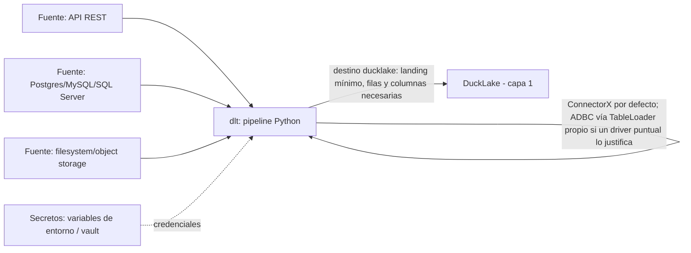

# Capa 3: Ingesta (la "cinta transportadora")

> Reemplazo: **Conectores de Power Query → dlt** (Airbyte queda como alternativa aceptada solo cuando el requisito es catálogo grande + UI propia; ver sección 4)
>
> **dlt es una capacidad de ingesta, no una arquitectura de almacenamiento RAW obligatoria.** Solo participa cuando la fuente no puede leerse directo; cuándo corresponde lo define la política canónica de materialización (`02-transformacion.md` §6.1.1 y §6.1.2).

---

## 1. Responsabilidad única de esta capa

Extraer datos de las fuentes que **no** se leen directo —APIs y SaaS, CDC, fuentes detrás del firewall del cliente, y bases SQL que no cumplen la certificación de lectura directa (`02-transformacion.md` §6.1.2)— y dejar en DuckLake (capa 1) un **landing mínimo**: solo las filas y columnas que el análisis usa, cuando el conector permite empujar la proyección y el filtro al origen, e incremental cuando la fuente lo permite. Las fuentes certificadas para lectura directa y los archivos durables no pasan por esta capa.

**Proyectar columnas y filtrar filas en la extracción sí le corresponde a esta capa** (no es lógica de negocio: es no traer lo que nadie usa). Todo lo demás —renombres semánticos, joins, reglas de negocio— es de la capa 2.

**Esta capa NO debe saber:**
- Nada de limpieza, joins ni modelado de negocio (eso es la capa de transformación, documento 02).
- Nada de métricas ni relaciones semánticas (capa 4).
- Nada de quién puede ver qué dato (auth, documento 09).
- Nada de cómo se sirve el resultado al frontend.

Si esta capa empieza a hacer un `JOIN` de negocio o a renombrar columnas con semántica de negocio "para ahorrar un paso", el diseño está roto — eso es trabajo de `stg_*` en la capa de transformación, no de la ingesta. Y si un pipeline de dlt copia tablas completas "por las dudas" cuando la fuente permitía traer solo lo necesario, también.

---

## 2. Qué hacían los conectores de Power Query exactamente (para saber qué reemplazamos)

- **Conectores cerrados**, mantenidos únicamente por Microsoft, a su ritmo de actualización — si una API de un SaaS cambia, hay que esperar el conector oficial o escribir uno propio en M.
- **Solo corren dentro de Power BI Desktop/Service** — no son reutilizables como pipeline independiente ni programables por fuera de la UI.
- **Sin control de versiones real** de la definición del pipeline — vive dentro del `.pbix` o en Power BI Service, no en un repo.
- **Sin manejo explícito de evolución de esquema** — si la fuente agrega una columna, el comportamiento depende de la configuración de cada consulta, no de una política declarada.

---

## 3. Defectos concretos que eliminamos

| Defecto | Por qué es un problema real |
| --- | --- |
| Conectores propietarios, actualizados solo por Microsoft | Dependencia total del roadmap de un solo proveedor para conectar una fuente nueva |
| Solo ejecutables dentro del ecosistema Power BI | Cero reutilización del pipeline de ingesta fuera de esa herramienta |
| Sin versionado real de la definición del pipeline | No hay revisión en pull request de un cambio en cómo se extraen los datos |
| Sin tests ni CI sobre el proceso de extracción | Un cambio silencioso en la fuente rompe el dashboard, no el pipeline |
| Manejo de evolución de esquema implícito, no declarado | Agregar una columna en la fuente puede romper el modelo sin aviso |

---

## 4. Qué reemplaza a los conectores — dlt vs Airbyte, con exigencia real

### 4.1 El panorama en 2026

**dlt** (dltHub) es una librería Python **embebible**, no un servidor: se instala con `pip install dlt` y un pipeline es una función Python versionable como cualquier otro código del repo. Su núcleo (extracción, normalización de JSON anidado, carga, inferencia y **evolución automática de esquema**, estado incremental) es **100% Apache 2.0**, con más de 6 millones de descargas mensuales en PyPI y adopción real (dlt es, de hecho, el motor interno que usan herramientas más nuevas como `ingestr` de Bruin). dltHub, la empresa, vende por encima una capa opcional (`dlt+`, workspace gestionado, fuentes premium como el change-tracking de SQL Server) — pero exactamente como MotherDuck sobre DuckDB en la capa 1: **conveniencia opcional, nunca dependencia dura**. El núcleo funciona completo y gratis sin tocar esa capa comercial.

**Airbyte** ofrece el catálogo de conectores prearmados más grande del mercado (300+) y una UI propia para configurarlos sin escribir código. El problema para este proyecto: **Airbyte Core está licenciado bajo Elastic License 2.0 (ELv2)**, no aprobada por la OSI — igual que pasó con dbt Fusion en la capa 2. Se puede usar gratis y self-hostear, pero no se puede ofrecer como servicio gestionado a terceros ni forkear libremente, y la empresa reserva Airbyte Cloud/Enterprise como cerrado y comercial. Operativamente además es más pesado: requiere levantar una plataforma completa (Temporal para orquestación interna, base de datos propia, contenedores Docker por conector) en vez de una librería que corre dentro de un proceso Python ya existente.

### 4.2 Comparación técnica directa

| Aspecto | dlt | Airbyte |
| --- | --- | --- |
| Licencia | 100% Apache 2.0 (núcleo). `dlt+`/dltHub es capa comercial opcional, no requerida | Airbyte Core: Elastic License 2.0 (no-OSI, no forkeable, no revendible como servicio). Protocolo y CDK sí son MIT |
| Forma de uso | Librería Python, embebida en el propio código del pipeline | Plataforma completa: servidor + base de datos + orquestador interno (Temporal) + contenedores por conector |
| Definición de pipeline | Código Python versionable en el mismo repo, testeable con `pytest` como cualquier función | Configuración vía UI/API propia; versionable como YAML/Terraform si se usa su proveedor de Terraform, pero pensado ante todo para la UI |
| Evolución de esquema | Automática y declarada explícitamente (agrega columnas, ajusta tipos, alerta sobre cambios "breaking") | Maneja evolución de esquema, pero como parte de la plataforma, no como código inspeccionable línea por línea |
| Catálogo de conectores | Menor que Airbyte, pero cubre lo esencial (REST genérico, 30+ bases SQL vía los backends *builtin* — SQLAlchemy/PyArrow/ConnectorX/pandas, ver corrección abajo —, filesystem/object storage) más la posibilidad de escribir un conector propio en Python puro en minutos | 300+ conectores prearmados, ideal cuando se necesita cobertura amplia "ya armada" sin escribir código |
| Footprint operativo | Ninguno adicional — corre donde ya corre el resto del código Python (orquestador, capa 2) | Requiere infraestructura dedicada: otro servicio a mantener, actualizar y monitorear |
| Coherencia con la capa 1 | El backend `connectorx` de `sql_database` (Rust, sin pasar por SQLAlchemy fila por fila) es rápido de fábrica; ADBC puede integrarse como *backend* propio cuando un driver puntual lo justifique (sección 4, corrección) | Usa sus propios conectores empaquetados en contenedores por fuente, sin relación con el resto del stack |

### 4.3 Decisión para este proyecto: dlt como default, Airbyte como alternativa puntual

1. **Misma razón que en la capa 2**: Airbyte Core bajo ELv2 repite el patrón de licenciamiento que la regla 3 del proyecto pide evitar — "gratis" no es lo mismo que "abierto", y la empresa ya trazó la línea de qué queda del lado comercial. dlt es Apache 2.0 sin ninguna letra chica en su núcleo.
2. **Coherencia de arquitectura**: dlt es una librería Python que corre embebida — el mismo patrón "embebido, no un servidor" que hizo ganar a DuckDB en la capa 1, y el mismo lenguaje (Python) que la tabla de la sección 9 del documento general ya asigna a esta capa. Airbyte agrega una pieza de infraestructura entera (Temporal + su propia base de datos) solo para mover datos — más superficie operativa de la que este proyecto necesita en su tamaño actual.
3. **El pipeline es código de verdad**: con dlt, un pipeline de ingesta es una función Python que se revisa en un pull request, se testea con `pytest`, y vive en el mismo repo que el resto del proyecto — cumple al pie de la letra la regla 4 ("texto plano versionable en Git").
4. **Corrección de precisión, señalada en una revisión posterior: ADBC no es un backend incorporado de `sql_database`.** Los backends *builtin* de `sql_database`, verificados contra la documentación oficial, son `sqlalchemy` (por defecto), `pyarrow`, `pandas` y `connectorx` — **ADBC no está en esa lista**. dlt sí permite un `TableLoader` personalizado (la propia documentación menciona ADBC como ejemplo de backend que se integra así), pero eso es trabajo nuestro, no algo que venga de fábrica con pasar `backend="adbc"`. Para el MVP: `connectorx` (rápido, sin dependencias extra) como default; un `TableLoader` de ADBC queda como mejora futura, solo cuando un driver puntual (SQL Server, Snowflake) aporte una ventaja medible sobre `connectorx`.

**Cuándo sí usar Airbyte (o su UI) en este proyecto:** si en el futuro aparece una fuente SaaS de nicho para la que Airbyte ya tiene un conector maduro y prearmado, y escribir el equivalente en dlt tomaría más esfuerzo que el costo de levantar Airbyte para esa única fuente, es una excepción razonable — se integra como una fuente más que deposita en el mismo warehouse, sin que el resto del stack lo note (por el contrato de la sección 7). No es la costumbre por defecto, es la excepción justificada.

**Honestidad sobre los límites de dlt:** el catálogo de fuentes "verificadas y mantenidas por dltHub" es más chico que el de Airbyte. Para fuentes muy específicas (un SaaS de nicho sin API REST estándar) puede requerir escribir el conector a mano — es rápido en Python puro, pero es trabajo que con Airbyte a veces ya viene hecho.

---

## 5. Qué agregamos que Power BI no tiene

- **Pipelines de ingesta como código Python versionado en Git**, revisables en pull request y testeables en CI, no atrapados en un `.pbix`.
- **Evolución de esquema declarada y explícita**: dlt avisa qué cambió en la fuente (columna nueva, tipo distinto) en vez de fallar en silencio o adivinar.
- **`connectorx` como backend rápido por defecto** para el camino de Import (esta capa) — distinto del mecanismo de DirectQuery de la capa 1 (extensión `postgres` de DuckDB + ADBC), porque son dos problemas distintos: traer datos a un pipeline vs. consultar en vivo.
- **Carga incremental nativa** (por cursor de fecha, por clave, o CDC según la fuente) sin reinventar la lógica en cada pipeline.
- **Cero infraestructura adicional** para el caso común — el pipeline corre donde ya corre el resto del proyecto Python.

---

## 6. Arquitectura interna de esta capa



### 6.1 Las tres fuentes "core" de dlt cubren la mayoría de los casos

- **`rest_api`**: cualquier API REST vía configuración declarativa (endpoints, paginación, auth) — para SaaS con API HTTP estándar.
- **`sql_database`**: 30+ bases SQL vía SQLAlchemy, con backends *builtin* intercambiables `pyarrow`/`connectorx`/`pandas` para el camino rápido sin pasar por filas Python una por una — **ADBC no es uno de ellos de fábrica**, ver la corrección de la sección 4.
- **`filesystem`**: local y object storage (S3, GCS, Azure Blob, SFTP), con soporte nativo de CSV/Parquet/JSONL.

Para una fuente que no encaje en ninguna de las tres, un conector propio en dlt es una función Python decorada con `@dlt.resource` — no un lenguaje nuevo que aprender, es el mismo Python del resto del pipeline.

### 6.2 Evolución de esquema, en concreto

Cada corrida de un pipeline dlt compara el esquema inferido contra el esquema anterior guardado en el estado del pipeline. Si hay una columna nueva, la agrega; si un tipo cambia de forma incompatible, lo señala explícitamente en vez de fallar en silencio o truncar datos. Este comportamiento es configurable por tabla (agregar automáticamente vs. requerir aprobación explícita) — la política se declara en código, no depende de un clic olvidado en una UI.

### 6.3 Manejo de secretos

Las credenciales de cada fuente (tokens de API, connection strings) se resuelven vía variables de entorno o un archivo `secrets.toml` **fuera del control de versiones** (excluido explícitamente en `.gitignore`) — nunca hardcodeadas en el código del pipeline. En producción, el mismo mecanismo se alimenta desde el gestor de secretos que defina la capa de infraestructura (documento 11), sin cambiar una línea del pipeline.

### 6.4 Qué persiste dlt, siempre — sin ocultar la limitación

**dlt no puede entregarle datos a SQLMesh sin escribirlos antes en un destino.** Esa es su función: extraer, normalizar y cargar. Cuando dlt participa, SQLMesh trabaja sobre una tabla que dlt escribió. Por eso dlt solo se usa donde esa materialización aporta algo: una fuente que no se puede volver a leer barato, estado incremental, reintentos, CDC, o la salida desde la red del cliente. Lo que dlt no obliga es a que esa copia sea un RAW completo.

| Qué | Detalle | Consecuencia para la plataforma |
| --- | --- | --- |
| Destino obligatorio | La salida de cada corrida se carga en un destino; acá, DuckLake (`destination="ducklake"`) | Es el **landing**: lo que el pipeline selecciona, no la fuente entera |
| Proyección y filtro | En `sql_database`: elegir columnas y adaptar la consulta al origen (p. ej. un `WHERE`) para no traer lo que no se usa; en Python, `add_map`/`add_filter` para lo que no se pueda empujar | Se usan siempre que el conector lo permita |
| Columnas y tablas propias | `_dlt_load_id` y `_dlt_id` en cada fila; tablas `_dlt_loads`, `_dlt_version` y `_dlt_pipeline_state` (donde vive también el estado incremental) | Son metadata del landing, nunca parte del resultado analítico |
| Cargas `merge` | Pasan por un dataset intermedio (`<dataset>_staging`) en el mismo destino | Una materialización técnica más: se trunca después de cargar cuando sea posible |
| Archivos temporales locales | Antes de cargar escribe paquetes en su directorio de trabajo, por defecto `~/.dlt/pipelines` (una carpeta global del usuario) | Se configura dentro del repo (p. ej. `.data/dlt`), con el mismo criterio que las extensiones de DuckDB |

Los detalles exactos —el destino `ducklake`, el dataset intermedio de `merge`, las opciones de proyección y filtro, el directorio de trabajo— se verifican contra la versión de dlt que fije el Paso 7.

---

## 7. Contrato de esta capa (qué consume, qué expone)

- **Consume**: credenciales y endpoints de fuentes externas (APIs, bases operativas, archivos) — nunca la base de datos interna de otra capa de este proyecto.
- **Expone**: un **landing mínimo** en DuckLake para las fuentes que usan el import con ingesta (`02-transformacion.md` §6.1.1). Las fuentes certificadas para lectura directa y los archivos durables no pasan por esta capa: la capa 2 las lee a través de DuckDB (`02-transformacion.md` §6.1.2).
- **No expone**: ninguna transformación de negocio, ningún join entre fuentes — eso empieza recién en `stg_*` de la capa de transformación (documento 02).
- **Intercambiabilidad**: si una fuente puntual requiere Airbyte por catálogo de conectores, el contrato no cambia — deposita el mismo landing mínimo en DuckLake. Ni la capa de transformación ni las de arriba deberían notar qué herramienta trajo el dato.

---

## 8. Por dónde empezar a construir (paso a paso concreto)

1. `pip install "dlt[ducklake]"` dentro de `packages/ingestion`, en su propio entorno (nunca compartido con `packages/transform`, `CLAUDE.md`) — **corrección: no `dlt[duckdb]`**, ese extra no incluye soporte de DuckLake, que es el destino nativo que ya elegimos (`13-recorrido-end-to-end.md`, paso 1).
2. `dlt init sql_database ducklake` (o `rest_api ducklake` si la primera fuente real es una API) para generar el scaffold del primer pipeline — corrección: `ducklake` como destino, no `duckdb`.
3. **Antes de escribir un pipeline, decidir si la fuente lo necesita** (`02-transformacion.md` §6.1.2): una fuente certificada para lectura directa o un archivo durable no usan dlt. Si lo necesita, apuntarlo a una fuente real (no un CSV de prueba), trayendo solo las columnas y filas que el análisis usa, con `dataset_name="landing"` y el directorio de trabajo de dlt dentro del repo, y correrlo una vez.
4. Forzar un cambio en la fuente (agregar una columna de prueba) y confirmar que dlt lo detecta y lo refleja en el esquema — validar la evolución de esquema en la práctica, no solo leerla en la documentación.
5. Mover las credenciales de la fuente a `secrets.toml` (excluido de Git) antes de considerar el pipeline terminado.
6. Recién con 1-2 fuentes reales llegando de forma confiable (con landing o por lectura directa, según corresponda), conectar la capa de transformación (documento 02).

---

## 9. Idea rescatada de otro líder de BI: CDC en tiempo real (Qlik Replicate)

Qlik ofrece **Replicate**, un producto de Change Data Capture (CDC): en vez de traer datos con un pipeline programado, lee directo el log de transacciones de la base operativa (WAL de Postgres, binlog de MySQL) y transmite cada `INSERT`/`UPDATE`/`DELETE` con latencia de milisegundos, sin sobrecargar la fuente con consultas repetidas — algo que ningún pipeline por lotes, ni el de Power BI ni el `sql_database` que ya documentamos, puede igualar en latencia.

**No hace falta agregar ninguna herramienta nueva para tener esto.** dlt ya trae una fuente dedicada, `pg_replication`, que implementa el mismo patrón (CDC basado en log, no en consultas) sobre el mismo mecanismo estándar de Postgres — replicación lógica vía WAL. Es, además, el mismo mecanismo que ya usa **ElectricSQL en la Capa 10** para sincronizar el estado del canvas colaborativo: dos capas distintas de este proyecto se apoyan en la misma tecnología de base, madura y ya probada, en vez de dos soluciones separadas para necesidades parecidas.

### 9.1 Cuándo usar cada camino

| Fuente de dlt | Cuándo | Latencia típica |
| --- | --- | --- |
| `sql_database` (ya documentado en la sección 6) | La mayoría de las fuentes — reportes que se refrescan periódicamente | Minutos a horas, según lo que programe la Capa 7 |
| `pg_replication` (CDC) | Cuando el dashboard necesita reflejar cambios operativos casi al instante (ej. estado de un pedido, inventario en vivo) | Sub-segundo |

**Con CDC, el landing es un snapshot por naturaleza:** el log de cambios no se puede volver a leer de la fuente una vez que el slot de replicación avanzó. Por eso siempre se persiste, y con política de retención (`02-transformacion.md` §6.1.1).

### 9.2 Requisito en la fuente, y su costo real

Para usar `pg_replication`, la base Postgres de origen necesita `wal_level = logical` habilitado — un cambio de configuración del lado de la fuente, no de este proyecto, y no gratis: cada slot de replicación activo consume recursos del servidor de origen y, si el pipeline consumidor se cae por mucho tiempo, el WAL puede crecer sin límite hasta que alguien lo drene. No es una opción "siempre mejor" — es la opción correcta cuando la latencia real importa, con el costo operativo adicional que corresponde documentarle a quien administre esa base de origen.

---

## 10. Cuántas fuentes tiene dlt hoy, y el formulario de conexión para usuarios no técnicos

### 10.1 El número real, sin inflar

dlt distingue entre **~30 "verified sources"** — mantenidas y testeadas por el propio equipo contra una API real (Salesforce, HubSpot, Stripe, Slack, Jira, GitHub, Google Ads/Analytics/Sheets, Shopify, Zendesk, MongoDB, Kafka, Notion, entre otras) — y una cifra mucho mayor ("8.000+") que aparece en material reciente del proyecto, ligada a la generación automática de conectores desde una especificación OpenAPI y a agentes de IA escribiendo pipelines directamente. Para la planificación de este proyecto, el número que corresponde usar es el de las ~30 verificadas — es real, probado, y suficiente para empezar; la cifra mayor no representa un catálogo curado con el mismo nivel de prueba.

### 10.2 dlt no compite con "DuckDB + Polars" — cubre una categoría que ellos no tienen

DuckDB y Polars conectan datos ya estructurados (bases SQL, archivos, formatos de lakehouse) — y de hecho dlt usa los mismos backends Arrow/ConnectorX por debajo para esa parte. Pero **ninguno de los dos tiene, ni pretende tener, un conector a una API de SaaS con autenticación, paginación y estado incremental** (Salesforce, Stripe, Slack) — esa categoría de conectividad no existe para un motor de consulta/dataframe, es trabajo de una herramienta de pipeline. dlt cubre las dos cosas; no le "gana" a DuckDB/Polars en su propio terreno, cubre el terreno que a ellos estructuralmente no les corresponde.

### 10.3 El hueco real: dlt exige escribir Python

Señalado en la auditoría externa (ChatGPT): conectar una fuente vía dlt significa escribir un `@dlt.resource` — la misma barrera técnica que Power Query eliminaba con su UI de "elegí la fuente, completá el formulario". Un usuario de negocio no va a escribir Python para conectar su cuenta de Salesforce.

**La solución no es buscar una librería de "wizard de conectores" — no existe una con buena gobernanza, porque las que resuelven esto (Airbyte, Fivetran) son productos completos, no una pieza insertable.** Se construye como un **formulario propio**, con las piezas de UI ya elegidas en la Capa 8 (shadcn-svelte para los campos, un patrón de wizard de varios pasos):

```
Paso 1: Elegir tipo de fuente (lista de las ~30 verified sources + "SQL genérico" + "API genérica")
Paso 2: Completar credenciales (campos generados según el tipo elegido — API key, OAuth, connection string)
Paso 3: Probar conexión (llamada real a la fuente, antes de guardar nada)
Paso 4: Guardar → registra la fuente; la plataforma decide el camino (lectura directa, o un pipeline de dlt con landing mínimo — `02-transformacion.md` §6.1.2) y lo entrega al backend (capa 6, procedimiento de escritura)
```

Este formulario no reemplaza escribir un `@dlt.resource` a mano para una fuente rara que no está en las ~30 — sigue siendo el camino correcto para eso (queda documentado en la sección 6.1) — pero cubre el caso común (una fuente ya verificada) sin que el usuario vea una línea de Python.

---

**Siguiente documento:** `04-semantico.md` — Cube Core reemplazando el modelo semántico y las relaciones de Power BI.
