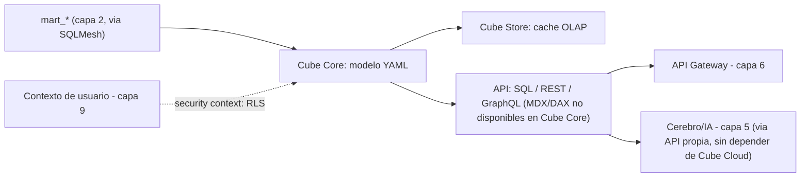

# Capa 4: Modelo Semántico — la "columna vertebral"

> Reemplazo: **Relaciones + jerarquías + RLS de Power BI → Cube Core** (MetricFlow queda descartado como default por acoplarse a dbt, no a SQLMesh — ver sección 4)

---

## 1. Responsabilidad única de esta capa

Definir, en un solo lugar, qué significa cada tabla `mart_*` en términos de negocio: el grafo de joins explícito, las métricas (medidas + agregaciones), las dimensiones, y las reglas de seguridad a nivel de fila. Es la única capa que "sabe" qué es una métrica de negocio.

**Esta capa NO debe saber:**
- Nada de cómo se limpiaron o transformaron los datos crudos (eso ya está resuelto en la capa 2, la capa 4 solo consume `mart_*`).
- Nada de cómo se renderiza un gráfico ni de qué framework de frontend lo consume (capa 8).
- Nada de autenticación de usuarios en sí (capa 9) — solo recibe *quién* está preguntando, vía contexto, y aplica la regla de fila correspondiente.

Si el frontend empieza a calcular una métrica de negocio con sus propios `SUM`/`GROUP BY` sobre una tabla cruda en vez de pedirle la métrica ya definida a esta capa, el diseño está roto — esa es exactamente la clase de error que Power BI permite y este proyecto busca hacer estructuralmente imposible.

---

## 2. Qué hacía el modelo semántico de Power BI exactamente (para saber qué reemplazamos)

- **Relaciones entre tablas** definidas visualmente, con cardinalidad (1:1, 1:N) y dirección de filtro (única o **bidireccional**).
- **Jerarquías** (ej. Año > Trimestre > Mes > Día) definidas dentro del modelo, usadas para *drill-down* en visuales.
- **RLS (Row-Level Security)** vía roles definidos en DAX, que filtran filas según el usuario autenticado — pero la lógica de cada rol vive dentro del `.pbix`, no en un archivo de texto revisable.
- **En el `.pbix` tradicional, todo esto vive en el mismo binario opaco** que el resto del modelo — no hay forma de ver en un diff qué cambió en una relación entre dos versiones del reporte. **Corrección de precisión:** Power BI actual permite guardar el modelo semántico como TMDL dentro de un proyecto PBIP — tablas, roles y relaciones en archivos de texto aptos para control de versiones; Microsoft describe TMDL explícitamente como pensado para diffs y merge en Git. La comparación justa con esta capa no es "Power BI no puede" — es que acá el texto plano versionado es el único formato posible, no una función que hay que activar y que convive con el resto del producto pensado para el binario.

---

## 3. Defectos concretos que eliminamos

| Defecto | Por qué es un problema real |
| --- | --- |
| Relaciones bidireccionales ambiguas | Cuando hay más de un camino de join activo, dos cálculos aparentemente iguales pueden dar números distintos sin ningún error visible |
| Modelo semántico atrapado en el binario `.pbix` | Imposible de revisar un cambio de relación o de RLS en un pull request |
| RLS definido en DAX dentro del archivo | La lógica de seguridad de fila no es auditable por fuera de Power BI Desktop |
| Sin API propia reutilizable | Las métricas solo se pueden consumir desde el propio Power BI — ninguna otra aplicación puede preguntarle al modelo "¿cuánto es el revenue de marzo?" |
| Sin testeo del grafo de joins antes de publicar | Un join mal declarado se descubre cuando el número ya está mal en un reporte publicado |

---

## 4. Qué reemplaza el modelo semántico — Cube Core vs MetricFlow, con exigencia real

### 4.1 El problema de fondo: MetricFlow no es independiente de dbt

El borrador original ponía a Cube.dev y MetricFlow como opciones intercambiables. No lo son, y esto importa mucho después de la decisión tomada en la capa 2: **MetricFlow es el motor del dbt Semantic Layer** — sus métricas se definen en YAML `semantic_models:`/`metrics:` que viven *dentro de un proyecto dbt* y se compilan usando el grafo de `ref()` de dbt. Este proyecto eligió **SQLMesh** como transformador por defecto en la capa 2, precisamente por no depender de dbt. Forzar MetricFlow encima significaría mantener un proyecto dbt "fantasma" solo para tener semántica — duplicando la capa de transformación, exactamente lo que la regla de responsabilidad única prohíbe. Además, el propio ecosistema reconoce que la experiencia de *serving* completa del dbt Semantic Layer (caché, múltiples interfaces de consulta) se entrega a través de **dbt Cloud** (plan Team) — el motor en sí es abierto, pero la forma "completa" de operarlo en producción vuelve a depender de una SaaS, el mismo patrón de vendor lock-in progresivo que ya se evitó dos veces (capas 2 y 3).

### 4.2 Cube Core: agnóstico de la capa de transformación, por diseño

**Cube Core** es un proyecto open source (licencia Apache 2.0) que no asume nada sobre cómo llegaron los datos a las tablas que consulta — solo necesita una fuente SQL. Define medidas, dimensiones y joins en YAML/JavaScript/Python, y expone el resultado simultáneamente por **SQL, REST y GraphQL**. Tiene:

- **Driver nativo de DuckDB** (incluyendo lectura directa de Parquet en object storage y conexión a MotherDuck) — se conecta directo a la capa 1 sin pasos intermedios.
- **Seguridad a nivel de fila y columna** vía "security context": el contexto del usuario autenticado (capa 9) se pasa a cada consulta y el modelo YAML decide qué filas/columnas son visibles — el reemplazo directo y auditable del RLS en DAX.
- **Cube Store**, un motor de caché OLAP propio (Rust) para que las consultas repetidas no vuelvan a pegarle al warehouse cada vez — resuelve el mismo problema que Power BI resolvía metiendo todo en RAM, pero sin duplicar el dataset completo.
- **Un servidor MCP propio ya existe en el ecosistema Cube** (para que un agente de IA pregunte "qué cubos y métricas existen" y consulte sin escribir SQL a mano) — aunque la versión que documenta Cube oficialmente vive del lado de Cube Cloud (plan pago). Esto no bloquea nada: como Cube Core ya expone una API REST/SQL completa y abierta, la capa 5 (cerebro/IA) puede construir su propio servidor MCP delgado sobre esa API sin depender de Cube Cloud — se deja anotado como tarea de esa capa, no de esta.

**Corrección de un dato factual (una revisión externa lo detectó, verificado contra la documentación oficial de Cube):** el README de Cube Core dice explícitamente *"REST, GraphQL, and SQL"* como sus APIs — **no incluye MDX ni DAX**. Ambas son funciones exclusivas de **Cube Cloud**, el producto comercial (la DAX API específicamente requiere el tier Enterprise). Esto tiene una consecuencia concreta que hay que decir sin vueltas: **no existe, en la versión self-hosteada de este proyecto, un camino nativo de "Analizar en Excel" o de conexión con herramientas legadas que solo hablan MDX/DAX** (como el propio Power BI en modo Live Connection, o Excel Pivot Tables contra un cubo). Si esa necesidad aparece en el futuro, las opciones son: construir un traductor propio (esfuerzo no trivial), pagar por Cube Cloud para esa función puntual, o aceptar que ese camino de integración queda fuera del alcance de este proyecto en su versión open source.

### 4.3 Comparación técnica directa

| Aspecto | Cube Core | MetricFlow (dbt Semantic Layer) | Malloy |
| --- | --- | --- | --- |
| Licencia | Apache 2.0, núcleo completo | Motor open source, pero el *serving* completo vive en dbt Cloud (Team) | Open source, pero es un lenguaje de modelado/consulta, no un servicio con API+caché+RLS propios |
| Dependencia de la capa de transformación | Ninguna — cualquier fuente SQL (`mart_*` de SQLMesh, dbt, o incluso tablas crudas) | Fuerte — requiere que las métricas vivan dentro de un proyecto dbt | Ninguna, pero tampoco resuelve serving/API/caché/RLS por sí solo |
| Interfaces de consulta | SQL, REST, GraphQL (MDX/DAX son exclusivos de Cube Cloud, no de Cube Core) | SQL API (vía dbt Cloud o `mf query` local) | Su propio lenguaje (`.malloy`), pensado para notebooks/exploración, no como servicio persistente |
| Caché | Cube Store (motor OLAP propio en Rust) | Depende de dbt Cloud para caché gestionado | No aplica — no es un servicio de *serving* |
| RLS / seguridad a nivel de fila | Nativo, vía "security context" | Limitado, requiere resolverlo aguas abajo (BI tool o warehouse) | No aplica |
| Adopción / madurez | Semántico open source más adoptado del mercado (Cube reporta ~20% del Fortune 1000 en su propio material de marketing — tratarlo como *claim* del vendor, no como dato de una fuente independiente); usado tanto para BI embebido como para servir agentes de IA | Motor maduro, pero atado al ecosistema dbt | Interesante como lenguaje, pero no compite en esta categoría (no es un servicio de *serving*) |
| Interoperabilidad futura | Cube se sumó al **Open Semantic Interchange**, el estándar YAML vendor-neutral impulsado por Snowflake, Dremio y dbt Labs (nació como iniciativa en septiembre de 2025, hoy Apache Ossie en incubación — ver nota de gobernanza más abajo) | Es la base declarativa del propio estándar | No participa de este estándar como motor de *serving* |

### 4.4 Decisión para este proyecto: Cube Core

1. **Coherencia con la capa 2.** Ya se eligió SQLMesh sobre dbt. Un semántico que exige un proyecto dbt paralelo violaría la responsabilidad única y duplicaría infraestructura solo para tener métricas.
2. **Coherencia con la capa 1.** Cube Core tiene driver nativo de DuckDB y MotherDuck — el mismo par ya elegido como motor.
3. **Sin SaaS obligatorio para tener la funcionalidad completa.** A diferencia del dbt Semantic Layer, Cube Core no reserva caché ni serving completo para un plan de pago — todo lo esencial vive en el núcleo Apache 2.0, self-hosteable.
4. **RLS de primera clase.** El "security context" de Cube es exactamente el reemplazo directo, auditable y versionado en Git de los roles en DAX que este proyecto busca eliminar.
5. **No cierra la puerta a estándares futuros.** Al sumarse a OSI, un modelo definido hoy en Cube tiene un camino de interoperabilidad hacia otros motores (incluido, irónicamente, el propio MetricFlow) sin reescritura completa si el panorama cambia.

**Nota de gobernanza (regla 7 de `CLAUDE.md`):** Cube Core es sostenido por una sola empresa (Cube Dev Inc.), sin fundación detrás — es el único caso, junto con dlt en la capa 3, donde el proyecto acepta ese riesgo residual porque no existe hoy un motor de modelo semántico (con API, caché y RLS propios) gobernado por una fundación. El riesgo está parcialmente mitigado por dos factores: la adopción de Cube es la más grande del mercado en esta categoría (no es una empresa chica), y el estándar de definiciones que Cube ya se comprometió a soportar entró en incubación en la **Apache Software Foundation** bajo el nombre **Apache Ossie**.

**Corrección de precisión (detectada por una revisión externa):** el estándar nació como iniciativa independiente ("Open Semantic Interchange") en **septiembre de 2025**, impulsado por **Snowflake, Dremio y dbt Labs** como desarrolladores principales — Databricks participa como partner del ecosistema, no como uno de los tres impulsores centrales. Publicó su versión v0.1 en enero de 2026, y entró en incubación bajo la Apache Software Foundation (como Apache Ossie) en junio de 2026 — todavía no tiene una primera release formal de la fundación. Esto no gobierna el motor de Cube en sí, pero sí el formato en que se escriben las definiciones — si Cube Dev Inc. desapareciera, el trabajo de modelado ya estaría en un formato que otro motor compatible con el estándar podría heredar, aunque "migración sin reescritura" sigue siendo hoy una aspiración razonable, no una garantía ya probada en producción. Se revisita esta decisión si Apache Ossie llega a una release formal, o si algún otro proyecto ofrece un motor de *serving* completo bajo gobernanza de fundación.

**Honestidad sobre los límites:** Cube Core es headless — no viene con una UI propia de exploración de datos tipo Looker, es una API pura pensada para que otra capa (el frontend, documento 08, o un agente de IA, documento 05) la consuma. Si el equipo esperara una herramienta de auto-servicio visual "todo incluido", Cube por sí solo no la da — eso se construye en la capa de frontend, encima de la API que Cube expone. Además, el servidor MCP "oficial" y con soporte documentado vive del lado de Cube Cloud; usar MCP con Cube Core self-hosteado implica escribir una capa delgada propia (tarea liviana: es una API REST ya definida) en el documento 05.

---

## 5. Qué agregamos que Power BI no tiene

- **Modelo semántico en YAML versionado en Git**, revisable en pull request, no atrapado en un binario.
- **RLS auditable como código** (security context), no oculto en expresiones DAX dentro del `.pbix`.
- **Una sola definición de métrica reutilizable por cualquier consumidor** (frontend propio, un notebook, un agente de IA) vía SQL/REST/GraphQL — no atada a un solo frontend como el modelo de Power BI lo está a Power BI Desktop/Service.
- **Grafo de joins explícito y sin ambigüedad de dirección** — cada relación se declara una sola vez, con una sola dirección posible.
- **Camino de interoperabilidad hacia un estándar abierto (OSI)** en vez de un formato propietario cerrado.

---

## 6. Arquitectura interna de esta capa



### 6.1 Estructura del modelo

- Un archivo de "cube" por entidad de negocio (`orders.yml`, `customers.yml`), cada uno apuntando a exactamente una tabla `mart_*`.
- Joins declarados explícitamente entre cubes, con una sola dirección — nunca bidireccional.
- Medidas (`count`, `sum`, `avg`, medidas calculadas) y dimensiones declaradas dentro de cada cube, no dispersas en consultas ad hoc.

### 6.2 RLS en concreto

El "security context" recibe, en cada consulta, los claims del usuario autenticado — resueltos por la capa 9 como dos cosas separadas: `workspace_role` (qué puede hacer) y `entitlements` (qué datos puede ver, ej. `{ region: ['Norte'] }`), nunca un solo campo de rol (`09-auth-gobernanza.md`, sección 6.1).

**Corrección de sintaxis, verificada contra la documentación oficial: `SECURITY_CONTEXT` (mayúsculas, interpolado dentro del `sql` de un cube) está deprecado** — Cube lo marca explícitamente como candidato a remoción en versiones futuras. El mecanismo actual es **`access_policy`**, con un bloque `row_level.filters` declarado aparte de la definición de columnas — más declarativo, y sin repetir el filtro de seguridad en el `sql` de cada cube:

```yaml
cubes:
  - name: ventas
    sql_table: mart_ventas
    # ...
    access_policy:
      - role: viewer
        row_level:
          filters:
            - member: region
              operator: equals
              values: ["{ securityContext.entitlements.region }"]
```

**Una precisión más, importante para no repetir el error de Cube Cloud vs. Cube Core:** el objeto `userAttributes` que aparece en buena parte de la documentación de Cube **es exclusivo de Cube Cloud** — en Cube Core (self-hosteado, lo que usa este proyecto) hay que referenciar `securityContext` directamente, nunca `userAttributes`, como en el ejemplo de arriba. La regla vive en este archivo de `access_policy`, versionado como el resto del cube, no en una capa de roles separada e invisible.

### 6.3 Caché, sin duplicar el dataset completo

Cube Store cachea resultados de consultas agregadas (pre-agregaciones), no el dataset entero — a diferencia del "import" completo a RAM de Power BI. Las pre-agregaciones se declaran explícitamente por cube cuando una consulta se repite mucho, y se refrescan en el mismo pipeline que orquesta el resto del proyecto (documento 07).

---

### 6.4 Conceptos de DAX que no se pueden "borrar de un plumazo" — jerarquías, calendario fiscal, parámetros

**Corrección de un hueco señalado por un análisis de producto independiente.** Este documento eliminó las relaciones bidireccionales y el contexto de filtro de DAX como defectos — con razón. Pero en el camino no se inventarió qué construcciones legítimas de DAX necesitan un equivalente explícito en Cube, y sin ese inventario, alguien migrando un modelo real se encuentra con huecos no documentados. Tres conceptos concretos:

- **Jerarquías** (Año > Trimestre > Mes > Día; o una jerarquía organizacional padre-hijo tipo organigrama). En Cube se declaran explícitamente como `hierarchies` dentro de un cube, agrupando dimensiones ya existentes en un orden de navegación — no es una dimensión nueva, es una relación de orden entre dimensiones que ya están definidas. Para jerarquías padre-hijo dinámicas (un organigrama que cambia), la traducción es un patrón recursivo en el modelo de SQLMesh (capa 2) que aplana la jerarquía en columnas de nivel antes de que Cube la consuma — Cube no resuelve recursividad de grafo por sí solo.
- **Calendario fiscal** (un año fiscal que no empieza en enero). Se resuelve con una dimensión de tiempo adicional en el cube, calculada una vez en SQLMesh (`fecha_fiscal`, `trimestre_fiscal`) a partir de una tabla de calendario — nunca calculado en Cube mismo, que no está pensado para lógica de calendario custom.
- **Parámetros** (una variable que el usuario elige y que cambia la consulta, ej. "moneda de visualización" o "año a comparar"). Esto es, en parte, una pieza de frontend: Cube soporta parámetros de consulta pasados desde el cliente, pero el control con el que el usuario los elige (un selector, un input) es responsabilidad de la Capa 8 — queda anotado ahí como pendiente de diseño.

**Lo que no tiene traducción directa, y hay que decirlo:** *calculation groups* (reutilizar una misma lógica de cálculo — ej. "variación %" — sobre cualquier medida sin repetirla) y *semi-aditividad* (una medida que suma en el tiempo pero promedia en otras dimensiones, típico de saldos bancarios) no tienen un equivalente de una línea en Cube. Se resuelven caso por caso, generalmente con medidas `multi_stage` explícitas por cada combinación necesaria — más verboso que DAX en este punto específico, y vale la pena saberlo de antemano en vez de descubrirlo migrando un reporte real.

### 6.5 Radar de tecnologías — alternativas vigiladas, no adoptadas

**Investigación de una revisión posterior, para dejar registrado que la decisión de Cube Core se revisó contra el panorama completo de 2026, no solo contra MetricFlow.** Ninguna de las siguientes reemplaza a Cube hoy — se documentan para revisar periódicamente, no como trabajo pendiente:

| Alternativa | Por qué se descartó por ahora | Cuándo reconsiderar |
| --- | --- | --- |
| **Sidemantic** | Headless, Apache-friendly en diseño, con soporte nativo de DuckDB y hasta importadores de Cube/LookML/DAX — conceptualmente muy alineado con este proyecto. Pero: **licencia AGPL-3.0** (exige más cuidado legal que Apache 2.0 para un producto distribuido) y todavía joven (~120 estrellas frente a ~20.000 de Cube) | Revisar cada 6 meses — es la alternativa con más potencial de las evaluadas |
| **Rill (Metrics SQL)** | Apache 2.0, DuckDB + ClickHouse nativos, un enfoque de "SQL sobre métricas" parecido al de Cube. Pero su Metrics SQL actual no soporta joins entre *metrics views*, ni CTEs, ni funciones de ventana en esa interfaz — demasiado restrictivo para lo que este proyecto necesita hoy | Revisar evolución de joins/CTE/window functions en su Metrics SQL |
| **Apache Ossie** | Es una *especificación* de intercambio semántico, no un motor de consultas — no compite con Cube, es complementario (ya adoptado como estándar de exportación futuro, capa 4 sección 4.2). Sigue en estado pre-estable (spec 0.2.0.dev0, sin releases formales de la fundación todavía) | Adoptar como formato de interoperabilidad cuando alcance estabilidad — MetricFlow ya está construyendo convertidores hacia Ossie, señal de que la estandarización avanza en serio |
| **MetricFlow** | Ya evaluado y descartado en la sección 4 — atado conceptualmente al mundo dbt, que este proyecto no usa (eligió SQLMesh) | Vigilar su interoperabilidad con Apache Ossie |

**Por qué esto no reabre la decisión de la sección 4:** ninguna alternativa reúne hoy, en una sola pieza madura, lo que Cube Core ya tiene — headless, Apache 2.0, modelo semántico completo, joins, seguridad de fila, Semantic SQL, REST, GraphQL, DuckDB y ClickHouse nativos, sin atarse a dbt. Sidemantic es la que más vale la pena vigilar por si madura; ninguna justifica hoy un cambio de arquitectura.

---

## 7. Contrato de esta capa (qué consume, qué expone)

- **Consume**: únicamente tablas `mart_*` expuestas por la capa de transformación (documento 02), vía el driver DuckDB/DuckLake de la capa 1. Nunca lee `stg_*` ni `int_*` directamente.
- **Expone**: una API de métricas por SQL, REST y GraphQL — nunca acceso directo al warehouse desde el frontend o desde el copiloto de IA. Todo consumidor de datos de negocio *gobernado* (dashboards compartidos, el copiloto de capa 5, cualquier número que otra persona va a confiar sin revisar el SQL detrás) pasa por acá. **Única excepción explícita, con su propio control de acceso:** SQL Lab (capa 8, sección 10.3) — para el MVP, restringido a quien tenga el permiso de gobernanza `sql_lab_access` (capa 9, sección 9.1) — nunca abierto por defecto, porque DuckDB no aísla usuarios dentro del mismo proceso lo suficiente como para que una vista filtrada por sí sola sea una frontera de seguridad real.
- **No expone**: MDX ni DAX — a diferencia de Cube Cloud (el producto comercial), **Cube Core self-hosteado solo expone SQL, REST y GraphQL**. Esto cierra, en la práctica, el camino nativo a "Analizar en Excel" o a herramientas legadas que hablan MDX/DAX — se documenta como una limitación real, no se finge que existe un puente que no está disponible en la versión open source. También: autenticación en sí (recibe el contexto de usuario ya resuelto por la capa 9, no gestiona login), ni renderizado de ningún tipo.
- **Intercambiabilidad**: si en el futuro OSI madura como estándar universal, el modelo de esta capa tiene un camino de exportación/migración sin reescritura completa — el contrato de la sección no cambia igual, la capa de arriba sigue viendo la misma API.

---

## 8. Por dónde empezar a construir (paso a paso concreto)

1. Instalar Cube Core (`npx cubejs-cli create` o Podman) apuntando al DuckDB/DuckLake de la capa 1 como fuente.
2. Definir el primer "cube" sobre una tabla `mart_*` real ya construida en la capa 2 — medidas y dimensiones básicas primero, sin RLS todavía.
3. Verificar la API REST (`/cubejs-api/v1/load`) devolviendo el resultado correcto de una métrica simple (ej. `SUM(revenue)` por mes).
4. Declarar el primer join explícito entre dos cubes y confirmar que no hay ambigüedad de dirección.
5. Recién cuando haya 3-5 métricas estables, introducir el security context con un caso de RLS real (ej. "un usuario de la región Norte solo ve filas de esa región").
6. Con la API respondiendo de forma estable, pasar a la capa de API Gateway (documento siguiente) para exponerla al frontend.

---

## 9. Idea rescatada de otro líder de BI: exploración asociativa (Qlik), sin sacrificar el grafo de joins explícito

Qlik permite explorar datos sin caminos de drill-down predefinidos: al seleccionar un valor, el resto de los campos responde como "asociado" (blanco) o "excluido" (gris) — sin que lo excluido desaparezca. Es una experiencia genuinamente útil para encontrar relaciones que nadie pensó a preguntar de antemano.

**El riesgo de copiarlo literal:** el motor de Qlik logra esto indexando relaciones *sin* joins predefinidos — exactamente la ambigüedad que este proyecto eliminó a propósito al reemplazar las relaciones bidireccionales de Power BI (sección 3 del documento general). Adoptar el modelo asociativo tal cual reintroduciría ese problema.

**La solución: la misma experiencia visual, sobre el grafo de joins ya explícito de Cube.** Se logra con un patrón bien conocido en sistemas de búsqueda y catálogos de e-commerce, llamado *disjunctive faceting*: para cada dimensión que se muestra como filtro, se consulta a Cube aplicando todos los filtros activos **excepto el de esa misma dimensión** — así esa faceta sigue mostrando todos sus valores posibles (incluidos los que darían 0 resultados bajo el filtro completo), en vez de colapsar a una sola opción.

```
Filtros activos: producto = "Zapatillas"

Consulta para la faceta "región" (excluye su propio filtro, mantiene el resto):
  Cube.query({
    measures: ['pedidos.count'],
    dimensions: ['pedidos.region'],
    filters: [{ member: 'pedidos.producto', operator: 'equals', values: ['Zapatillas'] }]
  })
  → conteo de CADA región bajo ese filtro de producto, incluidas las que dan 0
    (el frontend las pinta en gris, nunca las oculta)
```

**Esto no exige ningún cambio en el modelo YAML de Cube** — es una forma de *usar* la API que ya existe, corriendo una consulta en paralelo por cada dimensión visible como filtro, en vez de una sola consulta combinada. La orquestación de esas consultas en paralelo es trabajo de la Capa 6 (API Gateway); pintar la distinción blanco/gris es trabajo de la Capa 8 — ambas partes quedan anotadas como pendientes en esas capas, esta sección cierra la pregunta de si el modelo semántico necesitaba cambiar (no).

---

**Siguiente documento:** `05-cerebro-ia.md` — la capa declarativa + integración con la API de Claude, reemplazando DAX y agregando lenguaje natural sobre el modelo semántico.
