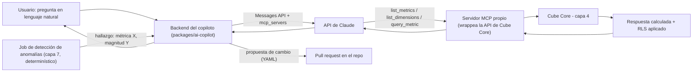

# Capa 5: Cerebro / Razonamiento con IA

> Reemplazo: **el rol de Copilot en Power BI → API de Claude, conectada a la capa semántica (capa 4) vía un servidor MCP propio — nunca SQL libre contra el warehouse**
>
> **Importante:** el cálculo determinístico que hacía DAX ya quedó reemplazado en la **capa 4** (Cube Core), no acá. Esta capa 5 es una adición opcional de lenguaje natural por encima de un cálculo que ya funciona solo — ver sección 0.

---

## 0. Por qué esta capa es opcional (y por qué eso es un requisito, no un detalle)

Es una objeción válida y hay que resolverla en el diseño, no en el texto de venta: **¿qué pasa con la plataforma si no hay internet o la API de Claude no responde?**

La respuesta tiene dos partes:

1. **El cálculo de negocio no vive acá.** DAX mezclaba dos cosas — calcular una medida y ser el único punto de entrada para "razonar" sobre el modelo. Este proyecto separó esos dos roles desde la capa 4: Cube Core calcula las métricas de forma determinística y **corre self-hosteado**, sin ninguna llamada a un servicio de IA en la nube. Un dashboard, una métrica, un filtro, un RLS — todo eso sigue funcionando exactamente igual si la API de Claude está caída o si no hay internet, porque nunca dependió de ella.
2. **Lo que sí depende de la nube es el rol de Copilot** — la conversación en lenguaje natural, la explicación de anomalías, la sugerencia de métricas nuevas. Eso es exactamente lo que reemplaza esta capa 5, y es exactamente lo único que se cae sin conexión. Vale la aclaración honesta: el Copilot de Power BI *también* depende de la nube de Microsoft — ahí no hay una regresión frente al original. El punto real no es "esto es peor que Power BI sin internet", es que el proyecto no puede permitirse que una capa de conveniencia rompa el resto si falta.

**Regla de diseño que se desprende de esto, y que aplica a todo lo que sigue en este documento:** esta capa debe poder desconectarse por completo — apagar el servidor MCP propio, no configurar la API key de Claude, lo que sea — y el resto de la plataforma (capas 1 a 4, y el frontend consumiéndolas directo) sigue funcionando sin cambios. Ninguna capa de abajo puede llamar a esta capa como parte de su camino crítico. El contrato de la sección 7 lo deja explícito.

---

## 1. Responsabilidad única de esta capa

Traducir lenguaje natural a preguntas resolubles por la capa semántica, explicar resultados y cambios ("¿por qué bajó este número?"), señalar anomalías detectadas por un proceso determinístico aparte, y proponer cambios al modelo semántico — **siempre como propuesta revisable, nunca como escritura directa a producción**.

**Esta capa NO debe saber:**
- Nada de cómo se calcula una métrica por dentro (joins, agregaciones) — eso ya lo resolvió la capa 4 de forma determinística. Esta capa solo pide "dame el valor de esta métrica con estos filtros", nunca reconstruye el cálculo por su cuenta.
- Nada de SQL crudo contra el warehouse — no tiene, ni debe tener, credenciales de acceso directo a la capa 1.
- Nada de autenticación de usuarios en sí (capa 9) — recibe el contexto ya resuelto, igual que la capa 4.

Si esta capa empieza a generar SQL a mano contra el warehouse "para responder más rápido", el diseño está roto — y además reintroduce exactamente el problema que la sección 4 documenta con evidencia: un LLM inventando su propia definición de una métrica que ya existe, con un número distinto al del dashboard.

---

## 2. Qué hacían DAX + Copilot exactamente (para saber qué reemplazamos)

- **DAX** mezcla dos roles en un mismo lenguaje: cálculo determinístico (una medida) y el único "punto de entrada" disponible para razonar sobre el modelo. No hay forma de preguntarle algo al modelo sin pasar por esa sintaxis.
- **Copilot en Power BI** está construido encima de ese mismo lenguaje rígido: cuando genera una medida DAX o una explicación, hereda las mismas ambigüedades de contexto de fila/filtro que ya son una fuente de errores para usuarios humanos.
- **Sin separación entre "quién calcula" y "quién explica"** — si el cálculo subyacente está mal planteado (relación bidireccional, por ejemplo), Copilot explica un número que ya venía mal, con la misma confianza que si estuviera bien.

---

## 3. Defectos concretos que eliminamos

| Defecto | Por qué es un problema real |
| --- | --- |
| Un solo lenguaje (DAX) para calcular y para "conversar" con el modelo | Cualquier limitación de DAX se hereda directo en lo que Copilot puede hacer |
| Copilot no separa "motor de cálculo" de "motor de lenguaje" | Un cálculo mal planteado se explica con la misma confianza que uno bien planteado |
| Sin capa de verificación entre la pregunta en lenguaje natural y el dato servido | Nada impide que la respuesta libre de un LLM invente una cifra o una definición de métrica distinta a la oficial |
| Sin mecanismo de revisión humana para cambios sugeridos por IA | Un cambio de modelo sugerido por Copilot no pasa por ningún control de versión antes de aplicarse |

---

## 4. Cómo se conecta la IA al modelo semántico — la decisión que realmente importa acá

### 4.1 Lo que ya está decidido, y lo que no estaba decidido pero debería estarlo

La elección de **motor de IA por defecto** fue tomada como decisión de proyecto desde el inicio: **integración con la API de Claude**. Esto no se vuelve a evaluar acá.

**Corrección real, señalada por una revisión externa:** una cosa es "Claude es la implementación recomendada" y otra, distinta, es "el contrato de esta capa asume Claude". La versión anterior de este documento mezclaba las dos — y eso sí es un problema, porque la regla 3 del proyecto ("open source primero, sin SaaS propietario que reintroduzca vendor lock-in") convive mal con una capa que solo sabe hablarle a un proveedor comercial específico. La corrección no es abandonar Claude — es **separar el contrato de la implementación**: esta capa define una interfaz `LLMProvider` (recibe una pregunta + el conjunto de herramientas MCP disponibles, devuelve una respuesta en lenguaje natural + qué herramientas invocó), y Claude es la implementación por defecto de esa interfaz — no la única posible por diseño.

```ts
// packages/ai-copilot/src/provider.ts
interface LLMProvider {
  responder(pregunta: string, herramientas: McpTool[]): Promise<{
    texto: string
    herramientas_invocadas: { nombre: string; parametros: unknown }[]
  }>
}

// La implementación por defecto — recomendada, no la única posible
class ClaudeProvider implements LLMProvider { /* usa el conector MCP nativo del Messages API */ }
```

Con esto, "Claude es la elección de este proyecto" sigue siendo cierto en la práctica (es lo que se instala y se usa por defecto), pero deja de ser una atadura estructural: cambiar de proveedor —a otro modelo comercial, o a un modelo local vía algo como vLLM— es implementar la misma interfaz, no reescribir la capa.

**Honestidad sobre el costo real de esta abstracción:** no es gratis. El conector MCP nativo del Messages API de Claude (sección 4.3) es una ventaja de integración específica de esa API — otro proveedor puede no tener un mecanismo equivalente igual de directo, y su implementación de `LLMProvider` tendría que resolver el "traducir pregunta → decidir qué herramienta llamar" con su propio mecanismo de tool-calling, a veces con más código propio. La interfaz evita el *lock-in estructural*, no evita que cambiar de proveedor sea trabajo real.

### 4.2 La evidencia: semántico primero, SQL libre nunca — con el peso correcto, ni más ni menos

Un benchmark pareado de 2026 (Ganz & Perigaud, sobre la misma metodología de Sequeda et al. 2023) midió esto de forma directa: sobre el mismo dataset modelado, **Claude Sonnet 4.6 pasa de 90,0% de precisión generando SQL libre a 98,2% cuando la misma pregunta se resuelve a través de una capa semántica**.

**Corrección de proporción, señalada por dos revisiones externas de forma independiente:** el número es real y está bien citado, pero se le dio más peso del que el propio estudio sostiene. Son **11 preguntas sobre un único dataset de una aseguradora ficticia** ("ACME Insurance"), publicado por **dbt Labs** — una empresa con interés directo en que la narrativa "capa semántica gana" se sostenga, porque vende una. Además, tres de esas preguntas originalmente excedían lo que la capa semántica evaluada podía expresar, y se agregaron modelos nuevos específicamente para poder resolverlas — el número final no es de un sistema que ya venía funcionando así, sino de uno ajustado para el propio benchmark. Un estudio de 11 preguntas hecho por un interesado no sostiene la afirmación "una arquitectura semantic-first va a rendir ~98% en cualquier empresa" — y este documento no debería citarlo como si lo hiciera.

**Lo que sí se sostiene, y es la razón real por la que esta capa está diseñada así:** el hallazgo *cualitativo*, no el número. Cuando la capa semántica no puede responder algo, el fallo es un rechazo explícito ("no puedo calcular eso con las métricas definidas"); cuando un LLM genera SQL libre y falla, el fallo es un **número equivocado servido con total confianza**. Esa asimetría entre "tipo de error" no depende de la muestra de 11 preguntas para ser cierta — es una consecuencia directa de cómo funciona cada arquitectura, y es el argumento que sostiene esta capa, no el 98,2%.

Un matiz importante para no repetir un error común: **un servidor MCP no es, por sí mismo, una capa semántica.** Si el servidor MCP expone un esquema crudo del warehouse y una herramienta genérica "ejecutar SQL", seguimos teniendo texto-a-SQL libre con pasos extra — el LLM sigue pudiendo inventar un join o una definición de métrica. El servidor MCP de esta capa tiene que exponer **operaciones del modelo semántico** (listar métricas disponibles, listar dimensiones de una métrica, ejecutar una consulta ya validada contra la API de Cube Core) — nunca una herramienta que ejecute SQL arbitrario.

### 4.3 Arquitectura de conexión: MCP propio sobre la API de Cube Core

La API de Claude tiene un **conector MCP nativo** en el Messages API: permite declarar un servidor MCP remoto (`mcp_servers`) y darle a Claude un conjunto de herramientas (`tools`) sin tener que escribir un cliente MCP a mano. Esto define la arquitectura de esta capa:

1. Se construye un **servidor MCP propio y liviano** (paquete `packages/ai-copilot`, TypeScript) que expone un puñado de herramientas de alto nivel: `list_metrics`, `list_dimensions`, `query_metric` — cada una traducida internamente a una llamada a la API REST/SQL de Cube Core (capa 4). Ninguna herramienta ejecuta SQL arbitrario.
2. La aplicación (backend del copiloto) llama a la API de Claude declarando ese servidor MCP propio como `mcp_servers`. Claude decide qué herramienta llamar y con qué parámetros para responder la pregunta del usuario.
3. Cube Core resuelve la consulta de forma determinística (joins, agregaciones, RLS vía security context) y devuelve el resultado ya calculado — Claude nunca ve una fila cruda del warehouse, solo el resultado de una métrica ya definida.
4. Claude arma la respuesta en lenguaje natural a partir de ese resultado ya confiable.

Esto mantiene la responsabilidad única al pie de la letra: la capa 4 sigue siendo la única fuente de verdad del cálculo; esta capa 5 solo pregunta y explica.

### 4.4 Detección de anomalías: determinística primero, IA para explicar después

Repitiendo el mismo patrón: los LLM son buenos explicando, no son la herramienta correcta para "calcular si este número es estadísticamente anómalo". La detección en sí es un job aparte, sencillo y determinístico (una comparación contra la serie histórica de la métrica — desviación estándar, o descomposición estacional si aplica), orquestado como una tarea programada (capa 7) que consulta la misma API de Cube Core que usa esta capa. Cuando ese job marca una métrica como anómala, **recién ahí** entra Claude: se le da el hallazgo ya detectado (qué métrica, qué magnitud, qué período) y se le pide que lo explique en lenguaje natural con acceso a las mismas herramientas MCP — por ejemplo, cruzando esa métrica con dimensiones relacionadas para proponer una hipótesis de causa. Claude nunca decide *si* algo es anómalo; decide *cómo explicarlo* una vez que ya se detectó.

### 4.5 Cambios propuestos por la IA: siempre como pull request

Cuando el copiloto sugiere una métrica nueva o detecta que falta una dimensión, la salida es un **diff de YAML sobre el modelo de la capa 4**, entregado como pull request en el repositorio (vía la API de Git/GitHub) — nunca una escritura directa al archivo en producción. Un humano revisa y mergea, exactamente igual que revisaría un cambio de código de cualquier otro colaborador. Esto no es una limitación de la IA, es el mismo flujo de revisión que ya aplica a cualquier cambio de las capas 2 y 4.

---

## 5. Qué agregamos que Power BI no tiene

- **Explicaciones en lenguaje natural respaldadas por un cálculo ya validado**, no por un LLM improvisando SQL — con un benchmark de 2026 como indicio (90%→98,2%, con las salvedades de muestra chica y origen del vendor ya documentadas en la sección 4.2) del tipo de error que esta arquitectura reduce.
- **Detección de anomalías separada del motor de lenguaje**: una comparación estadística determinística decide *qué* es anómalo; Claude decide *cómo explicarlo* — sin mezclar los dos roles como hacía Copilot con DAX.
- **Cambios de modelo propuestos por IA como pull request revisable**, nunca como escritura silenciosa a producción.
- **Una sola integración de IA reutilizable por cualquier cliente** (el frontend propio, una CLI, otro servicio) vía el mismo servidor MCP — no atada a la ventana de chat de un solo producto.

---

## 6. Arquitectura interna de esta capa



### 6.1 Herramientas del servidor MCP propio (mínimo viable)

| Herramienta | Qué hace | A qué le pega |
| --- | --- | --- |
| `list_metrics` | Devuelve las métricas y dimensiones disponibles, con su descripción de negocio | Metadata del modelo de Cube Core |
| `query_metric` | Ejecuta una métrica ya definida con filtros/granularidad dados | API REST de Cube Core |
| `explain_change` (opcional, fase 2) | Dado un hallazgo de anomalía, trae series relacionadas para que Claude arme una hipótesis | API REST de Cube Core |
| `find_certified_queries` | Devuelve las consultas certificadas del workspace que se parecen a la pregunta, con sus parámetros (§10.4) | Contenido activo de `agents/` (§10) |
| `run_certified_query` | Ejecuta una consulta certificada con valores para sus parámetros declarados, y nada más, con el security context de quien pregunta (§10.4) | API REST de Cube Core |
| `read_agent_rule` | Devuelve el texto de una regla `on_request` del workspace (§10.4) | Contenido activo de `agents/` (§10) |

Ninguna herramienta acepta SQL como parámetro. Esto es la barrera técnica, no solo una convención de prompt, que impide texto-a-SQL libre.

### 6.2 Manejo de ambigüedad

Cuando la pregunta del usuario no mapea claramente a una métrica existente, la respuesta correcta es que Claude lo diga explícitamente y ofrezca las métricas disponibles más cercanas — nunca que "adivine" una combinación de joins para responder igual. Esto es exactamente el patrón de falla "por rechazo, no por número incorrecto" que la sección 4.2 documenta como la ventaja cualitativa real del enfoque semántico — independiente del número puntual del benchmark citado ahí.

### 6.3 Límites de autonomía, explícitos

- **Puede hacer sin aprobación**: consultar métricas existentes, explicar resultados, señalar anomalías ya detectadas por el job determinístico.
- **Nunca hace sin aprobación humana**: escribir directo a un archivo de modelo en producción, ejecutar SQL arbitrario, crear una métrica nueva sin pasar por pull request, certificar una consulta ni crear o editar una regla del copiloto: eso lo hace una persona con el permiso correspondiente (§10.3).

---

## 7. Contrato de esta capa (qué consume, qué expone)

- **Consume**: la API de la capa semántica (capa 4) exclusivamente, a través del servidor MCP propio. Nunca el warehouse (capa 1) ni las tablas `mart_*`/`stg_*`/`int_*` directamente. Además, el contenido activo de `agents/` (consultas certificadas y reglas), que ya pasó por el servicio de certificación (§10.3).
- **Expone**: una interfaz de preguntas/respuestas (consumida por el frontend, capa 8, o por cualquier otro cliente que hable el mismo protocolo) y, como subproducto, pull requests propuestos sobre el modelo semántico.
- **No expone**: acceso de escritura directo a ninguna capa de datos. Toda modificación pasa por revisión humana en Git.
- **Dirección de la dependencia, en un solo sentido**: esta capa depende de la capa 4, nunca al revés. Ninguna capa 1-4 ni el frontend en su camino principal (ver dashboards, aplicar filtros, exportar) puede tener una llamada a esta capa como requisito para funcionar. Si el servidor MCP propio está apagado o el `LLMProvider` configurado (Claude, por defecto) no responde, el único síntoma visible debe ser que el chat/copiloto no contesta — nada más se degrada.
- **El proveedor de IA es intercambiable por contrato** (sección 4.1, interfaz `LLMProvider`): el resto del sistema depende de esta capa, nunca de qué implementación de `LLMProvider` esté configurada por detrás.

---

## 8. Por dónde empezar a construir (paso a paso concreto)

1. Con la capa 4 (Cube Core) ya sirviendo 3-5 métricas estables, escribir el servidor MCP propio con una sola herramienta: `query_metric`, wrappeando una llamada REST a Cube.
2. Probar ese servidor MCP de forma aislada (sin Claude todavía) — confirmar que devuelve el resultado correcto para 2-3 preguntas de prueba.
3. Conectar la API de Claude a ese servidor vía `mcp_servers` en el Messages API, y probar la primera pregunta real: "¿cuánto vendimos el mes pasado?".
4. Agregar `list_metrics` para que Claude pueda descubrir qué existe antes de intentar adivinar.
5. Recién con la conversación básica funcionando de forma confiable, construir el job de detección de anomalías (capa 7) como proceso aparte, y conectarlo a esta capa como una fuente de hallazgos, no como otra pregunta libre.
6. El flujo de pull requests para cambios propuestos por IA se construye último, sobre un modelo semántico ya estable — es la funcionalidad de mayor riesgo si se automatiza demasiado pronto.
7. Con la conversación básica estable, consultas certificadas y reglas (§10). Primero la lectura (`find_certified_queries`, `run_certified_query`, las reglas) sobre archivos escritos por Git; después el botón desde la conversación.

---

## 9. Idea rescatada de otro líder de BI: entrega proactiva de insights (Tableau Pulse)

Hasta acá, esta capa es enteramente reactiva: alguien pregunta, Claude responde. **Tableau Pulse invierte ese modelo** — un usuario "sigue" una métrica (como seguir a alguien en una red social), y sin que nadie pregunte nada, recibe un resumen periódico ("digest") por email o Slack: *"Ventas semanales subieron 15%, impulsado por un aumento del 40% en la categoría Tecnología"*. Power BI no tiene nada parecido — Copilot solo responde, nunca avisa solo.

**La buena noticia: ya teníamos la mitad de esto construido.** El job de detección de anomalías (sección 4.4) ya identifica de forma determinística cuándo una métrica se salió de lo normal. Lo que faltaba es (1) que alguien pueda "suscribirse" a una métrica sin que eso implique una anomalía, y (2) que el resultado se **empuje** por un canal, en vez de esperar a que el usuario abra el chat.

### 9.1 Qué se agrega, sin romper el diseño existente

- **Suscripciones**: una tabla chica y propia de esta capa (`cerebro_ia.suscripciones_metricas`: usuario, métrica, cadencia — diaria/semanal/mensual, canal de entrega). No vive en better-auth (capa 9): auth conoce identidad y roles, no preferencias de negocio de qué métrica le interesa a cada quien.
- **El job de digest**: un DAG nuevo en Airflow (capa 7) — el mismo orquestador que ya dispara el job de anomalías — que, en cada cadencia, recorre las suscripciones vencidas, pide el valor actual y la comparación relevante (reutilizando `query_metric`, ya construido) y, si el job de anomalías marcó algo para esa métrica, lo incluye. Con eso arma el prompt para que Claude redacte el resumen en lenguaje natural — la misma llamada a la API de Claude que ya existe, con un prompt distinto, no un mecanismo nuevo.
- **El canal de entrega**: igual que en la Capa 11 (protocolo estándar sobre API propietaria), el envío se hace vía **SMTP estándar** para email — cualquier proveedor sirve, ninguno es una dependencia dura. Slack/Teams son integraciones opcionales y intercambiables (un webhook configurable), nunca un requisito — si no se configura ningún canal, el digest simplemente no se envía, sin romper nada más.

### 9.2 Contrato de esta funcionalidad, dentro del contrato ya definido

- **Consume**: lo mismo que ya consumía esta capa (Cube Core vía el servidor MCP propio) más el resultado del job de anomalías (capa 7). No agrega ninguna dependencia nueva hacia otra capa de datos.
- **Expone**: mensajes salientes por un canal configurable (SMTP u otro webhook) — nunca un canal obligatorio.
- **Sigue siendo opcional y apagable**: si nadie se suscribe a nada, no se envía nada, y el resto de la plataforma no lo nota — la misma regla de la sección 0 sigue aplicando.

---

## 10. Consultas certificadas y reglas del copiloto — el patrón de Cube Cloud, construido por nosotros

**De dónde sale la idea.** Cube Cloud, el producto comercial y no Cube Core, configura su agente con archivos del repositorio del modelo, en dos carpetas:
- `agents/rules/`: instrucciones en Markdown, que se aplican siempre ("always") o cuando el agente las pide ("agent requested").
- `agents/certified_queries/`: consultas de confianza, con metadatos en un *frontmatter* YAML y el cuerpo en SQL. El agente las usa tal cual, las adapta o las ignora.

Es una función propietaria. Por la regla 8 de `CLAUDE.md`, se toma la idea y se construye con piezas propias, con dos diferencias de fondo:

1. **El cuerpo de una consulta certificada nunca es SQL.** Es una consulta semántica estructurada, del contrato `SemanticQuery` de `SemanticQueryPort` (Paso 5). Así se mantiene la barrera de §6.1: ninguna herramienta del copiloto acepta ni ejecuta SQL, tampoco "SQL certificado".
2. **Se puede certificar desde la conversación, sin ver ningún archivo, o desde Git.** Los dos caminos escriben lo mismo (§10.3).

### 10.1 Qué es cada cosa

- **Consulta certificada:** una pregunta de negocio frecuente ("¿cuánto vendimos por región el mes pasado?") ligada a una consulta semántica exacta, revisada por alguien con permiso. El copiloto la busca antes de armar una consulta propia, y hay tres casos posibles:
  - **Coincide:** la usa tal cual.
  - **La pregunta difiere solo en lo que la consulta declara como parámetro** (el período, el valor de un filtro): la adapta dentro de esos parámetros.
  - **No coincide:** arma una consulta nueva, y esa respuesta **no** lleva la marca de certificada.

  La respuesta siempre dice en cuál de los tres casos está, y quién certificó y cuándo: es la misma señal de confianza que la certificación de `09` §9.
- **Regla:** una instrucción en lenguaje natural para el copiloto, dentro de un workspace. Por ejemplo: "el año fiscal empieza en abril", "*cliente activo* significa al menos una compra en 90 días", "nunca compares regiones sin normalizar por cantidad de pedidos". Tiene dos modos:
  - `always`: entra en el contexto de cada conversación del workspace.
  - `on_request`: el copiloto ve solo el título y la descripción, y pide el texto completo cuando le sirve (el equivalente de las "agent requested rules").

**Qué no es ninguna de las dos: un permiso o una frontera de seguridad.**
- Una regla orienta la respuesta, pero no puede habilitar una herramienta, saltearse la RLS ni cambiar qué datos ve quien pregunta.
- Las barreras siguen siendo técnicas: las herramientas del servidor MCP (§6.1) y el security context que Cube aplica en cada consulta (`09` §6.1).
- Una consulta certificada tampoco lleva security context: es una plantilla, y cada persona que la ejecuta ve solo sus filas. Que la haya certificado alguien con acceso a todas las regiones no le da ese acceso a quien la usa.

### 10.2 Dónde viven y cómo se ven

Están en la carpeta `agents/` del repositorio que versiona el contenido semántico del despliegue. En el monorepo de desarrollo es `packages/ai-copilot/agents/`. Hay una subcarpeta por workspace, porque el permiso de certificar es por workspace (`09` §9.1):

```
agents/
├── certified-queries/
│   └── comercial/
│       └── sales-by-region-last-month.md
└── rules/
    └── comercial/
        └── fiscal-year.md
```

Consulta certificada (la forma de `query` es ilustrativa: la fija `SemanticQuery` v1 en el Paso 5):

```markdown
---
schema: certified-query/v1
id: 0f6c7c1e-8a3b-4d0e-9a51-2b7f5f1c9d20   # UUID estable: sobrevive a un renombre del archivo
title: Ventas por región del mes pasado
questions:                                # cómo lo pregunta la gente; el copiloto busca por acá
  - ¿Cuánto vendimos por región el mes pasado?
  - Ventas del último mes por zona
query:                                    # SemanticQuery v1 — nunca SQL, nunca el JSON de Cube
  metrics: [sales_orders.total_amount]
  dimensions: [sales_orders.region]
  time: { dimension: sales_orders.order_date, granularity: month, range: last_month }
  order: [{ member: sales_orders.total_amount, direction: desc }]
parameters:                               # lo único que el copiloto puede adaptar
  - time.range
status: certified                         # certified | revoked
certified_by: 3f2a9c4e-…                  # id de usuario de la plataforma; nunca un email en Git
certified_at: 2026-10-02T14:03:00Z
source: conversation                      # conversation | git: el camino del último cambio
note: Revisada con Finanzas; excluye pedidos anulados.
---
Cuándo conviene usarla y cuándo no (opcional, texto para el copiloto).
```

Regla:

```markdown
---
schema: agent-rule/v1
id: 5a2d1b7e-…
title: Año fiscal
apply: always                             # always | on_request
description: Cómo interpretar "este año", "el año pasado" y los trimestres
status: active                            # active | retired
updated_by: 3f2a9c4e-…
updated_at: 2026-10-02T14:10:00Z
source: git
---
El año fiscal empieza el 1 de abril. "Este año" es el año fiscal en curso, y
"el trimestre pasado" es el trimestre fiscal anterior.
```

**Límites de las reglas:** cada regla tiene un tamaño máximo, y las `always` de un workspace suman un máximo. Así se acotan el costo y la superficie de *prompt injection*. El copiloto las recibe delimitadas, como contexto del workspace, por debajo de las instrucciones propias de la plataforma.

### 10.3 Dos caminos, un solo registro: decide el permiso, nunca el tipo de usuario

**Regla de diseño, sin excepciones.** Hacen falta permisos del workspace en cuestión (`09` §9.1):
- `certify_metric`, para crear, editar o revocar una consulta certificada.
- `manage_agent_rules`, para crear, editar o retirar una regla.

Los dos caminos de abajo están abiertos a **cualquiera** que tenga el permiso correspondiente, y a nadie más. La plataforma no tiene ningún campo ni heurística de "usuario técnico / no técnico": no existe un modo desarrollador que habilite Git, ni una interfaz simplificada que lo esconda. Quien tiene el permiso elige el camino que prefiera, y puede usar los dos.

1. **Git:** se edita el archivo YAML/Markdown directamente, con un pull request o un commit, como cualquier otro cambio versionado del proyecto.
2. **Desde la conversación:**
   - En una respuesta del copiloto aparece el botón "Certificar esta consulta". Lo ve solo quien tiene `certify_metric` en ese workspace, y el servidor vuelve a verificarlo: nunca queda solo en la interfaz.
   - Abre un formulario corto: título, preguntas de ejemplo (prellenadas con la de la conversación), qué partes quedan como parámetro y una nota. No hay ningún archivo a la vista.
   - Certifica **la consulta semántica exacta que se ejecutó**, nunca el texto que redactó el LLM.
   - Las reglas tienen su equivalente, "Guardar como regla del workspace", sobre una instrucción que escribe la persona.

**Los dos caminos escriben lo mismo.** Hay un único servicio de certificación, en el backend de esta capa y detrás de la API Gateway. Tiene tres operaciones (certificar o editar, revocar o retirar, validar), y los dos caminos terminan en él:
- El botón llama al servicio. El servicio escribe **el archivo** en el repositorio (un commit por la API de Git del despliegue, el mismo mecanismo de §4.5) y el **registro de auditoría**.
- Un cambio hecho por Git lo valida el mismo servicio antes de activarse (con un chequeo del pull request y el mismo control al sincronizar), y deja el mismo registro de auditoría.

**La verdad es una sola:**
- **El contenido es el archivo en Git:** lo que se revisa, se versiona y se puede revertir.
- **El evento de auditoría** (`audit_event`, `18`, Audit & Compliance) dice quién certificó qué versión (el hash del contenido), por qué camino y cuándo. No hay una tabla aparte de certificaciones: el estado vigente es una vista sobre esos eventos.
- **El copiloto solo usa un archivo cuando las dos cosas coinciden:** el contenido activo es exactamente la versión que certificó alguien con el permiso.

**El permiso lo controla la plataforma, no el acceso a Git.**
- **Tener acceso de escritura al repositorio no alcanza.** Si cambia un archivo alguien sin el permiso, el archivo queda inactivo: el chequeo lo marca antes del merge y la sincronización no lo activa.
- **No tener acceso a Git no quita nada.** Quien tiene el permiso y no tiene acceso a Git usa el botón.
- **Atribución de un cambio de Git:**
  - La cuenta del proveedor de Git se vincula a la cuenta de la plataforma; better-auth ya soporta cuentas vinculadas de proveedores OAuth (`09` §5).
  - Nunca se atribuye por el email del commit, porque se puede falsificar.
- **Límite honesto:** con un repositorio sin un proveedor que identifique a sus autores, el camino de Git no puede activar contenido y queda solo el botón. Eso cambia cuando exista otra forma verificable, como commits firmados con claves registradas en la plataforma.

**Qué valida el servicio, venga de donde venga el cambio:**
- El esquema del archivo.
- Que cada miembro referenciado exista en el modelo semántico vigente.
- Que la consulta corra con el contexto de quien certifica, lo que además comprueba que esa persona puede verla.
- Que los parámetros declarados existan en la consulta.
- Los límites de tamaño de las reglas.
- El permiso de quien firma el cambio.

**Si alguien pierde el permiso,** lo que certificó sigue certificado, porque el permiso era válido cuando lo hizo. Revocarlo es una acción explícita de alguien con el permiso, y el registro muestra quién y cuándo.

### 10.4 Cómo las usa el copiloto

Tres herramientas nuevas en el servidor MCP propio, todas de solo lectura:

| Herramienta | Qué hace |
| --- | --- |
| `find_certified_queries` | Devuelve las consultas certificadas del workspace que se parecen a la pregunta (por `questions` y `title`), con sus parámetros |
| `run_certified_query` | Ejecuta una consulta certificada con valores para sus parámetros declarados, y nada más, con el security context de quien pregunta |
| `read_agent_rule` | Devuelve el texto de una regla `on_request` |

Las reglas `always` entran en el contexto de la conversación. Las `on_request` aparecen como una lista (título y descripción).

**No hay ninguna herramienta que escriba.** El copiloto puede sugerir "¿querés certificar esta consulta?", pero certificar es siempre un clic de una persona con el permiso (§6.3).

### 10.5 Certificación continua

Es la misma idea de `09` §9.2. Cuando cambia el modelo semántico, el servicio revalida todas las consultas certificadas. Si una referencia un miembro que ya no existe, o deja de correr, pasa sola a `revoked`, con el motivo en el registro de auditoría: nunca queda una insignia sobre una consulta rota. Volver a certificarla es otra vez decisión de alguien con el permiso.

### 10.6 Cuándo se construye y qué necesita antes

Se construye con el copiloto (Paso 12), no antes. Necesita:
- `SemanticQuery` / `SemanticQueryPort` (Paso 5).
- La tabla `workspace_permissions`, que nace con su primer consumidor (`09` §9.1).
- La API de Git del despliegue (la misma de §4.5).
- La vinculación de cuentas del proveedor de Git (capa 9).

Sigue siendo opcional y apagable (§0): sin el copiloto, nadie lee los archivos de `agents/` y el resto de la plataforma no lo nota.

---

**Siguiente documento:** `06-api-gateway.md` — tRPC exponiendo la capa semántica (y esta capa de IA) al frontend.
