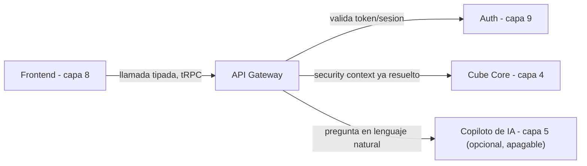

# Capa 6: API Gateway

> Reemplazo: **el motor de consultas interno de Power BI Service → tRPC** (GraphQL, respaldado por la GraphQL Foundation bajo la Linux Foundation, como alternativa de máxima seguridad si en algún momento aparecen clientes no-TypeScript — ver sección 4)
>
> **Corrección de gobernanza:** una versión anterior de este documento recomendaba oRPC. Se revierte a tRPC por la regla 7 de `CLAUDE.md` (gobernanza sobre riesgo de abandono): oRPC es sostenido por un mantenedor con sponsors de GitHub, sin empresa ni comunidad de escala detrás — descalifica bajo esa regla, sin importar sus ventajas técnicas (OpenAPI nativo). tRPC, aunque tampoco tiene una fundación, tiene una masa de adopción (~35.000 estrellas, base del ecosistema T3, uso en producción en una cantidad de empresas tal que el proyecto sobrevive aunque su mantenedor original se baje) que lo pone en una categoría de riesgo muy distinta.

---

## 1. Responsabilidad única de esta capa

Ser el único punto de entrada entre el frontend (capa 8) y todo lo que hay detrás (capa semántica, capa 4; copiloto de IA, capa 5), con un contrato tipado, versionado, y con los permisos ya validados antes de reenviar la consulta.

**Esta capa NO debe saber:**
- Nada de cómo se calcula una métrica (eso es la capa 4) ni de cómo se arma una respuesta de IA (capa 5) — solo enruta y valida.
- Nada de cómo se renderiza un componente en el frontend.
- Nada de la lógica interna de autenticación (capa 9) — solo verifica el token/sesión ya emitido y lo traduce al contexto que la capa 4 espera (security context de Cube).

Si esta capa empieza a calcular algo por su cuenta o a decidir qué puede ver un usuario sin pasar ese criterio a la capa 4/9, el diseño está roto.

### 1.1 Runtime concreto — corrección de un hueco real

**Señalado en una revisión posterior: "TypeScript + tRPC + OpenAPI" describe el contrato, pero nunca se dijo dónde corre nada de esto — tRPC no es un servidor HTTP por sí solo.** Se congela:

```
SvelteKit (capa 8)
   ↓
Fastify
 ├── tRPC (BFF interno, sección 4)
 ├── OpenAPI (API pública, sección 4.1)
 ├── better-auth (capa 9, montado como plugin)
 ├── /health, /ready (19-operabilidad-runtime.md §9)
 ├── middleware de OpenTelemetry (11-infraestructura.md §4.6)
 └── adaptadores hacia Cube (REST/GraphQL y, cuando se valide, SQL API)
```

**Fastify**, no Express ni un servidor a medida — verificado: es un proyecto de la **OpenJS Foundation** (misma categoría de gobernanza que Node.js, jQuery, Electron), con arquitectura de plugins, soporte TypeScript de primera clase, y **tRPC lo lista oficialmente entre sus adaptadores soportados** — no hace falta un adaptador comunitario de terceros para conectar las dos piezas.

**Implementado en el Paso 5 (`0.5.0`), con dos correcciones al diagrama de arriba.** better-auth no se monta como plugin: el gateway expone tres rutas propias y las reenvía al puerto `IdentityHttpHandler` (§6.4). Y los adaptadores hacia Cube no viven acá: el gateway solo conoce `SemanticRuntimePort`, y el adaptador de Cube está en `@atlasbi/semantic` (`21-engineering-standards.md` §3).

```
Fastify — escucha solo en 127.0.0.1:4100 (ATLASBI_GATEWAY_PORT); el proxy del Paso 6 da la cara a la red
 ├── /auth/sign-in/email · /auth/sign-out · /auth/token  → IdentityHttpHandler (capa 9, §6.4)
 ├── /api/trpc   → tRPC: session.me · semantic.meta · semantic.query (§7)
 ├── /api/v1     → reservado: 404 hasta que exista un consumidor externo real (§4.1)
 ├── /health · /ready (19-operabilidad-runtime.md §9)
 └── OpenTelemetry en el proceso (§6.5)
        │
        ├── IdentityPort (verificación local del token) + directorio de acceso (capa 9)
        └── SemanticRuntimePort ──► adaptador de Cube (@atlasbi/semantic) ──► Cube REST
```

---

## 2. Qué reemplazamos y por qué

En Power BI, el frontend (Desktop/Service) y el motor de consultas están fuertemente acoplados: no existe una API pública, estable y documentada que un cliente distinto pueda consumir en igualdad de condiciones con la propia interfaz de Power BI.

---

## 3. Defectos concretos que eliminamos

| Defecto | Por qué es un problema real |
| --- | --- |
| Motor de consultas acoplado a un único frontend propietario | Ningún otro cliente puede consumir el mismo dato con la misma facilidad |
| Sin contrato de API versionado explícito | Un cambio interno puede romper una integración externa sin aviso |
| Sin punto único auditable de acceso a datos | Distintos caminos de acceso dificultan auditar quién pidió qué |

---

## 4. Qué expone esta capa al frontend — tRPC, con la corrección de gobernanza aplicada

### 4.1 El contexto no cambió: monorepo TypeScript, un solo cliente principal

El frontend (capa 8) sigue siendo SvelteKit + Svelte 5, en el mismo monorepo TypeScript que el resto del proyecto. Compartir tipos de extremo a extremo sin generar código sigue siendo la prioridad — eso no cambió entre tRPC y oRPC, es el argumento de fondo que sostenía a los dos.

### 4.2 Por qué tRPC y no oRPC, aplicando la regla 7 sin excepciones

oRPC resolvía un problema real (generación nativa de OpenAPI, sin atarse a Zod) mejor que tRPC. Pero bajo la regla de gobernanza del proyecto, eso no alcanza: **oRPC es un proyecto sostenido por un desarrollador con financiamiento de sponsors de GitHub** (planes de sponsorship, sin una empresa ni una comunidad de escala equivalente detrás). Es exactamente el patrón que la regla 7 descalifica sin excepción, sin importar cuán buena sea la propuesta técnica.

**tRPC**, medido contra el checklist de la regla 7 (no solo por "adopción masiva" como frase suelta):

| Condición | tRPC |
| --- | --- |
| Repositorio de una organización, no una cuenta personal | ✅ `trpc/trpc` |
| Equipo nombrado de varias personas, no una sola presentada como dueña | ✅ "Project leads": Sachin Raja, Julius Marminge, Alex/KATT — varios nombres, no uno solo |
| Al menos un sponsor corporativo real | ✅ Cal.com Inc., Tola, entre otros |
| Rol estructural en un ecosistema más grande | ✅ Es la pieza de tipado end-to-end del T3 Stack, del que dependen miles de proyectos |

Pasa las cuatro condiciones — no es "es popular, alcanza", es que cumple el mismo checklist que se le exige a cualquier otra herramienta en esta situación.

### 4.3 Comparación técnica directa

| Aspecto | tRPC | oRPC | GraphQL |
| --- | --- | --- | --- |
| Gobernanza | Sin fundación, pero adopción masiva (~35k stars, base del T3 Stack) | 🔴 Mantenedor + sponsors, sin empresa ni comunidad de escala — descalifica bajo regla 7 | **GraphQL Foundation, bajo la Linux Foundation** — la opción de máxima seguridad de gobernanza |
| Tipado extremo a extremo sin codegen | Sí | Sí | No (requiere `graphql-codegen`) |
| OpenAPI nativo | No (adaptador no oficial) | Sí, de fábrica | No aplica (schema propio) |
| Clientes no-TypeScript | Requiere adaptador | Vía OpenAPI | Sí, es su razón de ser |
| Encaje con este proyecto | Alto — mismo monorepo TS, un cliente principal | Alto técnicamente, descalificado por gobernanza | Sobra para un solo cliente TypeScript hoy |

### 4.4 Decisión para este proyecto: tRPC

1. **Pasa la regla de gobernanza sin objeciones** — adopción masiva, base de un stack completo del ecosistema, no depende de un solo sponsor.
2. **No sacrifica la experiencia de desarrollo** que hacía atractiva a la elección original: tipos compartidos automáticamente, cero generación de código.
3. **El costo de no tener OpenAPI nativo es aceptable y resoluble**: la generación de un contrato OpenAPI a partir de tRPC es un problema activo del propio ecosistema (sección 4.1) — no vale la pena adoptar hoy una herramienta con menor respaldo (oRPC) solo para evitarlo.

**Cuándo ir directo a GraphQL en vez de al adaptador:** si la necesidad de clientes no-TypeScript se vuelve central (no una excepción puntual), la opción de **máxima seguridad de gobernanza** es GraphQL, cuya especificación está gobernada por la **GraphQL Foundation dentro de la Linux Foundation** — gobernanza neutral real, no una empresa. El costo es la ceremonia de siempre (SDL, resolvers, codegen), pero es la opción que ninguna auditoría de gobernanza podría objetar. Cube Core (capa 4) ya expone su propia API GraphQL nativa, así que ese camino está disponible sin construir nada extra si hiciera falta.

### 4.1 Dos fronteras, no una — corrección de un supuesto implícito

**Una revisión externa señaló, con razón, que este documento venía razonando en círculo: "hoy hay un solo cliente TypeScript, por lo tanto tRPC" — y ese razonamiento nunca se revisa a sí mismo, porque la arquitectura ya decidió de antemano que solo iba a haber un cliente TypeScript.** Para una aplicación web sola, ese razonamiento está bien. Para una plataforma que aspira a tener SDK en Python, una CLI, embedding en portales de terceros, agentes externos, o eventualmente un cliente mobile — asumir que "el único cliente" seguirá siendo TypeScript para siempre es la premisa que habría que cuestionar, no dar por sentada.

**La corrección: esta capa define dos fronteras distintas desde el diseño, no una sola que se estira después.**

| Frontera | Para quién | Tecnología |
| --- | --- | --- |
| **BFF interno** (Backend-for-Frontend) | El frontend propio (SvelteKit, capa 8) — optimizado para esa conversación específica | tRPC (sección 4) |
| **API pública estable** | Cualquier consumidor externo: SDK de Python, una CLI, integraciones embebidas, agentes de terceros, un futuro cliente mobile | REST/OpenAPI (generado, no mantenido a mano) — o GraphQL si predomina la necesidad de consultas flexibles de campos específicos |

**Esto no significa abandonar tRPC ni construir dos veces la misma lógica.** El BFF interno sigue siendo tRPC, sin cambios. **El contrato de la API pública es OpenAPI 3.x — nunca una librería específica.** Esta distinción importa porque la implementación de referencia cambió de manos en el medio de este proyecto: `trpc-openapi` (el adaptador que la primera versión de este documento mencionaba) **fue archivado por su dueño en noviembre de 2024, "por falta de mantenedores"** — es exactamente el riesgo de gobernanza que la regla 7 pide evitar, y en este caso ya se materializó. El propio equipo de tRPC está construyendo un paquete oficial, `@trpc/openapi`, que genera el spec por análisis estático de los tipos del router (sin anotar cada procedimiento a mano) — pero **hoy todavía está en alpha**, sin garantía de estabilidad de API. La decisión correcta es no atarse a ninguna implementación puntual: el contrato público de esta plataforma es "un documento OpenAPI 3.x", generado por `@trpc/openapi` cuando salga de alpha, por un adaptador propio y fino mientras tanto, o por un router REST específico si ninguna de las dos opciones convence en el momento de construirlo — la decisión de *cómo* se genera se toma en la implementación, nunca en el contrato.

**Por qué no se construye esto desde el primer commit:** una API pública versionada, documentada y con compromiso de estabilidad es un compromiso real — cambiarla después de que terceros dependan de ella tiene costo. Se define la frontera (esta sección) desde el diseño, pero se empieza a publicar procedimientos ahí recién cuando exista un consumidor real que la necesite (un SDK, una integración concreta) — no antes, para no versionar y mantener una superficie pública que nadie usa todavía.

**Paso 5 (decisión G5):** `/api/v1` queda reservado y vacío; todo lo que llega ahí recibe el mismo 404 neutro que cualquier ruta inexistente.

---

## 5. Qué agregamos que Power BI no tiene

- **Contrato de API único, tipado y versionado**, consumible sin generación de código.
- **Un solo punto auditable de acceso a datos.**
- **Una base de gobernanza sólida**: la herramienta elegida no depende de que una sola persona siga interesada en mantenerla.

---

## 6. Arquitectura interna de esta capa



### 6.1 Qué hace esta capa en cada request — corregido, rol y entitlements por separado

1. Recibe la llamada del frontend con el token de sesión (identidad y organización, nunca un rol de workspace — ver `09-auth-gobernanza.md`, sección 6.1).
2. Valida la identidad del token contra la capa 9 — localmente, sin preguntarle a esa capa en cada request.
3. Consulta **dos tablas por separado** (capa 9) con el `workspace_id` de la solicitud concreta: `workspace_membership` (qué puede *hacer* — el rol) y `data_entitlements` (qué datos puede *ver*, independiente del rol) — un mismo usuario puede tener rol y entitlements distintos en workspaces distintos, así que este paso no se puede saltar ni cachear de forma estática por usuario.
4. Arma el *security context* combinado (`{ user_id, organization_id, workspace_id, workspace_role, entitlements }`), lo firma como un JWT corto (con `CUBEJS_API_SECRET`), y lo envía en el header `Authorization` de la llamada a Cube — **nunca como un campo suelto dentro de la query**. Esto describe el camino de **REST/GraphQL** (`checkAuth`). **Corrección del Paso 5, medida: la afirmación de que el SQL API por HTTP (`/v1/cubesql`) usa `checkSqlAuth` era incorrecta.** `/v1/cubesql` autentica con `checkAuth`, la misma verificación de JWT que REST; `checkSqlAuth` solo corre en el protocolo de Postgres (`17-self-service-calculations.md` §3.2.3–§3.2.4).
5. Reenvía la consulta a Cube Core (capa 4) o al copiloto (capa 5), y devuelve la respuesta sin transformarla con lógica de negocio propia.

**Cómo quedó en el Paso 5 (`0.5.0`), medido en vivo.** Así recorre la cadena `semantic.query` en cada llamada:

1. **Identidad.** Lee `Authorization: Bearer <token de identidad>` (decisión G1) y lo verifica localmente, con las claves públicas en memoria. No le pregunta nada a la capa 9 (0,3 ms en la Fase 0). Sin token, con otro esquema (`Basic`) o con un token falsificado o vencido, responde `UNAUTHORIZED` con un único mensaje.
2. **Contexto de seguridad, por workspace y por llamada.** El directorio de acceso hace **tres** consultas en paralelo: el workspace, la membresía y los entitlements. Nada se guarda por usuario: un cambio de permisos rige desde la llamada siguiente. Si el workspace no existe, es de otra organización o la persona no es miembro, responde `FORBIDDEN` con el mismo mensaje en los tres casos.
3. **Token corto para Cube.** El adaptador de `@atlasbi/semantic` traduce el contexto a los grupos del modelo de Cube y firma un token HS256 de ≤ 300 s. El gateway nunca ve ese token: le pasa al puerto el contexto de la plataforma (`SecurityContext`), no los grupos ni el token.
4. **Metadata, validación, datos.** El adaptador pide la metadata visible para ese contexto y valida contra ella la consulta: forma, miembros, operadores, fechas y límite. Recién entonces pide los datos, con `limit + 1` filas para saber si hay más. Un miembro inexistente y uno que ese contexto no puede usar fallan igual (`NOT_FOUND`), sin oráculo.
5. **Solo datos de vuelta.** La respuesta de Cube a `/v1/load` repite la consulta efectiva, **incluidos los filtros de RLS con los valores de los entitlements**, la fuente de datos y las pre-agregaciones usadas (medido en la Fase 0). El adaptador devuelve solo columnas y filas. Los números van como string exacto, tal como los da Cube.

Por HTTP no se expone `/v1/cubesql` en este paso. Cuando se exponga, alcanza con lo que ya está: la opción `jwt` y `queryRewrite`. Un token sin `exp`, o con una vida de más de 300 s, pasa `checkAuth`, pero `queryRewrite` lo rechaza. No hace falta código nuevo en Cube.

### 6.2 Por qué no se expone Cube Core directo al frontend

Aunque Cube Core ya tiene su propia API REST/GraphQL, no se expone directo a internet: esta capa valida el token de cada request antes de reenviarlo.

### 6.3 Límite de intentos en el inicio de sesión (Paso 5)

**Una sola capa de límites, en esta Gateway (`@fastify/rate-limit`).** El limitador propio de better-auth se apaga explícitamente (`rateLimit.enabled: false`), para no tener dos, y porque la Fase 0 del Paso 5 le midió dos problemas:
- Se enciende solo con `NODE_ENV=production`.
- Si no conoce la IP del cliente, cae a un único balde compartido por ruta: tres intentos fallidos de cualquiera bloquean el inicio de sesión de **todos** durante 10 segundos.

En `POST /auth/sign-in/email` corren dos límites, combinados en un solo `preHandler`:

| Límite | Clave | Qué cuenta | Valor |
| --- | --- | --- | --- |
| Por IP | IP del cliente | Cada intento, con cualquier cuenta | 10 por minuto |
| Por cuenta | Email normalizado | Solo los intentos fallidos (401) | 5 cada 15 minutos |

- Superar cualquiera de los dos responde 429, sin decir cuál fue ni si la cuenta existe.
- Se implementan con `createRateLimit()`, no con dos `rateLimit()`. En `@fastify/rate-limit` 11.2.0, el segundo `rateLimit()` de una misma ruta nunca corre (medido).
- La IP sale de `request.ip`. Detrás del proxy del Paso 6, `trustProxy` nombra solo ese proxy; si no, el límite por IP se esquiva falseando `X-Forwarded-For`, el patrón de varios *advisories* de Fastify.

**Trade-off aceptado: el límite por cuenta también bloquea a su dueño.** Después de 5 contraseñas fallidas sobre una cuenta, esa cuenta no puede iniciar sesión durante el resto de la ventana de 15 minutos. Eso vale **aunque quien lo intente sea el dueño legítimo, con la contraseña correcta y desde otra IP**.
- **Por qué es inherente:** el límite no puede distinguir al dueño del atacante sin verificar la contraseña, y verificarla es justamente lo que el límite frena.
- **Lo que habilita:** quien conozca el email de alguien puede dejar esa cuenta sin poder iniciar sesión por 15 minutos con 5 intentos, y repetirlo.
- **Por qué se acepta:** sin límite por cuenta, se pueden probar contraseñas contra una cuenta desde muchas IP sin ningún freno. Además, el costo está acotado:
  - Solo cuentan los fallos: un inicio de sesión correcto no consume el cupo.
  - La ventana es de 15 minutos.
  - Las sesiones ya abiertas no se ven afectadas: el límite está solo en el inicio de sesión, no en la renovación del token (`/auth/token`).
  - El límite por IP frena a quien intenta esto con muchas cuentas a la vez.
- **Si se vuelve un problema real** (una cuenta atacada de forma sostenida), el remedio es un segundo factor o un desbloqueo por email, nunca aflojar el límite.

Es la misma clase de costo que el token de identidad que sigue siendo válido después de cerrar la sesión (`09-auth-gobernanza.md` §7): un límite conocido, dicho explícitamente y acotado, no un hueco escondido.

### 6.4 La superficie de identidad: tres rutas, nada más (Paso 5, decisión G4)

better-auth expone 54 *endpoints* por HTTP, y ninguno es solo de servidor. La Fase 0 midió lo que eso habilita: con una sesión, cualquiera puede crear organizaciones (`organization/create`), cambiar su usuario (`update-user`) y listar sesiones con sus *tokens* crudos (`list-sessions`). `get-session` devuelve el token de sesión en el cuerpo. Por eso el gateway **no monta** better-auth: publica tres rutas y las reenvía al puerto `IdentityHttpHandler` (versión 1.0, `@atlasbi/contracts`).

| Ruta | Qué hace | Respuesta |
| --- | --- | --- |
| `POST /auth/sign-in/email` | Inicia sesión con email y contraseña | `{}` y la *cookie* de sesión. Cualquier email o contraseña incorrectos dan el mismo 401 |
| `POST /auth/sign-out` | Cierra la sesión | `{}` y la *cookie* borrada |
| `GET /auth/token` | Cambia la *cookie* de sesión por un token de identidad nuevo (15 min) | `{ token }` |

- **Cualquier otra ruta bajo `/auth` responde 404**, y el proveedor de identidad nunca se entera. Esto vale también con una sesión válida (verificado en vivo).
- **`Origin` obligatorio e igual a `ATLASBI_PUBLIC_URL` en los dos POST.** Si falta o es otro, responde 403 antes de leer el cuerpo. El chequeo de origen de better-auth deja pasar una request **sin** `Origin` (medido), así que no alcanza solo.
- **Un cuerpo nunca lleva el token de sesión ni el registro de usuario del proveedor.** La *cookie* `identity.session_token` (`HttpOnly`, `SameSite=Lax`, y `Secure` con prefijo `__Secure-` cuando la URL pública es https) es la única credencial de sesión que recibe el navegador. El token de identidad vive solo en memoria del navegador (decisión G1).
- **El chequeo de origen y el CSRF de better-auth quedan encendidos explícitamente.** Sin declararlos, better-auth los apaga en silencio con `NODE_ENV=test` o cualquier variable `TEST`.

### 6.5 Endurecimiento y observabilidad (Paso 5, ajustes 3 y 4)

**tRPC.** Sus valores por defecto filtran información (Fase 0, P5-7): manda al cliente el mensaje de un error interno incluso en producción, agrega el *stack* cuando `NODE_ENV` no es `production`, acepta *batches* sin límite y, por GET, pone el *input* en la URL. Queda así:

- `isDev: false` siempre.
- Un `errorFormatter` propio:
  - Un error interno responde "Internal error".
  - Una validación fallida responde "Invalid input", con la ruta y la regla de cada campo, nunca su valor.
  - Ninguna respuesta lleva *stack* ni la ruta del procedimiento.
- Errores de dominio traducidos en un solo lugar:
  - `AuthenticationError` → `UNAUTHORIZED`.
  - `AccessDeniedError` → `FORBIDDEN`.
  - Los de `SemanticRuntimeError`: `invalid_query` → `BAD_REQUEST`, `unknown_member` → `NOT_FOUND`, `unavailable` → `SERVICE_UNAVAILABLE`, `query_failed` → `INTERNAL_SERVER_ERROR`.
- `maxBatchSize: 10`.
- Solo POST: un GET a `/api/trpc` responde 405, y el cliente usa `methodOverride: 'POST'` para las consultas.
- Cuerpo de hasta 1 MB.
- **Encontrado al implementar:** Fastify limita a 100 caracteres el parámetro de ruta donde tRPC pone los nombres de un *batch*. Diez llamadas a `session.me` ya daban 414, y el límite se subió.

**Respuestas de Fastify.**
- Su 404 repite el método y la URL, y su 500 lleva el mensaje del error. Los dos se reemplazan por respuestas neutras.
- Toda respuesta lleva `cache-control: no-store` y la CSP `default-src 'none'; frame-ancestors 'none'` (`@fastify/helmet`).
- No hay CORS: el navegador llega desde el origen de la plataforma (`19-operabilidad-runtime.md` §10).

**OpenTelemetry (decisión G8).**
- **Qué se instrumenta:** las requests de Fastify (`@fastify/otel`), las consultas a la base de la plataforma (`pg`) y las llamadas a Cube (`undici`). No se usa `sdk-node`: solo el SDK de trazas y el exportador OTLP/HTTP hacia el Collector.
- **Sin *query string* en ningún span:**
  - `@fastify/otel` pone la URL completa en `url.path` (Fase 0), y un `requestHook` la recorta.
  - `undici` registra `url.full` y `url.query` de toda llamada saliente, y un `startSpanHook` los recorta. Este segundo caso no estaba en la Fase 0: se encontró en el test de integración.
- **`pg` registra solo el SQL parametrizado, sin valores.** Ninguna instrumentación registra cabeceras ni *tokens*.
- **Sin propagador:**
  - El `traceparent` de un cliente se ignora, así que nadie de afuera elige a qué traza se suma una request.
  - Tampoco se envía `traceparent` a Cube, que no exporta trazas propias.
- La telemetría arranca antes de cargar Fastify y `pg`: `main.ts` importa el servidor recién después.

### 6.6 Costo por request, medido por HTTP (Paso 5)

Medido contra `pnpm dev`: 300 llamadas secuenciales por caso, después de un calentamiento.

| Llamada | p50 | p95 |
| --- | --- | --- |
| `GET /health` (solo HTTP) | 0,6 ms | 1,1 ms |
| `GET /auth/token` (sesión → token de identidad) | 6,0 ms | 9,4 ms |
| `session.me` (verificación + 1 consulta) | 2,7 ms | 3,6 ms |
| `semantic.meta` (+ contexto + metadata de Cube) | 5,3 ms | 7,0 ms |
| `semantic.query`, la misma consulta (la responde la caché de Cube) | 24,4 ms | 31,2 ms |
| `semantic.query`, una consulta distinta cada vez | 65,6 ms | 78,6 ms |

**Decisión: sin caché de metadata.** Pedir la metadata visible para el contexto en cada consulta cuesta unos 2–3 ms. El resto del tiempo es casi todo Cube. Esos milisegundos no justifican el riesgo de servir metadata vieja después de un cambio de permisos. Si en algún momento se agrega una caché, tiene que invalidarse con cada cambio de membresía o de entitlements, nunca solo por tiempo.

---

## 7. Contrato de esta capa (qué consume, qué expone)

- **Consume**: la API de la capa semántica (capa 4) y, cuando aplica, la interfaz de la capa 5. Nunca el warehouse directo.
- **Expone**: dos superficies — procedimientos tRPC tipados para el frontend interno (capa 8), y un contrato OpenAPI 3.x versionado para cualquier consumidor externo (SDK, CLI, integraciones, agentes) cuando exista uno real (sección 4.1). **Corrección: la implementación puede compartir schemas/lógica con tRPC, pero no existe obligación de derivar una de la otra** — cómo se genera OpenAPI (`@trpc/openapi`, un adaptador propio, o un router REST específico) sigue siendo una decisión de implementación, no un requisito del contrato.
- **No expone**: ninguna lógica de negocio propia.

**Implementado en el Paso 5 (`0.5.0`).**

- **Consume:**
  - De la capa 9: `IdentityPort` (solo `verifyIdentityToken`), `IdentityHttpHandler` 1.0 y el directorio de acceso (`resolveSecurityContext`, `listMemberships`).
  - De la capa 4: `SemanticRuntimePort` 1.0. Lo recibe ya construido; no sabe qué motor hay detrás.
- **Expone al frontend (BFF interno, tRPC):**

  | Procedimiento | Entrada | Salida |
  | --- | --- | --- |
  | `session.me` | — | Identidad (`userId`, `organizationId`) y los workspaces de su organización de los que la persona es miembro, con su rol |
  | `semantic.meta` | `workspaceId` | Medidas y dimensiones que esa persona puede consultar en ese workspace |
  | `semantic.query` | `workspaceId`, `query` (`SemanticQuery` v1) | `SemanticResult`: columnas, filas posicionales, `rowCount`, `truncated` |

  El gateway solo valida que `workspaceId` sea un UUID y que `query` sea un objeto. Lo demás lo valida el puerto, con una sola fuente de reglas. El frontend importa el tipo `AppRouter` de `@atlasbi/api-gateway` (Paso 6).
- **Expone al navegador:** las tres rutas de `/auth` (§6.4), y `/health` y `/ready`.
- **No expone todavía:** la API pública (`/api/v1`, §4.1) ni `/v1/cubesql`.

---

## 8. Por dónde empezar a construir (paso a paso concreto)

**Construido en el Paso 5:** el paquete `packages/api-gateway`, que `pnpm dev` corre con *hot reload* (`19-operabilidad-runtime.md` §3), y sus tests:

- **Unitarios, con dobles de los puertos:**
  - Rutas de `/auth`, `Origin` y límites de intentos.
  - Endurecimiento de tRPC y traducción de errores.
  - Salud y cabeceras.
- **De integración, por HTTP real:** better-auth sobre una base descartable, el Cube de desarrollo, los spans capturados en memoria, y Ana y Bruno viendo datos distintos en el mismo workspace.

Lo que sigue, en el Paso 6:

1. El frontend consume `AppRouter` con `httpBatchLink` y `methodOverride: 'POST'`.
2. El token de identidad se guarda solo en memoria y se renueva con `GET /auth/token` antes de que venza.
3. El gateway se empaqueta como imagen OCI y queda detrás del proxy del dominio único (`19-operabilidad-runtime.md` §10). Ahí `trustProxy` nombra solo ese proxy (§6.3).

---

## 9. Ideas rescatadas de otros líderes de BI: procedimientos de escritura y un "Action Hub" abierto

Hasta ahora esta capa solo tenía procedimientos de **lectura** (`semantic.query` y similares). Dos líderes de BI muestran que una plataforma moderna necesita también un camino de **escritura** y de **acción** — y los dos casos aparecieron ya anotados como pendientes en capas anteriores.

### 9.1 Cierre del pendiente de la Capa 2: procedimiento de escritura para "Input Tables"

La Capa 2 (sección 9) dejó pendiente un endpoint que **escriba**, no solo que consulte, para soportar el patrón de Sigma (usuarios de negocio escribiendo ajustes/forecasts directo al warehouse). Se resuelve con una categoría nueva de procedimiento tRPC, con una regla de seguridad más estricta que la de lectura:

```ts
// packages/api-gateway/src/procedures/writeInput.ts
export const writeInput = protectedProcedure
  .input(z.object({
    tabla: z.literal('raw_input_ajustes_forecast'), // whitelist explícita, nunca un nombre de tabla libre
    fila: z.record(z.unknown()),
  }))
  .mutation(async ({ input, ctx }) => {
    await assertPuedeEscribir(ctx.usuario, input.tabla); // RLS de escritura — capa 9, ver nota abajo
    return escribirFila(input.tabla, { ...input.fila, usuario_que_edito: ctx.usuario.id, editado_en: new Date() });
  });
```

**La diferencia real con un procedimiento de lectura, no solo sintáctica:** una `query` (lectura) es segura de reintentar y de cachear; una `mutation` (escritura) no. El procedimiento de escritura lista explícitamente **a qué tablas se puede escribir** (nunca un nombre de tabla como parámetro libre) y siempre queda una fila de auditoría (`usuario_que_edito`, `editado_en`) — esto todavía necesita que la Capa 9 defina qué es "RLS de escritura" (quién puede escribir en qué fila), que sigue pendiente en ese documento.

### 9.2 Un "Action Hub" abierto, inspirado en Looker Actions — con el hueco de SSRF cerrado

**Looker Actions** deja "accionar" sobre un resultado de datos (activar una campaña, marcar una transacción como fraude, mandar un mensaje) sin acoplar el BI a un proveedor específico: define un contrato HTTP abierto (Action API), cualquiera puede implementar un servicio que lo hable, y el propio "Action Hub" que lo aloja se puede self-hostear en infraestructura propia — exactamente el mismo principio de protocolo-sobre-proveedor que ya aplicamos en la Capa 11.

**Corrección de un hueco de seguridad real, señalado por una revisión externa.** La versión anterior de esta sección describía `triggerAction` como si reenviara a "un webhook configurado por el usuario" en el momento de la llamada — es decir, aceptando una URL como parámetro de la request. Eso es un vector clásico de **SSRF** (Server-Side Request Forgery): sin restricción, nada impide que alguien haga que el servidor de la plataforma le pegue a `http://169.254.169.254/` (el endpoint de metadata de la nube) o a un servicio interno de la red que no debería ser alcanzable desde afuera.

**La corrección: los webhooks se registran de antemano, nunca se reciben como parámetro libre en tiempo de ejecución.**

1. Un rol con permiso de administración (capa 9) **registra** un webhook una vez, con nombre y URL, en una tabla propia (`gobernanza.webhooks_registrados`).
2. Al registrarlo, la API Gateway **resuelve el dominio y rechaza el registro** si la IP resultante cae en rangos privados/reservados (`127.0.0.0/8`, `10.0.0.0/8`, `172.16.0.0/12`, `192.168.0.0/16`, `169.254.0.0/16` — el rango de metadata de nube incluido) — esto se revalida en cada ejecución, no solo al registrar, porque un DNS puede cambiar a qué IP apunta después.
3. `triggerAction` **nunca recibe una URL como parámetro** — recibe el `id` de un webhook ya registrado:

```ts
// packages/api-gateway/src/procedures/triggerAction.ts
export const triggerAction = protectedProcedure
  .input(z.object({
    webhookId: z.string(), // referencia a gobernanza.webhooks_registrados — nunca una URL libre
    accion: z.string(),
    datos: z.record(z.unknown()),
  }))
  .mutation(async ({ input, ctx }) => {
    const webhook = await obtenerWebhookRegistrado(input.webhookId); // ya validado al registrarse
    await assertUrlNoEsPrivada(webhook.url); // revalidación en cada ejecución, no solo al registrar
    return fetch(webhook.url, {
      method: 'POST',
      body: JSON.stringify({ accion: input.accion, datos: input.datos, usuario: ctx.usuario.email }),
      signal: AbortSignal.timeout(5000), // timeout corto, sin colgar la request del usuario
    });
  });
```

```ts
// Contrato mínimo del Action Hub: HTTP + JSON, sin SDK propietario
POST https://mi-webhook.example.com/accion
{
  "accion": "notificar_anomalia",
  "datos": { "metrica": "total_sales", "valor": 12000, "esperado": 18000 },
  "usuario": "analista@empresa.com"
}
```

Cualquiera puede escribir un servicio que reciba ese JSON — no hace falta que este proyecto mantenga un conector oficial por cada sistema externo posible. Esto cierra, de paso, el pendiente de la Capa 5 (sección 9) de mandar el digest a "cualquier canal": Slack, un CRM, o lo que sea, se resuelve con el mismo Action Hub, no con integraciones separadas por canal — con el registro previo y la validación de rango de IP como parte fija del contrato, no como un detalle de implementación librado a quien lo construya.

---

**Siguiente documento:** `07-orquestacion.md` — Apache Airflow orquestando el pipeline completo.
