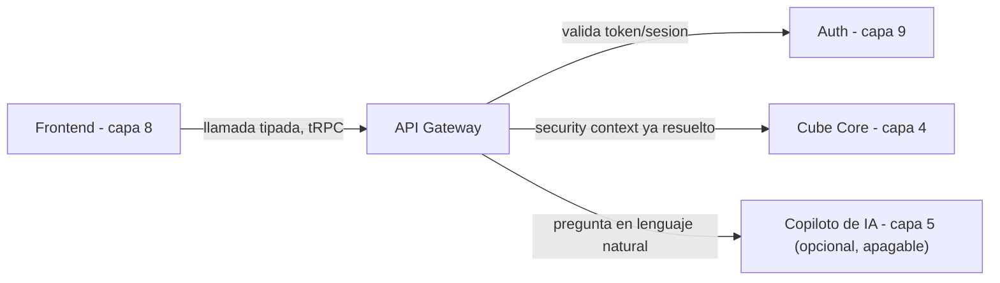

# Capa 6: API Gateway

> Reemplazo: **el motor de consultas interno de Power BI Service → tRPC** (GraphQL, respaldado por la GraphQL Foundation bajo la Linux Foundation, como alternativa de máxima seguridad si en algún momento aparecen clientes no-TypeScript — ver sección 4)
>
> **Corrección de gobernanza:** una versión anterior de este documento recomendaba oRPC. Se revierte a tRPC por la regla 7 de `CLAUDE.md` (gobernanza sobre riesgo de abandono): oRPC es sostenido por un mantenedor con sponsors de GitHub, sin empresa ni comunidad de escala detrás — descalifica bajo esa regla, sin importar sus ventajas técnicas (OpenAPI nativo). tRPC, aunque tampoco tiene una fundación, tiene una masa de adopción (~35.000 estrellas, base del ecosistema T3, uso en producción en una cantidad de empresas tal que el proyecto sobrevive aunque su mantenedor original se baje) que lo pone en una categoría de riesgo muy distinta.

---

## 1. Responsabilidad única de esta capa

Ser el único punto de entrada entre el frontend (capa 8) y todo lo que hay detrás (capa semántica, capa 4; copiloto de IA, capa 5), con un contrato tipado, versionado, y con los permisos ya validados antes de reenviar la consulta.

**Esta capa NO debe saber:**
- Nada de cómo se calcula una métrica (eso es la capa 4) ni de cómo se arma una respuesta de IA (capa 5) — solo enruta y valida.
- Nada de cómo se renderiza un componente en el frontend.
- Nada de la lógica interna de autenticación (capa 9) — solo verifica el token/sesión ya emitido y lo traduce al contexto que la capa 4 espera (security context de Cube).

Si esta capa empieza a calcular algo por su cuenta o a decidir qué puede ver un usuario sin pasar ese criterio a la capa 4/9, el diseño está roto.

### 1.1 Runtime concreto — corrección de un hueco real

**Señalado en una revisión posterior: "TypeScript + tRPC + OpenAPI" describe el contrato, pero nunca se dijo dónde corre nada de esto — tRPC no es un servidor HTTP por sí solo.** Se congela:

```
SvelteKit (capa 8)
   ↓
Fastify
 ├── tRPC (BFF interno, sección 4)
 ├── OpenAPI (API pública, sección 4.1)
 ├── better-auth (capa 9, montado como plugin)
 ├── /health, /ready (19-operabilidad-runtime.md §9)
 ├── middleware de OpenTelemetry (11-infraestructura.md §4.6)
 └── adaptadores hacia Cube (REST/GraphQL y, cuando se valide, SQL API)
```

**Fastify**, no Express ni un servidor a medida — verificado: es un proyecto de la **OpenJS Foundation** (misma categoría de gobernanza que Node.js, jQuery, Electron), con arquitectura de plugins, soporte TypeScript de primera clase, y **tRPC lo lista oficialmente entre sus adaptadores soportados** — no hace falta un adaptador comunitario de terceros para conectar las dos piezas.

---

## 2. Qué reemplazamos y por qué

En Power BI, el frontend (Desktop/Service) y el motor de consultas están fuertemente acoplados: no existe una API pública, estable y documentada que un cliente distinto pueda consumir en igualdad de condiciones con la propia interfaz de Power BI.

---

## 3. Defectos concretos que eliminamos

| Defecto | Por qué es un problema real |
| --- | --- |
| Motor de consultas acoplado a un único frontend propietario | Ningún otro cliente puede consumir el mismo dato con la misma facilidad |
| Sin contrato de API versionado explícito | Un cambio interno puede romper una integración externa sin aviso |
| Sin punto único auditable de acceso a datos | Distintos caminos de acceso dificultan auditar quién pidió qué |

---

## 4. Qué expone esta capa al frontend — tRPC, con la corrección de gobernanza aplicada

### 4.1 El contexto no cambió: monorepo TypeScript, un solo cliente principal

El frontend (capa 8) sigue siendo SvelteKit + Svelte 5, en el mismo monorepo TypeScript que el resto del proyecto. Compartir tipos de extremo a extremo sin generar código sigue siendo la prioridad — eso no cambió entre tRPC y oRPC, es el argumento de fondo que sostenía a los dos.

### 4.2 Por qué tRPC y no oRPC, aplicando la regla 7 sin excepciones

oRPC resolvía un problema real (generación nativa de OpenAPI, sin atarse a Zod) mejor que tRPC. Pero bajo la regla de gobernanza del proyecto, eso no alcanza: **oRPC es un proyecto sostenido por un desarrollador con financiamiento de sponsors de GitHub** (planes de sponsorship, sin una empresa ni una comunidad de escala equivalente detrás). Es exactamente el patrón que la regla 7 descalifica sin excepción, sin importar cuán buena sea la propuesta técnica.

**tRPC**, medido contra el checklist de la regla 7 (no solo por "adopción masiva" como frase suelta):

| Condición | tRPC |
| --- | --- |
| Repositorio de una organización, no una cuenta personal | ✅ `trpc/trpc` |
| Equipo nombrado de varias personas, no una sola presentada como dueña | ✅ "Project leads": Sachin Raja, Julius Marminge, Alex/KATT — varios nombres, no uno solo |
| Al menos un sponsor corporativo real | ✅ Cal.com Inc., Tola, entre otros |
| Rol estructural en un ecosistema más grande | ✅ Es la pieza de tipado end-to-end del T3 Stack, del que dependen miles de proyectos |

Pasa las cuatro condiciones — no es "es popular, alcanza", es que cumple el mismo checklist que se le exige a cualquier otra herramienta en esta situación.

### 4.3 Comparación técnica directa

| Aspecto | tRPC | oRPC | GraphQL |
| --- | --- | --- | --- |
| Gobernanza | Sin fundación, pero adopción masiva (~35k stars, base del T3 Stack) | 🔴 Mantenedor + sponsors, sin empresa ni comunidad de escala — descalifica bajo regla 7 | **GraphQL Foundation, bajo la Linux Foundation** — la opción de máxima seguridad de gobernanza |
| Tipado extremo a extremo sin codegen | Sí | Sí | No (requiere `graphql-codegen`) |
| OpenAPI nativo | No (adaptador no oficial) | Sí, de fábrica | No aplica (schema propio) |
| Clientes no-TypeScript | Requiere adaptador | Vía OpenAPI | Sí, es su razón de ser |
| Encaje con este proyecto | Alto — mismo monorepo TS, un cliente principal | Alto técnicamente, descalificado por gobernanza | Sobra para un solo cliente TypeScript hoy |

### 4.4 Decisión para este proyecto: tRPC

1. **Pasa la regla de gobernanza sin objeciones** — adopción masiva, base de un stack completo del ecosistema, no depende de un solo sponsor.
2. **No sacrifica la experiencia de desarrollo** que hacía atractiva a la elección original: tipos compartidos automáticamente, cero generación de código.
3. **El costo de no tener OpenAPI nativo es aceptable y resoluble**: la generación de un contrato OpenAPI a partir de tRPC es un problema activo del propio ecosistema (sección 4.1) — no vale la pena adoptar hoy una herramienta con menor respaldo (oRPC) solo para evitarlo.

**Cuándo ir directo a GraphQL en vez de al adaptador:** si la necesidad de clientes no-TypeScript se vuelve central (no una excepción puntual), la opción de **máxima seguridad de gobernanza** es GraphQL, cuya especificación está gobernada por la **GraphQL Foundation dentro de la Linux Foundation** — gobernanza neutral real, no una empresa. El costo es la ceremonia de siempre (SDL, resolvers, codegen), pero es la opción que ninguna auditoría de gobernanza podría objetar. Cube Core (capa 4) ya expone su propia API GraphQL nativa, así que ese camino está disponible sin construir nada extra si hiciera falta.

### 4.1 Dos fronteras, no una — corrección de un supuesto implícito

**Una revisión externa señaló, con razón, que este documento venía razonando en círculo: "hoy hay un solo cliente TypeScript, por lo tanto tRPC" — y ese razonamiento nunca se revisa a sí mismo, porque la arquitectura ya decidió de antemano que solo iba a haber un cliente TypeScript.** Para una aplicación web sola, ese razonamiento está bien. Para una plataforma que aspira a tener SDK en Python, una CLI, embedding en portales de terceros, agentes externos, o eventualmente un cliente mobile — asumir que "el único cliente" seguirá siendo TypeScript para siempre es la premisa que habría que cuestionar, no dar por sentada.

**La corrección: esta capa define dos fronteras distintas desde el diseño, no una sola que se estira después.**

| Frontera | Para quién | Tecnología |
| --- | --- | --- |
| **BFF interno** (Backend-for-Frontend) | El frontend propio (SvelteKit, capa 8) — optimizado para esa conversación específica | tRPC (sección 4) |
| **API pública estable** | Cualquier consumidor externo: SDK de Python, una CLI, integraciones embebidas, agentes de terceros, un futuro cliente mobile | REST/OpenAPI (generado, no mantenido a mano) — o GraphQL si predomina la necesidad de consultas flexibles de campos específicos |

**Esto no significa abandonar tRPC ni construir dos veces la misma lógica.** El BFF interno sigue siendo tRPC, sin cambios. **El contrato de la API pública es OpenAPI 3.x — nunca una librería específica.** Esta distinción importa porque la implementación de referencia cambió de manos en el medio de este proyecto: `trpc-openapi` (el adaptador que la primera versión de este documento mencionaba) **fue archivado por su dueño en noviembre de 2024, "por falta de mantenedores"** — es exactamente el riesgo de gobernanza que la regla 7 pide evitar, y en este caso ya se materializó. El propio equipo de tRPC está construyendo un paquete oficial, `@trpc/openapi`, que genera el spec por análisis estático de los tipos del router (sin anotar cada procedimiento a mano) — pero **hoy todavía está en alpha**, sin garantía de estabilidad de API. La decisión correcta es no atarse a ninguna implementación puntual: el contrato público de esta plataforma es "un documento OpenAPI 3.x", generado por `@trpc/openapi` cuando salga de alpha, por un adaptador propio y fino mientras tanto, o por un router REST específico si ninguna de las dos opciones convence en el momento de construirlo — la decisión de *cómo* se genera se toma en la implementación, nunca en el contrato.

**Por qué no se construye esto desde el primer commit:** una API pública versionada, documentada y con compromiso de estabilidad es un compromiso real — cambiarla después de que terceros dependan de ella tiene costo. Se define la frontera (esta sección) desde el diseño, pero se empieza a publicar procedimientos ahí recién cuando exista un consumidor real que la necesite (un SDK, una integración concreta) — no antes, para no versionar y mantener una superficie pública que nadie usa todavía.

---

## 5. Qué agregamos que Power BI no tiene

- **Contrato de API único, tipado y versionado**, consumible sin generación de código.
- **Un solo punto auditable de acceso a datos.**
- **Una base de gobernanza sólida**: la herramienta elegida no depende de que una sola persona siga interesada en mantenerla.

---

## 6. Arquitectura interna de esta capa



### 6.1 Qué hace esta capa en cada request — corregido, rol y entitlements por separado

1. Recibe la llamada del frontend con el token de sesión (identidad y organización, nunca un rol de workspace — ver `09-auth-gobernanza.md`, sección 6.1).
2. Valida la identidad del token contra la capa 9 — localmente, sin preguntarle a esa capa en cada request.
3. Consulta **dos tablas por separado** (capa 9) con el `workspace_id` de la solicitud concreta: `workspace_membership` (qué puede *hacer* — el rol) y `data_entitlements` (qué datos puede *ver*, independiente del rol) — un mismo usuario puede tener rol y entitlements distintos en workspaces distintos, así que este paso no se puede saltar ni cachear de forma estática por usuario.
4. Arma el *security context* combinado (`{ user_id, organization_id, workspace_id, workspace_role, entitlements }`), lo firma como un JWT corto (con `CUBEJS_API_SECRET`), y lo envía en el header `Authorization` de la llamada a Cube — **nunca como un campo suelto dentro de la query**. Esto describe el camino de **REST/GraphQL** (`checkAuth`); el **SQL API** (`/v1/cubesql`) usa `checkSqlAuth`, un mecanismo distinto — ver `17-self-service-calculations.md` secciones 3.2.3/3.2.4 para el experimento pendiente de validarlo.
5. Reenvía la consulta a Cube Core (capa 4) o al copiloto (capa 5), y devuelve la respuesta sin transformarla con lógica de negocio propia.

### 6.2 Por qué no se expone Cube Core directo al frontend

Aunque Cube Core ya tiene su propia API REST/GraphQL, no se expone directo a internet: esta capa valida el token de cada request antes de reenviarlo.

---

## 7. Contrato de esta capa (qué consume, qué expone)

- **Consume**: la API de la capa semántica (capa 4) y, cuando aplica, la interfaz de la capa 5. Nunca el warehouse directo.
- **Expone**: dos superficies — procedimientos tRPC tipados para el frontend interno (capa 8), y un contrato OpenAPI 3.x versionado para cualquier consumidor externo (SDK, CLI, integraciones, agentes) cuando exista uno real (sección 4.1). **Corrección: la implementación puede compartir schemas/lógica con tRPC, pero no existe obligación de derivar una de la otra** — cómo se genera OpenAPI (`@trpc/openapi`, un adaptador propio, o un router REST específico) sigue siendo una decisión de implementación, no un requisito del contrato.
- **No expone**: ninguna lógica de negocio propia.

---

## 8. Por dónde empezar a construir (paso a paso concreto)

1. `pnpm add @trpc/server @trpc/client` dentro de `packages/api-gateway`.
2. Definir un primer procedimiento (`getMetric`) que llame a la API REST de Cube Core (capa 4).
3. Conectar la validación de token contra la capa 9 (o un stub mientras esa capa no exista).
4. Consumir ese procedimiento desde un cliente de prueba y confirmar que los tipos se infieren correctamente.
5. Recién con 2-3 procedimientos estables, conectar el frontend real (documento siguiente).

---

## 9. Ideas rescatadas de otros líderes de BI: procedimientos de escritura y un "Action Hub" abierto

Hasta ahora esta capa solo tenía procedimientos de **lectura** (`getMetric` y similares). Dos líderes de BI muestran que una plataforma moderna necesita también un camino de **escritura** y de **acción** — y los dos casos aparecieron ya anotados como pendientes en capas anteriores.

### 9.1 Cierre del pendiente de la Capa 2: procedimiento de escritura para "Input Tables"

La Capa 2 (sección 9) dejó pendiente un endpoint que **escriba**, no solo que consulte, para soportar el patrón de Sigma (usuarios de negocio escribiendo ajustes/forecasts directo al warehouse). Se resuelve con una categoría nueva de procedimiento tRPC, con una regla de seguridad más estricta que la de lectura:

```ts
// packages/api-gateway/src/procedures/writeInput.ts
export const writeInput = protectedProcedure
  .input(z.object({
    tabla: z.literal('raw_input_ajustes_forecast'), // whitelist explícita, nunca un nombre de tabla libre
    fila: z.record(z.unknown()),
  }))
  .mutation(async ({ input, ctx }) => {
    await assertPuedeEscribir(ctx.usuario, input.tabla); // RLS de escritura — capa 9, ver nota abajo
    return escribirFila(input.tabla, { ...input.fila, usuario_que_edito: ctx.usuario.id, editado_en: new Date() });
  });
```

**La diferencia real con un procedimiento de lectura, no solo sintáctica:** una `query` (lectura) es segura de reintentar y de cachear; una `mutation` (escritura) no. El procedimiento de escritura lista explícitamente **a qué tablas se puede escribir** (nunca un nombre de tabla como parámetro libre) y siempre queda una fila de auditoría (`usuario_que_edito`, `editado_en`) — esto todavía necesita que la Capa 9 defina qué es "RLS de escritura" (quién puede escribir en qué fila), que sigue pendiente en ese documento.

### 9.2 Un "Action Hub" abierto, inspirado en Looker Actions — con el hueco de SSRF cerrado

**Looker Actions** deja "accionar" sobre un resultado de datos (activar una campaña, marcar una transacción como fraude, mandar un mensaje) sin acoplar el BI a un proveedor específico: define un contrato HTTP abierto (Action API), cualquiera puede implementar un servicio que lo hable, y el propio "Action Hub" que lo aloja se puede self-hostear en infraestructura propia — exactamente el mismo principio de protocolo-sobre-proveedor que ya aplicamos en la Capa 11.

**Corrección de un hueco de seguridad real, señalado por una revisión externa.** La versión anterior de esta sección describía `triggerAction` como si reenviara a "un webhook configurado por el usuario" en el momento de la llamada — es decir, aceptando una URL como parámetro de la request. Eso es un vector clásico de **SSRF** (Server-Side Request Forgery): sin restricción, nada impide que alguien haga que el servidor de la plataforma le pegue a `http://169.254.169.254/` (el endpoint de metadata de la nube) o a un servicio interno de la red que no debería ser alcanzable desde afuera.

**La corrección: los webhooks se registran de antemano, nunca se reciben como parámetro libre en tiempo de ejecución.**

1. Un rol con permiso de administración (capa 9) **registra** un webhook una vez, con nombre y URL, en una tabla propia (`gobernanza.webhooks_registrados`).
2. Al registrarlo, la API Gateway **resuelve el dominio y rechaza el registro** si la IP resultante cae en rangos privados/reservados (`127.0.0.0/8`, `10.0.0.0/8`, `172.16.0.0/12`, `192.168.0.0/16`, `169.254.0.0/16` — el rango de metadata de nube incluido) — esto se revalida en cada ejecución, no solo al registrar, porque un DNS puede cambiar a qué IP apunta después.
3. `triggerAction` **nunca recibe una URL como parámetro** — recibe el `id` de un webhook ya registrado:

```ts
// packages/api-gateway/src/procedures/triggerAction.ts
export const triggerAction = protectedProcedure
  .input(z.object({
    webhookId: z.string(), // referencia a gobernanza.webhooks_registrados — nunca una URL libre
    accion: z.string(),
    datos: z.record(z.unknown()),
  }))
  .mutation(async ({ input, ctx }) => {
    const webhook = await obtenerWebhookRegistrado(input.webhookId); // ya validado al registrarse
    await assertUrlNoEsPrivada(webhook.url); // revalidación en cada ejecución, no solo al registrar
    return fetch(webhook.url, {
      method: 'POST',
      body: JSON.stringify({ accion: input.accion, datos: input.datos, usuario: ctx.usuario.email }),
      signal: AbortSignal.timeout(5000), // timeout corto, sin colgar la request del usuario
    });
  });
```

```ts
// Contrato mínimo del Action Hub: HTTP + JSON, sin SDK propietario
POST https://mi-webhook.example.com/accion
{
  "accion": "notificar_anomalia",
  "datos": { "metrica": "total_sales", "valor": 12000, "esperado": 18000 },
  "usuario": "analista@empresa.com"
}
```

Cualquiera puede escribir un servicio que reciba ese JSON — no hace falta que este proyecto mantenga un conector oficial por cada sistema externo posible. Esto cierra, de paso, el pendiente de la Capa 5 (sección 9) de mandar el digest a "cualquier canal": Slack, un CRM, o lo que sea, se resuelve con el mismo Action Hub, no con integraciones separadas por canal — con el registro previo y la validación de rango de IP como parte fija del contrato, no como un detalle de implementación librado a quien lo construya.

---

**Siguiente documento:** `07-orquestacion.md` — Apache Airflow orquestando el pipeline completo.
