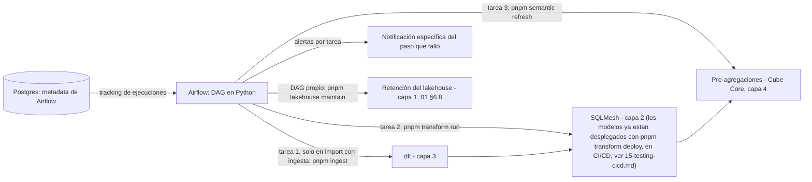

# Capa 7: Orquestación

> Reemplazo: **el motor de refresco programado de Power BI Service → Apache Airflow**
>
> **Corrección de gobernanza:** una versión anterior de este documento recomendaba Kestra. Se corrige a Apache Airflow por la regla 7 de `CLAUDE.md`: Kestra es sostenido por una sola empresa (Kestra Technologies, financiada por capital de riesgo); Airflow es un proyecto de nivel superior de la **Apache Software Foundation**, sin dueño único, y además se modernizó en serio en su versión 3.0 (versionado de DAGs, scheduling basado en eventos, UI rediseñada) — cumple gobernanza, estándar de facto, y "moderno" al mismo tiempo, sin trade-off.

---

## 1. Responsabilidad única de esta capa

Programar, encadenar y monitorear la ejecución de todo el pipeline: ingesta (capa 3) → transformación (capa 2) → refresco de pre-agregaciones en la capa semántica (capa 4). No contiene lógica de negocio propia.

**Esta capa NO debe saber:**
- Nada de cómo se transforma un dato (capa 2) ni de cómo se extrae (capa 3).
- Nada de qué es una métrica (capa 4).
- Nada de autenticación de usuarios finales.

---

## 2. Qué hacía el motor de refresco de Power BI Service exactamente

- Refresco programado "cada X horas", sin manejo real de dependencias entre datasets.
- Todo o nada: si el refresco falla en un punto, no hay forma granular de reintentar solo esa parte.
- Alertas genéricas, sin indicar qué falló específicamente.
- Sin backfills programáticos.

---

## 3. Defectos concretos que eliminamos

| Defecto | Por qué es un problema real |
| --- | --- |
| Refresco monolítico "todo o nada" | Un fallo en una fuente tira abajo el refresco completo |
| Sin dependencias explícitas entre pasos | El orden depende de configuración manual, no de una declaración verificable |
| Alertas genéricas | Hay que investigar manualmente qué falló |
| Sin backfills de primera clase | Recalcular un rango de fechas puntual no tiene flujo dedicado |

---

## 4. Por qué Apache Airflow — gobernanza, estándar y modernidad, sin trade-off

### 4.1 El error del documento anterior

La versión previa eligió Kestra sobre Dagster razonando correctamente sobre coherencia de stack (agnóstico de lenguaje, YAML declarativo como Cube) y sobre el ruido de gobernanza que generó la adquisición de Dagster Labs por Prefect. Pero no aplicó la misma vara a Kestra: **Kestra Technologies es una sola empresa con financiamiento de capital de riesgo**, ni más ni menos expuesta a M&A, cambios de estrategia o cierre que cualquier otra startup — exactamente lo que la regla 7 pide evitar.

### 4.2 Apache Airflow cumple las tres condiciones a la vez

- **Gobernanza**: proyecto de nivel superior de la Apache Software Foundation desde 2016 — sin empresa dueña, gobernado por un comité de proyecto (PMC) con committers de múltiples organizaciones.
- **Estándar de facto**: el orquestador más desplegado del mundo, adoptado por una porción enorme del Fortune 500, con cientos de miles de instalaciones — si hay una palabra para describir a Airflow en esta categoría, es "el estándar", no "una opción moderna entre varias".
- **Moderno, no solo viejo-pero-estable**: Airflow 3.0 (2025) fue una modernización real, no un parche — versionado de DAGs (poder ver y comparar versiones históricas de un pipeline), scheduling basado en eventos (no solo cron), y una UI reescrita. El ritmo de releases en 2026 es alto, no es un proyecto en piloto automático.

### 4.3 Comparación técnica directa

| Aspecto | Apache Airflow | Kestra | Dagster |
| --- | --- | --- | --- |
| Gobernanza | **Apache Software Foundation** | Empresa única (Kestra Technologies) | Empresa única, en transición por adquisición de Prefect |
| Definición de flujos | Python | YAML | Python ("assets") |
| Adopción | La más grande del mercado, "el estándar" | Creciente pero muy por detrás | Fuerte en nichos analytics-engineering |
| Modernización reciente | Airflow 3.0: DAGs versionados, scheduling por eventos, UI nueva | YAML + agnóstico de lenguaje desde el inicio | Modelo de "assets" con lineage nativo |
| Coherencia con el resto del stack | Alta — Python, igual que SQLMesh (capa 2) y dlt (capa 3) | Alta en paradigma declarativo, pero introduce YAML como tercer formato | Media — introduce "assets" como paradigma nuevo |

### 4.4 Decisión para este proyecto: Apache Airflow

1. **Pasa la regla de gobernanza sin objeción alguna** — es, literalmente, el ejemplo de libro de un proyecto gobernado por una fundación.
2. **Es más coherente con el resto del stack de lo que Kestra era, aunque este punto pesa menos de lo que el resto del documento sugiere**: los DAGs se escriben en Python, el mismo lenguaje que ya usan SQLMesh (capa 2) y dlt (capa 3). Dicho con honestidad: un DAG que solo encadena 4-5 tareas no necesita "coherencia de lenguaje" para ser mantenible — un YAML de Kestra de ese tamaño también se lee bien. El argumento real y decisivo es la regla 7 (gobernanza), no este; la coherencia de lenguaje es una ventaja real pero secundaria, no la razón de fondo de la elección.
3. **La modernización de la versión 3.0 responde directamente a la objeción de "es viejo y pesado"** que existía en versiones anteriores — DAGs versionados y triggers por eventos son capacidades genuinamente actuales, no una capa de marketing sobre una arquitectura de 2015.
4. **No hay trade-off que aceptar**: a diferencia de la Capa 3 (ingesta), acá la opción gobernada por fundación es también la más adoptada y la que mejor encaja técnicamente — no hay que sacrificar nada para cumplir la regla 7.

**Honestidad sobre los límites:** Airflow sigue teniendo más piezas operativas que levantar (scheduler, webserver, base de metadata, workers) comparado con la simplicidad de un solo binario de Kestra — es un sistema más grande, con más superficie para configurar. Eso es un costo operativo real, no gratis, pero es el precio de elegir el estándar gobernado por una fundación en vez de una herramienta más nueva y liviana de una startup.

---

## 5. Qué agregamos que Power BI no tiene

- **Dependencias explícitas entre pasos del pipeline**, declaradas en código Python versionado en Git.
- **Reintentos y alertas por tarea específica.**
- **Backfills programáticos** de primera clase — de hecho, uno de los casos de uso originales de Airflow.
- **Versionado de DAGs** (Airflow 3.0): poder ver y comparar cómo era el pipeline en una fecha pasada.

---

## 6. Arquitectura interna de esta capa



### 6.1 Un DAG por pipeline, dependencias explícitas en código

```python
from airflow.sdk import DAG, task
from datetime import datetime

with DAG("pipeline_diario", start_date=datetime(2026, 1, 1), schedule="@daily") as dag:

    @task
    def ingesta():
        # pnpm --reporter=silent ingest <source> --json (capa 3) — solo para fuentes con
        # import con ingesta (02-transformacion.md §6.1.1). En el import directo no hay
        # tarea de extracción: `transform run` lee la fuente registrada.
        ...

    @task
    def transformacion():
        # pnpm --reporter=silent transform run --json — NUNCA `transform deploy` acá: los
        # modelos ya están desplegados (eso corre en CI/CD, ver 15-testing-cicd.md). Esta
        # tarea solo procesa el intervalo de datos pendiente de los modelos ya vigentes.
        ...

    @task
    def refresco_semantico():
        # pnpm --reporter=silent semantic refresh --json — reconstruye las
        # pre-agregaciones de Cube Core con lo que la transformación acaba de publicar
        ...

    ingesta() >> transformacion() >> refresco_semantico()
```

Cada tarea (`@task`) es una unidad de reintento y alerta independiente.

**El mantenimiento del lakehouse va en un DAG propio**, no dentro de los de datos: expira versiones, limpia archivos viejos y huérfanos y compacta según la política de retención (`01-motor-almacenamiento.md` §6.8), con `pnpm lakehouse maintain` (Plan C, §7.1), la operación administrativa de la plataforma — nunca con SQL de mantenimiento suelto en un DAG.

### 6.2 Backfills, en concreto

Airflow permite re-ejecutar un DAG para un rango de fechas pasado sin tocar el resto del pipeline — reutilizando la capacidad de *backfill* selectivo que SQLMesh ya expone en la capa 2, orquestada desde acá en vez de reinventada. **Corrección de sintaxis (Airflow 3):** el comando actual es `airflow backfill create --dag-id <id> --from-date <fecha> --to-date <fecha>` — el viejo `airflow dags backfill` quedó reemplazado por este subcomando dedicado, con más control (comportamiento de reprocesamiento, `--run-backwards`, límite de corridas concurrentes).

---

## 7. Contrato de esta capa (qué consume, qué expone)

- **Consume**: los verbos de trabajo de la plataforma, uno por capa (§7.1), nunca la CLI ni la API de una herramienta:
  - `pnpm ingest <source>` (capa 3), cuando la fuente usa ingesta;
  - `pnpm transform run` (capa 2), la ejecución diaria — nunca `transform deploy`, que es despliegue de CI/CD y no operación diaria (`15-testing-cicd.md`), ni `transform tool`, que es solo para desarrollo;
  - `pnpm semantic refresh` (capa 4), el refresco de las pre-agregaciones;
  - `pnpm lakehouse maintain` (capa 1), la retención del lakehouse.
- **Expone**: una UI/API de monitoreo de ejecuciones, historial de corridas, y alertas por tarea.
- **No expone**: ninguna transformación ni definición de métrica propia.

### 7.1 Los trabajos: códigos de salida y resumen (Paso 7 y Plan C)

Cada tarea llama a un verbo de trabajo de la plataforma con `--json` y decide con dos cosas: el código de salida y el resumen JSON. Todos los resúmenes (`@atlasbi/contracts`, `jobs/`) comparten el mismo sobre: `status`, `exitCode`, `retryable`, `startedAt`, `finishedAt` y, si falló, `error`, con un código cerrado y un mensaje propio de la plataforma, nunca el de la herramienta. Cada trabajo versiona aparte lo que agrega:

| Verbo | Resumen | Qué agrega al sobre |
| --- | --- | --- |
| `pnpm ingest <source>` | `IngestSummary` 1.0 (Paso 7) | Qué cargó por partición (`loads`) y qué quedó en el landing (`landing`) |
| `pnpm transform run` · `deploy` · `test` · `check` | `TransformJobSummary` 1.0 | `verb` y cada modelo evaluado (`models`: intervalos, duración, auditorías que pasaron y que fallaron); `deploy` suma qué cambió (`changes`), `test` los unit tests (`tests`), `check` las reglas del proyecto (`lint`) y las auditorías (`audits`) |
| `pnpm semantic refresh` | `SemanticRefreshSummary` 1.0 | Cada pre-agregación reconstruida o fallida (`builds`) |
| `pnpm lakehouse maintain` | `LakehouseMaintenanceSummary` 1.0 | `dryRun`, la política aplicada, versiones expiradas, archivos y huérfanos borrados, tablas compactadas y notas para una persona (`notes`) |

Los códigos de salida son los mismos para todos:

| Código | Significado | Qué hace Airflow |
| --- | --- | --- |
| 0 | Terminó bien | Sigue con la tarea siguiente |
| 64 | Uso incorrecto del comando | Falla sin reintento: es un error del DAG |
| 65 | Los datos. En la ingesta, un tipo de columna que cambió o un contrato que no se cumple. En la transformación, un modelo inválido o que falla, una auditoría o un unit test (`model_invalid`, `model_failed`, `audit_failed`, `test_failed`). En el refresco, una pre-agregación que no se pudo construir (`build_failed`) | Falla sin reintento **y alerta**: hay que revisar la fuente, el modelo o el contrato (ver abajo) |
| 70 | Error interno | Falla sin reintento; el detalle sale con `ATLASBI_INGEST_DEBUG=1` o `ATLASBI_TRANSFORM_DEBUG=1` |
| **75** | **Reintentable:** la fuente, el catálogo, el almacenamiento, el estado de la transformación o la capa semántica no respondieron, o no terminaron a tiempo | Reintenta tal cual: la ingesta retoma la carga que falló sin duplicarla, y `transform run` evalúa solo los intervalos que siguen pendientes |
| 77 | Credenciales rechazadas (la fuente, el lakehouse o el estado) | Falla sin reintento y avisa |
| 78 | Configuración: falta un secreto o una variable, el entorno no está preparado, o el nivel no tiene esa pieza (el portátil no tiene capa semántica que refrescar) | Falla sin reintento |

`retryable` del resumen es `true` exactamente cuando el código es 75.

**Un 65 de `transform` tiene que alertar, no solo marcar la tarea como fallida (Plan C, Fase C).** Una auditoría fallida no protege a quien lee el mart: SQLMesh escribe primero y audita después. Medido en vivo con un evento repetido en el landing de GitHub: `transform run` salió con 65 (`audit_failed`) y el mart ya tenía 597 filas en vez de 596. Esas filas siguen visibles hasta que una corrida posterior lo reconstruye con el dato o el modelo corregidos; el intervalo queda pendiente, así que esa corrida llega sola. Por eso el refresco semántico no corre después de un 65, y alguien tiene que enterarse. Si una auditoría debe bloquear antes de publicar (escribir en otro entorno, auditar y recién después promover), se mide en la Fase 0 del Paso 8.

**`transform deploy` y `transform tool` nunca van en un DAG.** `deploy` es despliegue y corre en CI/CD (`15-testing-cicd.md`); `tool` le pasa sus argumentos a la herramienta, fuera de este contrato, y es solo para desarrollo (`02-transformacion.md` §6.5).

**El DAG de mantenimiento** llama a `pnpm lakehouse maintain` con la política de retención del `.env` (`01-motor-almacenamiento.md` §6.8). Fuera de desarrollo (`ATLASBI_ENV` distinto de `development`), una corrida real pide confirmación, así que el DAG pasa `--confirm=atlasbi` de forma explícita. Con catálogo SQLite, un escritor en curso bloquea el catálogo y el mantenimiento sale con 75: se reintenta.

**Cómo llamarlos para que stdout tenga solo el JSON (hallazgo del Paso 7).** `pnpm -s ingest github --json` no alcanza: cuando el comando falla, pnpm 11 igual escribe en stdout su línea `[ELIFECYCLE] Command failed with exit code N.`, después del resumen. Con **`pnpm --reporter=silent <verbo> … --json`** (o `pnpm run --silent …`), stdout lleva solo el resumen; está probado con pnpm 11.27.1. El progreso para una persona, y la salida de la herramienta, van siempre a stderr. En la Fase C del Plan C se probó en vivo con `transform run` y `transform deploy`, en los tres casos (0, 65 y 75): stdout fue una sola línea de JSON en los seis.

**Cuándo llega lo ingerido al mart (hallazgo del Paso 7).** El mart de GitHub (`marts.mart_github_repo_events`) tiene `cron '@daily'`: `transform run` lo reconstruye una vez por intervalo diario, que cierra a las 00:00 UTC. Lo que se ingiere más tarde en el día, después de esa corrida, llega al mart al día siguiente: `transform run` no evalúa ningún modelo (`models` vacío) hasta que cierre el próximo intervalo (medido en la Fase C). **El horario del DAG tiene que tenerlo en cuenta:** encadenar la ingesta antes de `transform run` dentro del mismo intervalo, o cambiar el `cron` del mart si hace falta más frescura. Nunca forzar un `transform deploy` para refrescar: eso es despliegue, no operación diaria (`15-testing-cicd.md`).

---

## 8. Por dónde empezar a construir (paso a paso concreto)

1. Levantar Airflow localmente vía Docker Compose (imagen oficial, Postgres como backend de metadata).
2. Escribir el primer DAG con dos tareas: `pnpm ingest` de la primera fuente con ingesta (capa 3), y encadenar `pnpm transform run` (capa 2) con `>>` — el despliegue de cambios de modelo (`pnpm transform deploy`) ya debería haber corrido en CI/CD antes de este punto, ver `15-testing-cicd.md`. Cada tarea decide por el código de salida (§7.1).
3. Correrlo manualmente desde la UI y verificar que el orden de dependencias se respeta.
4. Agregar la tercera tarea (`pnpm semantic refresh`, capa 4) al final de la cadena, y el DAG propio de `pnpm lakehouse maintain`.
5. Programar el DAG con `schedule` y confirmar que una alerta se dispara específicamente en la tarea que se hace fallar a propósito — también con un 65 de `transform run`, que alerta aunque no se reintente (§7.1).
6. Recién con el pipeline diario estable, construir el backfill como un comando parametrizado sobre el mismo DAG.

---

**Siguiente documento:** `08-frontend.md` — SvelteKit + Svelte 5 + ECharts, el frontend que consume la API Gateway (capa 6).
