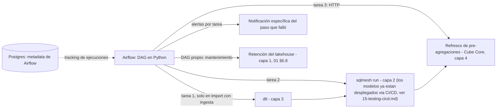

# Capa 7: Orquestación

> Reemplazo: **el motor de refresco programado de Power BI Service → Apache Airflow**
>
> **Corrección de gobernanza:** una versión anterior de este documento recomendaba Kestra. Se corrige a Apache Airflow por la regla 7 de `CLAUDE.md`: Kestra es sostenido por una sola empresa (Kestra Technologies, financiada por capital de riesgo); Airflow es un proyecto de nivel superior de la **Apache Software Foundation**, sin dueño único, y además se modernizó en serio en su versión 3.0 (versionado de DAGs, scheduling basado en eventos, UI rediseñada) — cumple gobernanza, estándar de facto, y "moderno" al mismo tiempo, sin trade-off.

---

## 1. Responsabilidad única de esta capa

Programar, encadenar y monitorear la ejecución de todo el pipeline: ingesta (capa 3) → transformación (capa 2) → refresco de pre-agregaciones en la capa semántica (capa 4). No contiene lógica de negocio propia.

**Esta capa NO debe saber:**
- Nada de cómo se transforma un dato (capa 2) ni de cómo se extrae (capa 3).
- Nada de qué es una métrica (capa 4).
- Nada de autenticación de usuarios finales.

---

## 2. Qué hacía el motor de refresco de Power BI Service exactamente

- Refresco programado "cada X horas", sin manejo real de dependencias entre datasets.
- Todo o nada: si el refresco falla en un punto, no hay forma granular de reintentar solo esa parte.
- Alertas genéricas, sin indicar qué falló específicamente.
- Sin backfills programáticos.

---

## 3. Defectos concretos que eliminamos

| Defecto | Por qué es un problema real |
| --- | --- |
| Refresco monolítico "todo o nada" | Un fallo en una fuente tira abajo el refresco completo |
| Sin dependencias explícitas entre pasos | El orden depende de configuración manual, no de una declaración verificable |
| Alertas genéricas | Hay que investigar manualmente qué falló |
| Sin backfills de primera clase | Recalcular un rango de fechas puntual no tiene flujo dedicado |

---

## 4. Por qué Apache Airflow — gobernanza, estándar y modernidad, sin trade-off

### 4.1 El error del documento anterior

La versión previa eligió Kestra sobre Dagster razonando correctamente sobre coherencia de stack (agnóstico de lenguaje, YAML declarativo como Cube) y sobre el ruido de gobernanza que generó la adquisición de Dagster Labs por Prefect. Pero no aplicó la misma vara a Kestra: **Kestra Technologies es una sola empresa con financiamiento de capital de riesgo**, ni más ni menos expuesta a M&A, cambios de estrategia o cierre que cualquier otra startup — exactamente lo que la regla 7 pide evitar.

### 4.2 Apache Airflow cumple las tres condiciones a la vez

- **Gobernanza**: proyecto de nivel superior de la Apache Software Foundation desde 2016 — sin empresa dueña, gobernado por un comité de proyecto (PMC) con committers de múltiples organizaciones.
- **Estándar de facto**: el orquestador más desplegado del mundo, adoptado por una porción enorme del Fortune 500, con cientos de miles de instalaciones — si hay una palabra para describir a Airflow en esta categoría, es "el estándar", no "una opción moderna entre varias".
- **Moderno, no solo viejo-pero-estable**: Airflow 3.0 (2025) fue una modernización real, no un parche — versionado de DAGs (poder ver y comparar versiones históricas de un pipeline), scheduling basado en eventos (no solo cron), y una UI reescrita. El ritmo de releases en 2026 es alto, no es un proyecto en piloto automático.

### 4.3 Comparación técnica directa

| Aspecto | Apache Airflow | Kestra | Dagster |
| --- | --- | --- | --- |
| Gobernanza | **Apache Software Foundation** | Empresa única (Kestra Technologies) | Empresa única, en transición por adquisición de Prefect |
| Definición de flujos | Python | YAML | Python ("assets") |
| Adopción | La más grande del mercado, "el estándar" | Creciente pero muy por detrás | Fuerte en nichos analytics-engineering |
| Modernización reciente | Airflow 3.0: DAGs versionados, scheduling por eventos, UI nueva | YAML + agnóstico de lenguaje desde el inicio | Modelo de "assets" con lineage nativo |
| Coherencia con el resto del stack | Alta — Python, igual que SQLMesh (capa 2) y dlt (capa 3) | Alta en paradigma declarativo, pero introduce YAML como tercer formato | Media — introduce "assets" como paradigma nuevo |

### 4.4 Decisión para este proyecto: Apache Airflow

1. **Pasa la regla de gobernanza sin objeción alguna** — es, literalmente, el ejemplo de libro de un proyecto gobernado por una fundación.
2. **Es más coherente con el resto del stack de lo que Kestra era, aunque este punto pesa menos de lo que el resto del documento sugiere**: los DAGs se escriben en Python, el mismo lenguaje que ya usan SQLMesh (capa 2) y dlt (capa 3). Dicho con honestidad: un DAG que solo encadena 4-5 tareas no necesita "coherencia de lenguaje" para ser mantenible — un YAML de Kestra de ese tamaño también se lee bien. El argumento real y decisivo es la regla 7 (gobernanza), no este; la coherencia de lenguaje es una ventaja real pero secundaria, no la razón de fondo de la elección.
3. **La modernización de la versión 3.0 responde directamente a la objeción de "es viejo y pesado"** que existía en versiones anteriores — DAGs versionados y triggers por eventos son capacidades genuinamente actuales, no una capa de marketing sobre una arquitectura de 2015.
4. **No hay trade-off que aceptar**: a diferencia de la Capa 3 (ingesta), acá la opción gobernada por fundación es también la más adoptada y la que mejor encaja técnicamente — no hay que sacrificar nada para cumplir la regla 7.

**Honestidad sobre los límites:** Airflow sigue teniendo más piezas operativas que levantar (scheduler, webserver, base de metadata, workers) comparado con la simplicidad de un solo binario de Kestra — es un sistema más grande, con más superficie para configurar. Eso es un costo operativo real, no gratis, pero es el precio de elegir el estándar gobernado por una fundación en vez de una herramienta más nueva y liviana de una startup.

---

## 5. Qué agregamos que Power BI no tiene

- **Dependencias explícitas entre pasos del pipeline**, declaradas en código Python versionado en Git.
- **Reintentos y alertas por tarea específica.**
- **Backfills programáticos** de primera clase — de hecho, uno de los casos de uso originales de Airflow.
- **Versionado de DAGs** (Airflow 3.0): poder ver y comparar cómo era el pipeline en una fecha pasada.

---

## 6. Arquitectura interna de esta capa



### 6.1 Un DAG por pipeline, dependencias explícitas en código

```python
from airflow.sdk import DAG, task
from datetime import datetime

with DAG("pipeline_diario", start_date=datetime(2026, 1, 1), schedule="@daily") as dag:

    @task
    def ingesta():
        # dispara el pipeline dlt de la capa 3 — solo para fuentes con import con ingesta
        # (02-transformacion.md §6.1.1). En el import directo no hay tarea de extracción:
        # `sqlmesh run` lee la fuente registrada.
        ...

    @task
    def transformacion():
        # sqlmesh run — NUNCA "plan --auto-apply" acá: los modelos ya estan
        # desplegados (eso corre en CI/CD, ver 15-testing-cicd.md). Esta tarea
        # solo procesa el intervalo de datos pendiente de los modelos ya vigentes.
        ...

    @task
    def refresco_semantico():
        # POST a la API de pre-agregaciones de Cube Core
        ...

    ingesta() >> transformacion() >> refresco_semantico()
```

Cada tarea (`@task`) es una unidad de reintento y alerta independiente.

**El mantenimiento del lakehouse va en un DAG propio**, no dentro de los de datos: expira versiones, limpia archivos viejos y huérfanos y compacta según la política de retención (`01-motor-almacenamiento.md` §6.8), a través de la operación administrativa de la plataforma — nunca con SQL de mantenimiento suelto en un DAG.

### 6.2 Backfills, en concreto

Airflow permite re-ejecutar un DAG para un rango de fechas pasado sin tocar el resto del pipeline — reutilizando la capacidad de *backfill* selectivo que SQLMesh ya expone en la capa 2, orquestada desde acá en vez de reinventada. **Corrección de sintaxis (Airflow 3):** el comando actual es `airflow backfill create --dag-id <id> --from-date <fecha> --to-date <fecha>` — el viejo `airflow dags backfill` quedó reemplazado por este subcomando dedicado, con más control (comportamiento de reprocesamiento, `--run-backwards`, límite de corridas concurrentes).

---

## 7. Contrato de esta capa (qué consume, qué expone)

- **Consume**: comandos/CLI o llamadas HTTP de cada capa (`dlt run` en capa 3 cuando la fuente usa ingesta, la operación de mantenimiento del lakehouse en capa 1, `sqlmesh run` en capa 2 para la ejecución diaria — nunca `sqlmesh plan`, que es un comando de despliegue de CI/CD, no de operación diaria, ver `15-testing-cicd.md` — el endpoint de refresco de pre-agregaciones de Cube en capa 4).
- **Expone**: una UI/API de monitoreo de ejecuciones, historial de corridas, y alertas por tarea.
- **No expone**: ninguna transformación ni definición de métrica propia.

---

## 8. Por dónde empezar a construir (paso a paso concreto)

1. Levantar Airflow localmente vía Docker Compose (imagen oficial, Postgres como backend de metadata).
2. Escribir el primer DAG con dos tareas: disparar el pipeline de dlt de la primera fuente con ingesta (capa 3), y encadenar `sqlmesh run` (capa 2) con `>>` — el despliegue de cambios de modelo (`sqlmesh plan`) ya debería haber corrido en CI/CD antes de este punto, ver `15-testing-cicd.md`.
3. Correrlo manualmente desde la UI y verificar que el orden de dependencias se respeta.
4. Agregar la tercera tarea (refresco de pre-agregaciones de Cube, capa 4) al final de la cadena.
5. Programar el DAG con `schedule` y confirmar que una alerta se dispara específicamente en la tarea que se hace fallar a propósito.
6. Recién con el pipeline diario estable, construir el backfill como un comando parametrizado sobre el mismo DAG.

---

**Siguiente documento:** `08-frontend.md` — SvelteKit + Svelte 5 + ECharts, el frontend que consume la API Gateway (capa 6).
