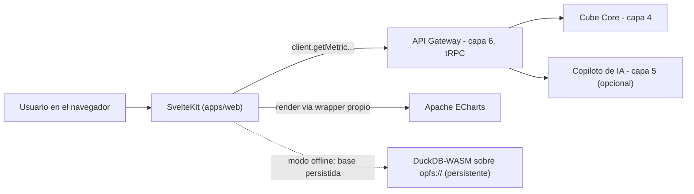

# Capa 8: Frontend / Visualización

> Reemplazo: **Power BI Desktop/Service (canvas, visuals nativos, SDK de custom visuals) → SvelteKit + Svelte 5 + Apache ECharts**
>
> **Corrección de gobernanza:** una versión anterior de este documento recomendaba LayerChart. Se corrige a Apache ECharts por la regla 7 de `CLAUDE.md`: LayerChart depende de un mantenedor principal, sin empresa ni fundación detrás; ECharts es un proyecto de la **Apache Software Foundation** desde 2018. El costo de este cambio es real y se documenta en la sección 4.2: se pierde la integración nativa con la reactividad de Svelte 5, y hay que resolverla con un wrapper delgado.

---

## 1. Responsabilidad única de esta capa

Renderizar dashboards y charts a partir de los datos que expone la API Gateway (capa 6). Es la "cara" de la plataforma.

**Esta capa NO debe saber:**
- Nada de cómo se calcula una métrica (capa 4) ni de cómo se arma una respuesta de IA (capa 5).
- Nada del esquema del warehouse ni de la capa semántica directamente.
- Nada de la lógica de autenticación en sí (capa 9).

---

## 2. Qué reemplazamos y por qué

Power BI Desktop es una aplicación de escritorio pesada, con un ciclo de "editar en Desktop → publicar a Service". Los *custom visuals* corren dentro de un sandbox de iframe con WebGL deshabilitado. La edición es de un solo usuario a la vez.

El framework (SvelteKit + Svelte 5, decisión explícita del usuario del proyecto: nada de React) no se reabre acá — es una decisión de producto, no técnica, y por eso no se audita con la misma vara de comparación que el resto de las herramientas. Razones técnicas que la sostendrían igual, para que quede dicho y no como dogma sin fundamento: sin virtual DOM (bundles más chicos, menos trabajo en cada actualización de la UI), reactividad más explícita con los *runes* de Svelte 5 (más fácil de razonar en un dashboard con muchos widgets interdependientes que el modelo de hooks/re-render de React), y una curva de aprendizaje más corta para equipos chicos. Lo que sí se revisa acá, con la misma exigencia que el resto del proyecto, es la librería de gráficos.

---

## 3. Qué eliminamos de Power BI

- El sandbox de iframe con WebGL deshabilitado.
- El ciclo pesado de "editar en Desktop, publicar a Service".
- La edición de un solo usuario a la vez.

---

## 4. Librería de gráficos — ECharts, con la corrección de gobernanza aplicada

### 4.1 Por qué se corrige LayerChart

LayerChart es técnicamente una buena elección para Svelte 5: son componentes nativos, construidos en *runes*, sin necesitar sincronizar manualmente el gráfico con los datos. Pero está sostenido por un mantenedor principal, sin empresa ni fundación — exactamente el patrón que la regla 7 descalifica sin excepción, sin importar la calidad técnica.

### 4.2 Apache ECharts: el costo real de elegir gobernanza sobre integración nativa

**Apache ECharts** es un proyecto de nivel superior de la Apache Software Foundation desde 2018, con la cobertura de tipos de gráfico más amplia de las opciones disponibles (incluyendo mapas de calor, 3D, candlesticks, grafos de red — cosas que LayerChart no tiene), renderizado adaptativo (SVG para interactividad, canvas automático para datasets grandes), y rendimiento probado en producción a gran escala en datasets con millones de puntos (la cifra exacta depende del hardware y del tipo de gráfico — conviene medirlo en el caso propio antes de citarlo como garantía, en vez de repetir un número de marketing sin verificar).

El costo real: ECharts es una librería JavaScript genérica, no un componente Svelte. Se integra montándola en un `<div>` y llamándola con un objeto de configuración (`option`) — no reacciona sola a los *runes* de Svelte 5. Hace falta un wrapper delgado propio (no una librería de terceros nueva, para no reintroducir el mismo problema de gobernanza) que conecte los dos mundos:

```svelte
<script lang="ts">
  import * as echarts from 'echarts'
  import { onMount, onDestroy } from 'svelte'

  let { data, options }: { data: unknown; options: echarts.EChartsOption } = $props()
  let container: HTMLDivElement
  let chart: echarts.ECharts

  onMount(() => {
    chart = echarts.init(container)
  })

  // Cuando "data" u "options" cambian, ECharts se sincroniza a mano.
  // Este es el único punto del proyecto donde una librería no reacciona sola.
  $effect(() => {
    chart?.setOption({ ...options, series: [{ ...options.series?.[0], data }] })
  })

  onDestroy(() => chart?.dispose())
</script>

<div bind:this={container} style="width: 100%; height: 100%"></div>
```

Este wrapper es parte del código propio del proyecto (`packages/ui` o similar dentro de `apps/web`), no una dependencia externa — el riesgo de gobernanza que se quería evitar no se reintroduce por la puerta de atrás.

### 4.3 Comparación técnica directa

| Aspecto | Apache ECharts | LayerChart |
| --- | --- | --- |
| Gobernanza | **Apache Software Foundation** | Un mantenedor principal, sin empresa ni fundación |
| Integración con Svelte 5 | Requiere wrapper propio (`$effect` + `setOption`) | Nativa (componentes en *runes*) |
| Cantidad de tipos de gráfico | Mayor — incluye mapas, grafos de red, 3D | Menor — cubre lo estándar |
| Datasets grandes | Mejor — canvas con aceleración | Peor — SVG, no pensado para esa escala |
| Bundle | Más pesado si se importa todo (tree-shaking disponible por módulo) | Más liviano |

### 4.4 Decisión para este proyecto: Apache ECharts

1. **Pasa la regla de gobernanza sin objeción** — ASF, igual categoría que Apache Airflow (capa 7) y Apache Arrow/ADBC (capa 1).
2. **El costo de integración es acotado y conocido**: un solo componente wrapper, mantenido dentro del propio proyecto, resuelve el problema para todos los gráficos de la plataforma — no es un costo que se repite por cada chart.
3. **Gana en capacidad real**, no solo en gobernanza: si en el futuro hace falta un mapa o un grafo de red (por ejemplo, para visualizar el grafo de joins del modelo semántico de la capa 4), ECharts ya lo tiene — LayerChart no.

---

## 5. Qué agregamos que Power BI no tiene

- **Ejecución local-first vía DuckDB-WASM** (con la salvedad de persistencia explicada en la sección 4.3 original — ver más abajo).
- **Control total del pixel**, sin los límites del SDK de *custom visuals* de Power BI.
- **Una librería de gráficos gobernada por una fundación**, no atada a la disponibilidad de un solo mantenedor.

---

## 6. DuckDB-WASM y la persistencia offline — corregido, el límite ya no existe (con una salvedad de versión)

**Corrección de un dato desactualizado, detectado por dos revisiones externas independientes.** La versión anterior de este documento decía que DuckDB-WASM no podía persistir una base de datos nativamente en el navegador vía OPFS, a diferencia de SQLite-WASM. Eso dejó de ser cierto: **DuckDB publicó soporte de bases de datos persistentes en `opfs://` el 18 de septiembre de 2026** — DuckDB-WASM ahora puede abrir un archivo persistido en el Origin Private File System del navegador, que sobrevive a recargas y reinicios, igual que SQLite-WASM.

**La salvedad real que hay que respetar:** la build que npm distribuye como `latest` tiene, al momento de esta corrección, un bug conocido de canonicalización de rutas que rompe la persistencia — hay que **fijar una versión específica** (`1.32.0` o `1.33.1-dev64.0` en adelante) en vez de instalar la última disponible sin verificar. Esto no es una limitación de la arquitectura, es un detalle de implementación a tener en cuenta al fijar la dependencia en `package.json` — y hay que revisarlo de nuevo al momento de construir esta capa, porque la corrección definitiva puede haber llegado ya a `latest` para entonces.

**Qué cambia en la práctica:** el modo offline ya no depende exclusivamente de cachear datos en IndexedDB y reconstruir el estado en memoria en cada carga — ahora es posible mantener una base DuckDB completa y persistida directamente en el navegador, más cerca del comportamiento "local-first real" que este documento prometía desde el principio. La estrategia de caché de la sección 6.2 (arquitectura) se simplifica: en vez de re-cargar Parquet/Arrow a una instancia en memoria en cada sesión, se abre directamente el archivo persistido en `opfs://`.

---

## 7. Arquitectura interna de esta capa



---

## 8. Contrato de esta capa (qué consume, qué expone)

- **Consume**: únicamente la API de la Capa 6 (tRPC) — nunca el warehouse, la capa semántica, ni el copiloto de IA directamente.
- **Expone**: la interfaz de usuario final, en el navegador.
- **No expone**: ninguna lógica de cálculo ni de negocio propia.

---

## 9. Por dónde empezar a construir (paso a paso concreto)

1. `pnpm create svelte@latest apps/web` con Svelte 5 y TypeScript.
2. Instalar `echarts` y construir el wrapper delgado de la sección 4.2.
3. Renderizar un gráfico de barras con datos de prueba a través del wrapper (todavía sin conectar a la Capa 6).
4. Conectar el cliente tRPC de la Capa 6 y reemplazar los datos de prueba por el primer procedimiento real (`getMetric`).
5. Armar un dashboard mínimo con 2-3 charts reales.
6. Recién con ese dashboard mínimo funcionando, evaluar la estrategia concreta de caché offline.

---

## 10. Ideas rescatadas de otros líderes de BI

Esta es la capa donde más ideas de otros líderes convergen — cuatro en total, cada una con su propia consideración honesta.

### 10.1 Renderizado asociativo (Qlik) — la mitad que faltaba de la Capa 4

La Capa 4 (sección 9) ya resolvió cómo consultar los datos para lograr la experiencia "seleccionado/asociado/excluido" de Qlik, sin sacrificar el grafo de joins explícito: una consulta por dimensión visible como filtro, excluyendo el filtro propio de esa dimensión. Lo que falta acá es **pintarlo**: cada control de filtro (una lista, un selector) recibe, además del valor y el conteo, si ese valor está dentro del filtro combinado actual o quedaría excluido — y se renderiza en gris (opacidad reducida, nunca oculto) en el segundo caso. Es un estado visual más en el componente de filtro, no un rediseño de la interfaz.

### 10.2 Interfaz de planilla de cálculo (Sigma) — para exploración y para "Input Tables"

Sigma resuelve dos necesidades con la misma interfaz: exploración de datos con fórmulas tipo Excel, y la escritura directa al warehouse ("Input Tables", ya diseñada en la Capa 2 y con su endpoint de escritura en la Capa 6, sección 9). En este proyecto conviene igual de separado: una vista de tipo grilla (filas/columnas, ordenamiento, filtros locales) sobre el resultado de una consulta a Cube — de solo lectura por defecto, y con celdas editables únicamente sobre las tablas que la Capa 6 haya habilitado explícitamente para escritura. La librería de grilla concreta a usar (candidatas: TanStack Table como capa de lógica headless, con un renderizador propio encima) se termina de decidir en la fase de implementación, aplicando la misma regla de gobernanza (7) que a cualquier otra dependencia nueva del proyecto — no se fija acá para no comprometerse con una elección sin la misma exigencia que el resto del stack.

### 10.3 SQL Lab — el escape hatch exploratorio (Tableau / DirectQuery), con el modelo de seguridad correcto para el MVP

**Segunda corrección sobre esta misma sección — la primera no alcanzaba.** La versión anterior proponía generar vistas filtradas por rol y validar, con un chequeo de texto sobre el SQL escrito, que el usuario solo referenciara esas vistas. Una revisión externa detectó, con razón, que **esa validación no es una barrera de seguridad real** cuando a alguien se le permite ejecutar SQL arbitrario contra el mismo proceso de DuckDB: nada impide que el SQL escrito use `read_parquet('/ruta/al/archivo.parquet')` para leer un archivo directo por ruta, `ATTACH` para conectar otra base, o una extensión de red (`httpfs`) para leer algo de fuera — ninguno de esos caminos pasa por el `FROM`/`JOIN` que la validación revisaba. DuckDB, a diferencia de Postgres, **no aísla usuarios dentro del mismo proceso** — el SQL corre con los mismos privilegios que el propio proceso, y su propia documentación trata el SQL no confiable como si fuera código arbitrario, no como una consulta a sandboxear con un simple chequeo de texto.

**La corrección real, en dos partes — una para el MVP, otra para cuando la plataforma madure:**

1. **Para el MVP: SQL Lab queda restringido a quien tenga el permiso de gobernanza `sql_lab_access`** (otorgable puntualmente a un `analyst` de confianza, sin necesidad de hacerlo `admin` completo — capa 9, sección 9.1) — nunca abierto por defecto a un `viewer`. No es la solución elegante, es la honesta: acotar el acceso a personas de confianza puntuales (el mismo criterio con el que ya se otorga `certify_metric` en la Capa 9) hace que el riesgo de que ese SQL libre se salte un límite de fila deje de ser el problema central — siguen sin poder alterar datos (conexión de solo lectura), y el radio de exposición es acotado a quienes ya tenían el permiso otorgado explícitamente.
2. **Para una fase posterior, si SQL Lab necesita abrirse a más roles: un servicio de consulta aislado**, no un chequeo de texto — un proceso separado (no el mismo que sirve el resto de la plataforma), en modo `read_only`, con extensiones de red y de sistema de archivos deshabilitadas, límites de recursos (tiempo, filas, memoria) y una allowlist de objetos aplicada **a nivel de conexión**, no de texto de la consulta. DuckDB viene desarrollando su propio sistema de permisos más fino, pero su documentación actual todavía lo señala como beta — no es razonable apoyar toda la frontera de seguridad de esta plataforma en una función marcada como experimental.

```
Dashboard compartido, RLS aplicado ──► siempre vía Cube (capa 4)
Pregunta puntual de alguien con permiso `sql_lab_access` ──► SQL Lab (MVP), solo lectura
Se repite seguido ────────────────────► señal para promoverla a medida oficial (PR)
Fase futura: abrir a más roles ───────► requiere un servicio de consulta aislado, no un chequeo de texto
```

**Por qué esto sigue siendo mejor que "no tener SQL Lab":** para el caso de uso real (un data steward respondiendo una pregunta puntual sin esperar a que se defina una métrica oficial), restringir por rol de confianza es una solución honesta y suficiente — la vista filtrada por rol de la versión anterior de este documento no desaparece, sigue siendo útil como capa adicional de higiene, pero ya no se presenta como la frontera de seguridad en sí.


### 10.4 Búsqueda como entrada principal (ThoughtSpot) — adoptada con una condición no negociable

ThoughtSpot parte de una idea de fondo: un dashboard es la mejor respuesta que se podía dar antes de tener una interfaz de lenguaje natural — la necesidad real de la persona es "tengo una pregunta, dame una respuesta", y esa necesidad se resuelve mejor con una barra de búsqueda que con un tablero fijo. Por eso ThoughtSpot pone la búsqueda como pantalla principal y los dashboards ("Liveboards") en un rol secundario.

**La condición que no se negocia:** la Capa 5 (copiloto de IA) está diseñada, a propósito, para ser **opcional y apagable** — sin internet o sin la API de Claude, el resto de la plataforma tiene que seguir funcionando (Capa 5, sección 0). Copiar a ThoughtSpot literalmente (búsqueda como *única* pantalla de entrada) rompería esa regla: si la búsqueda dependiera de Claude y fuera la única puerta de entrada, sin conexión la plataforma completa quedaría inutilizable, no solo el copiloto.

**La adopción correcta, compatible con esa regla:** una barra de "preguntá algo" prominente, en la parte superior de la pantalla principal — pero **encima** de los dashboards ya armados con Cube, nunca en su lugar. Si el copiloto está disponible, resuelve la pregunta en lenguaje natural (capa 5). Si no lo está, la barra simplemente no aparece o se muestra deshabilitada, y los dashboards de abajo — que nunca dependieron de ella — siguen funcionando exactamente igual. Se adopta la idea de fondo de ThoughtSpot (la pregunta es más directa que navegar un dashboard) sin adoptar su dependencia estructural de la IA como punto de entrada obligatorio.

---

## 11. El Authoring Engine — desglose completo, incorporando tres análisis de producto independientes

Tres fuentes distintas (dos auditorías externas y un análisis de producto dedicado) coincidieron en algo que el documento original subestimaba: **esta capa es, con diferencia, la más grande del proyecto** — no "Svelte + ECharts + un wrapper", sino un motor de authoring completo. Se desglosa siguiendo la misma estructura Canvas/Visuals/Interaction/State que trajo ese análisis.

```
BI FRONTEND
                       │
        ┌──────────────┼──────────────┐
        │              │              │
   Dashboard       Report        Explore
    Viewer         Builder         Mode
        │              │              │
        └──────────────┼──────────────┘
                       │
                Authoring Engine
                       │
    ┌──────────────────┼──────────────────┐
    │                  │                  │
 Canvas             Visuals           Interaction
 Engine             Engine              Engine
    │                  │                  │
 resize            ECharts          cross-filter
 move              tablas           drill-down
 snapping          matriz           selecciones
 layers                                tooltips
                       │
                  State Engine
                       │
             undo / redo / historial
```

### 11.1 Canvas Engine — GridStack.js, con el riesgo de gobernanza documentado

**Corrección/ampliación de la sección 4:** además de la librería de gráficos (ECharts), esta capa necesita un motor de canvas separado para el modo "Report Builder" — arrastrar, redimensionar y anidar widgets, con snap a grilla y persistencia del layout. Se investigó a fondo con la misma exigencia de gobernanza que el resto del proyecto:

| Opción | Encaje técnico | Gobernanza |
| --- | --- | --- |
| **GridStack.js** | Hecho exactamente para esto — redimensionar, snap, anidar, persistir | 🔴 Mantenedor individual (Alain Dumesny; antes Dylan Weiss, antes Pavel Reznikov), sin empresa activa |
| Muuri (Haltu Oy) | No trae resize+persistencia de fábrica — solo masonry/sort/filter; habría que construir el 70% restante a mano | 🟡 Mejor — empresa real detrás, no una persona sola |

**Decisión: GridStack.js, con el riesgo residual documentado explícitamente** — el mismo tratamiento que ya se aplicó a dlt (ingesta) y Cube (semántico) cuando no existe alternativa de fundación en la categoría. La severidad se mitiga porque es una pieza de UI encapsulada detrás de un wrapper propio (igual que ECharts): si quedara abandonada, es forkeable por su tamaño acotado, y existen alternativas funcionalmente equivalentes (react-grid-layout, o construir sobre Muuri con más esfuerzo) a las que migrar sin tocar el resto del stack.

### 11.2 Componentes base — shadcn-svelte + Tailwind v4, sin riesgo de gobernanza

**Corrección de arquitectura, no solo de librería.** El componente de UI base (botones, diálogos, sidebar, controles de filtro) se resuelve con **shadcn-svelte** — que por debajo usa la lógica headless de Bits UI (mantenida por un individuo, `huntabyte`), pero **no se instala como dependencia viva**: su CLI copia el código fuente directo al repo del proyecto (`pnpm dlx shadcn-svelte@latest add <componente>`). Esto cambia la naturaleza del riesgo de gobernanza por completo — el código ya es nuestro, versionado en Git, y sigue funcionando exactamente igual aunque el proyecto original desaparezca mañana. Es la misma lógica de la regla 4 del proyecto ("todo en texto plano versionable en Git"), aplicada a componentes de interfaz.

**Estilos: Tailwind CSS v4** (no v3) — proyecto de una empresa real (Tailwind Labs Inc.), gobernanza sin objeciones. La configuración vive en un bloque `@theme` dentro del CSS, generando variables CSS nativas — el mismo mecanismo que ya se usa para el modo oscuro/claro, no dos sistemas de theming distintos:

```css
@import "tailwindcss";

@theme {
  --color-fondo: oklch(1 0 0);
  --color-texto: oklch(0.2 0 0);
}

@media (prefers-color-scheme: dark) {
  :root:not([data-theme="light"]) {
    --color-fondo: oklch(0.15 0 0);
    --color-texto: oklch(0.95 0 0);
  }
}
```

### 11.3 Sidebar colapsable a íconos + jerarquía tipo file explorer

El componente **Sidebar de shadcn-svelte ya trae de fábrica el modo `collapsible="icon"`** (colapsa a solo íconos, con animación y estado persistido) — es su demo insignia, no hace falta construir nada de eso:

```svelte
<Sidebar.Provider>
  <Sidebar.Root collapsible="icon">
    <Sidebar.Header><!-- selector de workspace --></Sidebar.Header>
    <Sidebar.Content>
      <TreeExplorer nodos={workspaceJerarquia} />
    </Sidebar.Content>
    <Sidebar.Footer><!-- usuario / settings --></Sidebar.Footer>
  </Sidebar.Root>
  <Sidebar.Trigger />
</Sidebar.Provider>
```

**Adentro del sidebar va un árbol de jerarquías (tipo VSCode file explorer)** para navegar Organización → Workspace (`team`, capa 9) → Dashboards/Datasets. Se investigaron las opciones existentes (`svelte-treeview`, `svelte-file-tree-explorer`) y **todas son de mantenedores individuales, sin empresa ni fundación** — pero a diferencia de GridStack, un árbol expandible es un patrón de UI simple y bien entendido (un componente recursivo: `{#each hijos}<svelte:self .../>{/each}`). **Decisión: construirlo como componente propio**, no sumar una cuarta dependencia de riesgo para algo que no lo amerita — cero gobernanza que auditar, porque es código propio desde el día uno.

### 11.4 Command palette (Cmd+K)

Se resuelve igual que el resto de los componentes base: el componente **"Command" de shadcn-svelte** (que por debajo usa `cmdk-sv`, mantenida también por `huntabyte`) se copia como código propio — mismo argumento de la sección 11.2, el riesgo de abandono deja de aplicar porque el código ya es nuestro.

### 11.5 Principios de diseño — la sensación Linear/Vercel/Figma

Esto no se resuelve con una librería, es dirección de diseño deliberada, a aplicar cuando se construya (no una decisión de documentación):

- Paleta acotada, casi monocromática, con un solo color de acento.
- Tipografía cuidada (no la fuente por defecto del sistema).
- Microanimaciones rápidas y sutiles (~150-200ms).
- Atajos de teclado como ciudadanos de primera clase — el Cmd+K de la sección 11.4 es la puerta de entrada, no el único lugar.
- Modo oscuro como experiencia de diseño completa, no un CSS invertido a último momento.
- Densidad de información alta, pero con espaciado que no la hace sentir apretada.

Estos principios son del **UI Design System de la aplicación**. Los estándares propios de las visualizaciones (tipografía de ejes y etiquetas, paletas semánticas, anatomía de tooltips y leyendas, motion, estados) son un **Visualization Design System** separado: `22-visualization-engine.md` §4–§5.

### 11.6 Matrix Engine — subsistema propio, no "otro visual de ECharts"

**Corrección de un hueco real, señalado en una revisión posterior: la versión anterior de esta sección solo nombraba una librería candidata, sin diseñar el subsistema. Una matriz tipo Power BI no es una tabla con estilos — es un motor con responsabilidades propias, y tratarla como "otro tipo de widget de ECharts" es un error de arquitectura que sale caro corregir después.**

**Separación de responsabilidades, la misma que ya rige el resto del proyecto (cálculo vs. renderizado, nunca mezclados):**

```
Cube Core (capa 4) ──calcula──► filas/columnas/medidas ya agregadas, con jerarquía resuelta
        │
        ▼
Matrix Engine (capa 8, subsistema propio)
        │
        ├── Motor de estructura: qué filas/columnas están expandidas, subtotales, grand totals
        ├── TanStack Table + TanStack Virtual: renderizado y virtualización (solo lo visible se monta en el DOM)
        └── Formato condicional: reglas declarativas sobre el valor de una celda, evaluadas client-side
```

**Lo que el Matrix Engine tiene que resolver, explícitamente, antes de darlo por "solo una tabla":**

- **Expand/collapse de jerarquías con carga server-side**: expandir un nodo no trae todo el árbol de antemano — dispara una consulta nueva a Cube (vía el Query Coordinator, `14-interaction-state-engine.md`) pidiendo solo el siguiente nivel de la jerarquía ya definida en la Capa 4 (`hierarchies`, `04-semantico.md` sección 6.4). Cargar todo el árbol de una para un dataset grande es exactamente el tipo de problema de rendimiento que este proyecto evita en otras capas.
- **Subtotales y grand totals**: se piden como medidas adicionales en la misma consulta a Cube (`group_by` sin la dimensión de detalle), no se calculan client-side sumando filas ya traídas — la fuente de verdad del cálculo sigue siendo Cube, nunca el frontend.
- **Virtualización**: con TanStack Virtual, solo las filas/columnas visibles en pantalla se montan en el DOM — imprescindible para una matriz de miles de filas sin que el navegador se congele.
- **Formato condicional**: reglas declarativas (`{ if: 'value < 0', style: 'color: red' }`) evaluadas en el cliente sobre datos ya recibidos — nunca en Cube, que no es responsable de presentación.

**Implementación actual:** TanStack Table (headless, MIT) + TanStack Virtual para la virtualización — ninguna de las dos impone estilos, así que el formato condicional y el resto del diseño visual siguen las mismas reglas de la sección 11.5 (Linear/Vercel/Figma).

### 11.7 Visualization Engine — una capa de adaptadores, no "ECharts es nuestra arquitectura de visualización"

**Corrección de un error de encuadre, señalado en la misma revisión: en el diseño hasta ahora, "ECharts" y "la capa de visualización" eran, en los hechos, la misma cosa — y no deberían serlo.** ECharts es un *renderer* — una de varias piezas intercambiables detrás de una capa de adaptadores (`EChartsAdapter`, `MatrixAdapter` para la matriz de la sección 11.6, y otros a futuro), no la arquitectura en sí.

**Por qué esto importa más allá de la prolijidad conceptual:** con esta separación, cambiar ECharts por otra librería de charts en el futuro (si aparece una razón real — regla 5 del proyecto) significa escribir un adaptador nuevo, no reescribir cada componente de dashboard que hoy asume ECharts directo. Es el mismo principio de protocolo-sobre-proveedor que ya se aplica en el resto del proyecto (S3-compatible, Postgres wire protocol) — acá aplicado a la capa de renderizado.

**Decisión estratégica posterior: la visualización pasa a ser uno de los diferenciadores principales del producto.** La arquitectura completa — `VisualSpec` → Visualization Compiler → Visualization Engine → `VisualizationRendererPort` (ECharts hoy; Vega y deck.gl como candidatos) → Interaction Engine, más Visual Intelligence, Visualization Design System, Motion System, Custom Component Studio (HTML + CSS + Vanilla JS) y Custom Visual SDK — vive en **`22-visualization-engine.md`, documento canónico**. Esta sección no la repite. ECharts sigue siendo el renderer principal.

### 11.8 Lo que todavía no está diseñado — backlog explícito de esta capa

Para que quede honesto y no se pierda entre los ajustes ya hechos:

- **Interaction Engine**: ~~cross-filter, drill-down/drill-through, tooltips, selección múltiple — hoy sin una sola línea de diseño~~. **Corrección: ya diseñado, ver `14-interaction-state-engine.md` — este backlog quedó obsoleto en ese punto, no repetir la afirmación.**
- **State Engine**: undo/redo e historial de cambios del dashboard — conecta con la Capa 10 (colaboración) pero es una pieza propia.
- **Los tres modos de uso sin diferenciar todavía**: Dashboard Viewer / Report Builder / Explore Mode, hoy mezclados conceptualmente en un solo documento.
- Conditional formatting, temas de visualización, bookmarks, exportación (PDF/snapshot), responsive/mobile real, accesibilidad (teclado, screen readers, i18n) — huecos de alcance ya anotados en el documento general, sin resolver todavía. Para la visualización, la dirección (Design System, Motion, export, accesibilidad, extensibilidad) ya está fijada en `22-visualization-engine.md`; el diseño detallado sigue pendiente.

---

## 12. Estructura de páginas — navegación solo por sidebar, sin barra superior de menú

El sidebar colapsable a íconos (sección 11.3) es la **única** navegación de la aplicación — no hay una segunda barra de menú compitiendo por atención:

```
Sidebar (colapsable a íconos)
├── 📊 Dashboards          → /dashboards
│   ├── Comercial          (workspace, capa 9 — entidad propia, no un alias de `team` de better-auth)
│   │   ├── Ventas Q3      → /dashboards/[id]          (modo Viewer)
│   │   └── Cohortes       → /dashboards/[id]/editar   (modo Builder, GridStack activo)
│   └── Finanzas
├── 🔍 Explorar            → /explorar (exploración no-code del Semantic Model, definida en `20-product-ui-ux.md` sección 4 — SQL Lab/asociativo/planilla de la sección 10 son piezas dentro de ese modo, no su definición completa)
├── 🔌 Fuentes             → /fuentes (formulario de conexión, capa 3 sección 10.3)
├── 📚 Catálogo            → /catalogo (**corrección: nunca embebido/iframe** — deep-link + consumo de API propia, ver `20-product-ui-ux.md` sección 1 y 5)
└── ⚙️ Configuración       → /configuracion (auth, capa 9)
```

**Por qué el modo Viewer y el modo Builder son rutas separadas, no un toggle en la misma pantalla:** cargar GridStack.js (el motor de canvas) tiene un costo — de JavaScript, de complejidad de estado — que no tiene sentido pagar cuando alguien solo quiere *ver* un dashboard ya armado. `/dashboards/[id]` es de solo lectura, liviana; `/dashboards/[id]/editar` es la única ruta que monta el canvas editable, con la paleta de charts disponibles (ECharts) para arrastrar.

**`/explorar` es su propia pantalla, no un modo de un dashboard existente** — agrupa las tres piezas exploratorias que ya se documentaron (SQL Lab, la planilla de Sigma, la exploración asociativa de Qlik) porque las tres comparten la misma naturaleza: análisis puntual, no gobernado, candidato a promoverse a una métrica oficial si se repite.

**La barra de búsqueda/Cmd+K (sección 11.4 / sección 10.4) flota sobre cualquiera de estas pantallas** — no es una navegación más, es un atajo para saltar directo a cualquier destino sin bajar por el árbol del sidebar, y por diseño (sección 10.4) desaparece sin romper nada si el copiloto de IA no está disponible.

---

**Siguiente documento:** `09-auth-gobernanza.md` — better-auth reemplazando el modelo de permisos y roles de Power BI.
