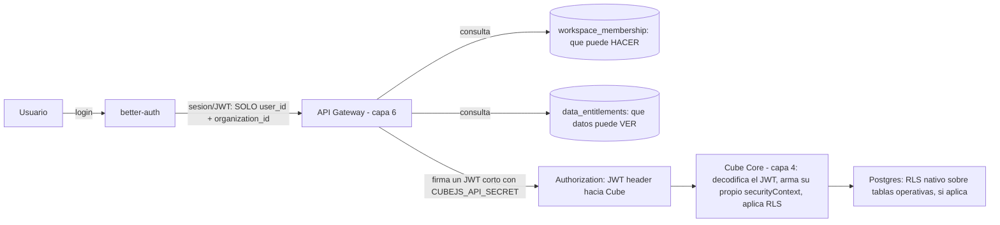

# Capa 9: Autenticación y Gobernanza

> Reemplazo: **workspaces/roles de Power BI Service → better-auth + RLS a nivel de base de datos + security context de Cube (capa 4)**

---

## 1. Responsabilidad única de esta capa

Autenticar usuarios, emitir sesiones/tokens verificables, y definir qué rol tiene cada uno dentro de cada organización/espacio de trabajo. No contiene lógica de negocio ni de visualización — solo responde una pregunta: "¿quién sos, y qué rol tenés?".

**Esta capa NO debe saber:**
- Nada de cómo se calcula una métrica (capa 4) ni de qué filas puede ver un rol específico en términos de negocio — esta capa entrega el *rol*, la capa 4 decide qué filas corresponden a ese rol vía su security context.
- Nada de cómo se renderiza nada en el frontend.

Si esta capa empieza a decidir directamente "el usuario X puede ver la región Norte" en vez de "el usuario X tiene el rol `analista_norte`", el diseño está roto — esa traducción de rol a filas visibles es responsabilidad de la capa semántica (capa 4), no de auth.

---

## 2. Qué reemplazamos y por qué

El sistema de permisos de Power BI (workspaces, apps, roles de RLS) es un sistema atado al ecosistema Microsoft (Entra ID/Azure AD como identidad de base). En el `.pbix` tradicional, las reglas de RLS quedaban ocultas dentro del binario, sin forma de revisar un cambio de seguridad de fila en un pull request. **Corrección de precisión:** con TMDL/PBIP, Power BI ya permite guardar los roles de RLS como texto versionable — la diferencia real con esta capa no es "Power BI no puede", es que acá el modelo de permisos vive en una tabla propia de este proyecto (`workspace_membership`, sección 6.2) además de en better-auth, con revisión de pull request como flujo por defecto, no como una capacidad adicional del ecosistema Microsoft que hay que adoptar aparte.

---

## 3. Defectos concretos que eliminamos

| Defecto | Por qué es un problema real |
| --- | --- |
| Sistema de permisos atado al ecosistema Microsoft | Migrar de identidad implica migrar todo el modelo de permisos junto |
| Reglas de RLS ocultas dentro del `.pbix` tradicional (TMDL/PBIP ya lo resuelve parcialmente, ver arriba) | Sin ese flujo activado, no hay revisión en pull request de un cambio de seguridad de fila |
| Workspaces como unidad rígida de organización | Estructura de permisos fija, difícil de adaptar a jerarquías de organización distintas |

---

## 4. better-auth — con la corrección de gobernanza aplicada, y un giro reciente a favor

### 4.1 El chequeo de gobernanza (regla 7 de `CLAUDE.md`)

better-auth nació en 2024 como el proyecto de un solo desarrollador (Bereket Engida), y a mediados de 2025 se convirtió en una startup con una ronda semilla de USD 5M (Y Combinator, Peak XV, entre otros) — en ese momento, habría sido exactamente el mismo patrón de riesgo que ya se descartó en las capas 6 y 8 (una empresa chica). **Pero el panorama cambió con un evento posterior: Vercel adquirió Better Auth**, incorporando al fundador y al equipo core. Hoy el proyecto tiene más de 4,7 millones de descargas semanales en npm y más de 850 colaboradores — pasó de ser "una startup chica" a estar respaldado por una de las empresas más grandes del ecosistema de infraestructura web (la misma que sostiene Next.js), con un nivel de adopción que ya lo vuelve, de hecho, un estándar del ecosistema TypeScript.

**Verificado en la Fase 0 del Paso 4 (2026-09-26):**
- **La adquisición es real.** Vercel la anunció en su blog el 7/7/2026, y la librería sigue siendo MIT, con el mismo nombre y el mismo modelo de contribución.
- **Riesgo residual, que se documenta y no se esconde:**
  - better-auth tiene 23 *advisories* publicadas. Ninguna afecta a 1.7.6, la versión fijada.
  - Varias de 2026 fueron altas o críticas, casi todas en plugins que este proyecto no usa (`oidcProvider`, `mcp`, `sso`). La única en un plugin nuestro fue la de invitaciones de `organization` (CVE-2026-53514), corregida en 1.6.11; las invitaciones quedan apagadas hasta que exista verificación de email.
  - Una sola cuenta publica el paquete en npm.
- **Mitigación:**
  - Un conjunto mínimo de plugins: email y contraseña, `organization` y `jwt`.
  - **Sin el plugin `admin`.** Con solo activarlo expondría por HTTP unos 20 endpoints `/admin/*` (impersonación, cambio de rol, cambio de contraseña), protegidos únicamente por la sesión y un rol global. `disabledPaths` los apaga uno por uno, por exclusión, y esa protección ya fue esquivada una vez (GHSA-x732-6j76-qmhm).
  - Versión fijada por lockfile, con la atestación de npm verificada.
  - Revisión de *advisories* en cada actualización.

**No es una fundación** — sigue siendo una sola empresa la que lo sostiene. Pero está en la misma categoría que tRPC (capa 6): adopción tan masiva que el proyecto tiene inercia propia más allá de cualquier decisión de una sola empresa, y ahora respaldado por una compañía consolidada, no una startup en etapa semilla.

### 4.2 La alternativa de máxima seguridad de gobernanza: Keycloak

**Keycloak** es un proyecto **CNCF Incubating** desde abril de 2023 (Cloud Native Computing Foundation, bajo el paraguas de la Linux Foundation), con desarrollo activo de Red Hat y más de 12.000 colaboradores en el ecosistema — es, sin ninguna duda, la opción de gobernanza más sólida que existe en autenticación open source hoy.

El costo es real y concreto: Keycloak es un servidor de identidad completo, corre en la JVM (vía Quarkus), necesita su propia base de datos relacional, y en producción típica requiere 2-4 GB de RAM solo para el servicio de auth — es una pieza de infraestructura pesada, pensada para IAM empresarial complejo (multi-realm, federación LDAP/Active Directory, broker de identidades entre organizaciones). Para una plataforma de BI self-hosteada que ya tiene una arquitectura deliberadamente liviana (DuckDB embebido, servicios Node.js), levantar un servidor Java aparte solo para resolver login y roles es una desproporción real de complejidad operativa.

### 4.3 Comparación técnica directa

| Aspecto | better-auth | Keycloak |
| --- | --- | --- |
| Gobernanza | Vercel (empresa grande, no fundación) + adopción masiva (4,7M descargas/semana) | **CNCF Incubating**, Red Hat, máxima seguridad institucional |
| Arquitectura | Librería TypeScript embebida en la propia app (Node.js) | Servidor Java aparte, con su propia base de datos y proceso |
| Footprint operativo | Ninguno adicional — corre donde ya corre el resto del backend TS | Un servicio JVM completo, 2-4 GB de RAM mínimo |
| Encaje con el stack de este proyecto | Alto — TypeScript nativo, mismo lenguaje que la capa 6 y 8 | Bajo — introduce Java como lenguaje/runtime nuevo solo para esta capa |
| RBAC / organizaciones | Plugin `organization` maduro: roles, permisos, `hasPermission()`, control de acceso configurable | Nativo, con soporte de LDAP/SAML/OIDC completo, pensado para IAM de gran escala |
| Cuándo tiene sentido | Self-hosted, TypeScript-first, sin requerimiento de SSO empresarial complejo | Cuando ya existe una organización con LDAP/Active Directory/SAML que hay que federar |

### 4.4 Decisión para este proyecto: better-auth

1. **La gobernanza ya no es el riesgo que era** — la adquisición por Vercel resuelve exactamente la objeción que hizo caer a oRPC y LayerChart en capas anteriores.
2. **Coherencia total con el resto del stack de aplicación** (capas 6 y 8, ambas TypeScript) — no introduce un lenguaje ni un runtime nuevo solo para resolver login.
3. **El plugin de organizaciones, junto con una tabla propia de membresía por workspace, resuelve el equivalente funcional a workspaces/roles de Power BI** (ver la corrección de la sección 6.2 — `team` de better-auth no da roles propios por equipo de fábrica, así que el rol por workspace se modela aparte): usuarios pertenecen a una organización (better-auth) y a uno o más workspaces con un rol propio en cada uno (tabla `workspace_membership` de este proyecto), verificado antes de armar el security context — como código, versionado, no oculto en un binario.

**Cuándo sí Keycloak:** si la organización que adopte esta plataforma ya tiene una identidad corporativa federada (Active Directory, SAML de otro proveedor) y necesita que este BI se integre a ese sistema existente en vez de tener su propio directorio de usuarios, Keycloak es la elección correcta — el costo operativo se justifica porque ya es una pieza estándar de la infraestructura de identidad de la empresa, no una nueva.

---

## 5. Qué agregamos que Power BI no tiene

- **Permisos como código, versionados en Git** junto al resto del proyecto, no ocultos en un `.pbix`.
- **Auditoría propia y completamente controlada** — el log de quién hizo qué vive en la base de datos propia del proyecto, no en un servicio externo.
- **Independencia de un proveedor de identidad único**: better-auth soporta múltiples proveedores OAuth/OIDC sin atar la plataforma a Microsoft Entra ID como única puerta de entrada.

---

## 6. Arquitectura interna de esta capa



### 6.1 De identidad a filas visibles: dos preguntas separadas, nunca una — corregido

**Segunda corrección sobre este mismo flujo, más profunda que la anterior — señalada por una revisión externa.** La corrección previa ya separó "quién sos" (better-auth) de "qué rol tenés en este workspace" (`workspace_membership`, resuelto por request). Pero seguía quedando una mezcla real: el `workspace_role` se traducía **directo** a un filtro de fila (`WHERE region = 'Norte'`) — como si "ser viewer" implicara automáticamente "ver solo la región Norte". Eso no es cierto en general: dos usuarios pueden tener el mismo `workspace_role` (`viewer`) y necesitar ver **datos distintos** (Juan ve Norte, Pedro ve Sur) — con un solo campo de rol, la única forma de resolver eso es inventando roles combinados (`viewer_norte`, `viewer_sur`), que es exactamente lo que se quiere evitar.

**La corrección: separar en dos preguntas, con dos tablas distintas, combinadas recién en el security context final.**

1. **`workspace_role`** (`workspace_membership`, ya definida en la sección 6.2) responde **qué puede hacer** alguien — ver, editar, certificar, administrar. Nunca decide qué filas ve.
2. **`data_entitlements`** (tabla nueva, esta sección) responde **qué datos puede ver** — independiente del rol:

```sql
-- Implementada en el Paso 4 (migración 000002_access_control.sql)
CREATE TABLE access.data_entitlements (
    workspace_id   uuid NOT NULL,
    user_id        uuid NOT NULL,
    dimension      text NOT NULL,                 -- 'region'… — una dimensión que protege la capa semántica
    all_values     boolean NOT NULL DEFAULT false, -- "todos" es una concesión explícita
    allowed_values text[] NOT NULL DEFAULT '{}',   -- ['North'] o ['La Paz', 'El Alto']; nunca vacía
    PRIMARY KEY (workspace_id, user_id, dimension),
    -- lo que alguien ve cuelga de su membresía: se borra con ella
    FOREIGN KEY (workspace_id, user_id)
        REFERENCES access.workspace_membership (workspace_id, user_id) ON DELETE CASCADE,
    CHECK ((all_values AND cardinality(allowed_values) = 0)
        OR (NOT all_values AND cardinality(allowed_values) > 0))
);

-- Juan y Pedro son los dos 'viewer' en workspace_membership, pero ven datos distintos:
-- (comercial, juan_id,  'region', false, ARRAY['North'])
-- (comercial, pedro_id, 'region', false, ARRAY['South'])
```

**Correcciones del Paso 4 sobre esta tabla:**
- **La columna se llamaba `values`, que es palabra reservada en SQL.** Ahora es `allowed_values`.
- **Se deniega por defecto.** Si una dimensión protegida no tiene fila para ese usuario y workspace, se deniega; la ausencia de fila nunca significa "todo". "Todos los valores" es una concesión explícita (`all_values`), y la base rechaza una lista vacía o un "todos" con valores.
- **Qué dimensiones están protegidas lo sabe la capa semántica, no Auth.** Auth devuelve las concesiones que existen, y `@atlasbi/semantic` deniega la dimensión protegida que no tenga una.

**El flujo completo, corregido:**

1. **better-auth** autentica y certifica identidad y tenant únicamente: `{ user_id, organization_id }` — nunca un rol, nunca un entitlement.
2. **La API Gateway (capa 6)**, en cada request, resuelve **las dos cosas por separado**: `workspace_role` desde `workspace_membership`, y `data_entitlements` desde la tabla de arriba, ambas para el `workspace_id` de la solicitud concreta.
3. La Gateway arma el security context combinado: `{ user_id, organization_id, workspace_id, workspace_role, entitlements: { region: ['Norte'] } }`.
4. **La Gateway firma un JWT corto** (con `CUBEJS_API_SECRET`, la clave que Cube ya usa para verificar tokens) conteniendo ese security context como payload, y lo envía en el header `Authorization` de la llamada a Cube — **nunca como un campo `securityContext` suelto dentro de las opciones de `load()`**. Es el mecanismo de autenticación de **REST/GraphQL** (`checkAuth`, JWT verificado, no un parámetro de conveniencia) — el **SQL API** (`/v1/cubesql`, usado por el Editor de SQL avanzado, `17-self-service-calculations.md`) usa un mecanismo distinto (`checkSqlAuth`), pendiente de validar empíricamente antes de darlo por implementado — no generalizar "JWT en Authorization" como si aplicara a las dos superficies de Cube por igual.
5. **Cube Core (capa 4)** usa `entitlements.region` (no `workspace_role`) dentro de su YAML para el filtro de fila real — el rol nunca entra en esa ecuación. `workspace_role` sí puede usarse en Cube para decidir qué medidas/dimensiones están permitidas (control de qué puede *hacer*), pero es una regla separada de la de filas.
6. Si además hay tablas operativas consultadas directo (fuera del camino de Cube), **RLS nativo de Postgres** aplica la misma lógica de `entitlements`, no de `workspace_role`, como capa adicional de defensa.

**Implementado en el Paso 4 (`0.4.0`): pasos 1, 2, 3 y 5 del flujo, y la cadena completa verificada en vivo.**
- **Paso 1, el token de identidad.** Lleva solo `sub` (el usuario) y `org` (la organización), más los *claims* estándar. Es EdDSA, dura 15 minutos y se verifica localmente con `jose` (§7). Un *claim* de más lo invalida.
- **Pasos 2 y 3, `resolveSecurityContext` (`@atlasbi/auth`).**
  - Hace las dos consultas por separado y devuelve `SecurityContext` v1 (`@atlasbi/contracts`).
  - Deniega un workspace de otra organización, aunque exista una fila de membresía ahí.
- **Paso 4, el token corto hacia Cube.**
  - HS256, emisor `platform-api`, audiencia `semantic-layer`, vida de 5 minutos como máximo.
  - Lleva **grupos** derivados de los *entitlements* (`region:all`, o `region:listed` con la lista), nunca el rol (`04-semantico.md` §6.2 y §6.6).
  - El SQL API de Cube recibe el mismo token como contraseña y aplica la misma RLS. El transporte HTTP `/v1/cubesql` sigue pendiente para el Paso 5.
  - Cube vuelve a comprobar el vencimiento en cada consulta, así que una conexión abierta no sobrevive a su token.
- **Lo que falta es solo el transporte.** La Gateway, que recibe la sesión y firma el token en cada request, llega en el Paso 5.

**⚠ Advertencia — trampa verificada en Cube Core 1.7.45 (Fase 0 del Paso 4): las políticas de acceso se combinan con OR entre grupos.**

- **Cómo combina Cube.** A cada consulta, Cube le aplica todas las `access_policy` de los grupos que devuelve `contextToGroups`. Los filtros de un mismo grupo se combinan con AND; los de grupos distintos, con **OR**. Una política sin `group` vale para todas las personas.
- **Hoy es seguro, con una sola dimensión protegida (`region`).** La traducción del security context a grupos es: `region:all`; `region:listed` con la lista de valores, que nunca está vacía; o ningún grupo, que deniega todo.
- **La trampa: agregar una segunda dimensión protegida con ese mismo patrón, un grupo por dimensión, abre el acceso completo.** Alguien con `region:all` y `category:listed` recibiría la **unión** de las dos políticas. Como la de `region:all` no filtra nada, vería todas las filas de todas las categorías: el recorte por categoría desaparece.
- **Nada lo avisa.** Cube no da error ni advertencia, y los tests de una sola dimensión siguen pasando.

**Antes de proteger una segunda dimensión:**
1. **Rediseñar la traducción.** Por ejemplo, un solo grupo con todos los filtros en la misma política, que se combinan con AND; o políticas elegidas con `conditions` según la combinación de dimensiones. Recién después, agregar la dimensión.
2. **Agregar un test que combine las dos dimensiones** y verifique que cada una sigue filtrando por su cuenta.

**Dónde vive la traducción.** Está en un solo lugar, `@atlasbi/semantic`, que arma los grupos a partir del security context, para que este cambio no se disperse. Por la misma razón, nunca se escribe una política sin `group` "por las dudas": se aplicaría a todo el mundo.

**Capacidad disponible, sin implementar todavía: enmascaramiento de datos en Cube Core.** Además de ocultar filas (`row_level`) y miembros (`member_level`), las `access_policy` de Cube Core admiten `member_masking` desde la versión 1.6.23 (la fijada en el Paso 3, 1.7.45, lo incluye): un miembro que el usuario no puede ver en claro devuelve un valor enmascarado (`***`, `-1`, `NULL`, según el `mask` declarado en la dimensión o medida) en vez de negar la consulta entera. Sirve, por ejemplo, para que un reporte compartido siga funcionando para quien no puede ver el nombre del cliente. Queda registrado para cuando haga falta; no forma parte del MVP.

**Por qué el rol (ni los entitlements) pueden vivir en el JWT de sesión de better-auth (paso 1):** un usuario puede tener rol y entitlements distintos en cada workspace — el JWT de sesión es una verdad estática de identidad, válida mientras dura la sesión; el rol y los entitlements son datos de negocio que dependen de *qué* workspace se está consultando ahora mismo, y se resuelven en cada request (paso 2), nunca de antemano.

**Dos hechos medidos en la Fase 0 del Paso 5 (Cube Core 1.7.45):**

- **`public: false` no es una frontera de seguridad.** Un miembro marcado así no aparece en la metadata, pero igual se puede filtrar y ordenar por él. Lo que oculta de verdad es `member_level` en una `access_policy`: un miembro oculto usado en un filtro no responde con datos ni da pistas, porque Cube aplica el segmento `rlsAccessDenied` y la consulta da vacía. Ocultar algo a quien no tiene permiso se hace siempre con `access_policy`, nunca con `public: false`.
- **Cube escribe en su log el security context completo de cada consulta.** Es el *payload* del token verificado, con `sub`, `org`, `workspace`, los grupos y los **valores de los entitlements**, más la consulta. Ese log contiene, por lo tanto, quién vio qué recorte de datos. Su retención y quién puede leerlo se deciden con el mismo cuidado que la base de la plataforma. El adaptador nunca le pasa a Cube el token del cliente, solo el token corto que firma por request (`04-semantico.md` §6.6).

### 6.2 `organization` ≠ `workspace` — corrección de un error real de modelado, en dos rondas

**Corrección de un error nuevo, señalado por una revisión externa posterior a la primera corrección de esta sección.** La primera ronda dijo "usar `team` de better-auth como workspace, con un rol propio por equipo" — pero **better-auth no da un rol independiente por `team` de fábrica**. Verificado contra el código y la documentación del proyecto: la tabla `teamMember` solo tiene `teamId` y `userId` como columnas de identidad — no tiene una columna de rol propia. Los roles viven a nivel de **miembro de la organización** (`member`, con `organizationRole`/`hasPermission()`), no a nivel de equipo. De hecho, hay una discusión abierta en el propio repositorio de better-auth ("Multiple teams and multiple roles") donde alguien está prototipando, a mano, agregar un campo de rol a `teamMember` — porque hoy no existe.

**Esto significa que el ejemplo que este documento daba como ya resuelto no sale del modelo real:**

```
Delapaz
├── Comercial
│   └── Juan = admin      ← esto NO lo da better-auth de fábrica
└── Finanzas
    └── Juan = viewer     ← el rol de Juan en better-auth es uno solo, a nivel de organización
```

**La corrección real: `team` sigue sirviendo para *agrupar* miembros (es útil, y se mantiene), pero el rol por workspace se modela con una tabla propia, encima de better-auth, no dentro de él:**

| Capa | Qué resuelve |
| --- | --- |
| `organization` de better-auth | Identidad/tenant — a qué empresa pertenece el usuario |
| `team` de better-auth | Agrupación de miembros dentro de la organización (útil para invitaciones, listados) — pero sin rol propio |
| **`workspace_membership` (tabla propia de este proyecto)** | `user_id`, `workspace_id`, `role` — acá vive el rol real por workspace |

```sql
-- Tabla propia, no una extensión de better-auth
CREATE TABLE workspace_membership (
    user_id      TEXT NOT NULL,
    workspace_id TEXT NOT NULL,
    role         TEXT NOT NULL,  -- 'admin' | 'editor' | 'analyst' | 'viewer' — nunca 'data_steward' acá, ver sección 9.1
    PRIMARY KEY (user_id, workspace_id)
);

-- Permisos de gobernanza: independientes del rol, otorgables uno por uno (sección 9.1)
CREATE TABLE workspace_permissions (
    user_id      TEXT NOT NULL,
    workspace_id TEXT NOT NULL,
    permission   TEXT NOT NULL,  -- 'certify_metric' | 'sql_lab_access' | 'manage_glossary' | 'manage_quality'
    PRIMARY KEY (user_id, workspace_id, permission)
);

-- Ejemplo: Juan es admin en Comercial y viewer en Finanzas,
-- y además tiene el permiso de certificar métricas en Finanzas sin ser admin ahí
-- workspace_membership:  (123, 'comercial', 'admin'), (123, 'finanzas', 'viewer')
-- workspace_permissions: (123, 'finanzas', 'certify_metric')
```

**Implementado en el Paso 4** (migraciones `000001` y `000002`):
- **Esquemas:** las tablas de better-auth viven en el esquema `auth`, como almacenamiento del proveedor que nuestro código nunca consulta. Las propias viven en `access`: `workspace` (con `organization_id` hacia `auth.organization`), `workspace_membership` (con `CHECK` sobre los cuatro roles) y `data_entitlements` (§6.1).
- **IDs:** son `uuid`.
- **`workspace_permissions` todavía no existe.** Nace con su primer consumidor (SQL Lab o certificación), nunca como una tabla "para después".
- **Una persona pertenece a una sola organización en el MVP.** El token de identidad nombra exactamente una; con ninguna, o con varias, no se emite.

better-auth sigue haciendo lo que hace bien: autenticar y administrar la pertenencia a la organización. Los permisos de contenido por workspace — que es exactamente el problema que Power BI, Tableau y Looker resuelven con un modelo de autorización más rico que "member de un team" — los controla este proyecto con su propia tabla, consultada por la Capa 6 (API Gateway) antes de armar el security context que se le pasa a Cube (capa 4).

**Por qué esto no es "reinventar auth"**: la parte difícil y sensible (contraseñas, sesiones, OAuth, tokens) la sigue resolviendo better-auth entero, sin tocar nada de eso. Lo que se construye a mano es una tabla de autorización de negocio — el mismo tipo de tabla que cualquier plataforma con workspaces termina necesitando, esté o no basada en better-auth.


---

### 6.3 SQL Lab (capa 8): restringido por rol de confianza, no por un chequeo de texto

**Corrección de una solución insuficiente, señalada por una revisión externa.** DuckDB no tiene row-level security nativo, y validar por texto qué tablas referencia una consulta no es una barrera de seguridad real cuando se permite SQL arbitrario contra el mismo proceso (un `read_parquet()` con ruta directa, un `ATTACH`, o una extensión de red pueden saltarse esa validación sin pasar por el `FROM`/`JOIN` revisado). La corrección para el MVP: **SQL Lab queda habilitado solo para quien tenga el permiso de gobernanza `sql_lab_access`** (otorgable a un `analyst` o `admin` puntual, no un rol nuevo — sección 9.1) — nunca por defecto para un `viewer` común — hasta que exista un servicio de consulta aislado (proceso separado, extensiones deshabilitadas, límites de recursos) que sí sea una frontera de seguridad real. El detalle completo, incluida la fase futura, está en `08-frontend.md`, sección 10.3.

---

### 6.4 Identidad propia de la plataforma: quién existe, fuera del proveedor (después de `0.5.0`)

**Decisión de la auditoría de aislamiento entre capas (opción 1, aprobada el 2026-10-05).** Hasta `0.5.0`, las tablas de autorización apuntaban con claves foráneas a las tablas de better-auth: `access.workspace` a `auth.organization`, y `access.workspace_membership` a `auth."user"`. Cambiar de proveedor obligaba entonces a rehacer la autorización. Federar con Keycloak, donde los usuarios ni siquiera viven en nuestro Postgres, la habría vuelto imposible. Desde la migración `000003`, la plataforma tiene su propia identidad:

- **`identity.organization` e `identity.principal`:** quién existe para la plataforma. Las claves foráneas de `access` apuntan acá, nunca a `auth.*`.
- **`identity.provider_subject` (`provider`, `subject`, `principal_id`):** qué cuenta de qué proveedor es qué principal.
  - Con better-auth, el sujeto es el mismo id del principal, así que el `sub` del token de identidad no cambia.
  - Un proveedor con ids propios, como Keycloak, se mapea acá sin otra migración.
- **El proveedor conserva lo suyo:** credenciales, sesiones, las claves del token y la pertenencia a la organización.

**Escrituras explícitas, no *hooks*.** El adaptador escribe estas filas justo después de cada alta en el proveedor, y si esa escritura falla, deshace el alta. Alcanza porque el puerto es el único camino que crea cuentas: no hay registro público (decisión D5).

**⚠ Si algún día se habilita el registro público, esta decisión tiene que revisarse.** Lo mismo vale para cualquier otro camino que cree cuentas sin pasar por `IdentityPort`, como un panel de administración del proveedor. Ese camino crearía personas que la plataforma no registra, y la reconciliación las detectaría recién después.

**La reconciliación** (`IdentityPort.reconcile`, versión 1.1) **corre en dos lugares:**
- **`pnpm dev` detecta.** El paso `Identity` de la cadena falla si el proveedor conoce a alguien que la plataforma no, y da el remedio.
- **`pnpm identity:reconcile` repara:** agrega lo que falta. **Nunca borra.** Lo que la plataforma conoce y el proveedor no, un principal huérfano, se lista para que lo decida una persona: borrarlo arrastraría sus membresías.

**La batería de contrato de `IdentityPort` verifica esto para cualquier proveedor:**
- Todo lo que crea el puerto aparece en `identity.*`.
- La reconciliación detecta un desfase y lo repara sin borrar nada.

La migración se probó antes sobre el escenario que deja `pnpm seed`: no quedan datos huérfanos y ninguna clave foránea de `access` apunta a `auth.*`.

## 7. Contrato de esta capa (qué expone, qué consume)

- **Consume**: credenciales del usuario (email/password, OAuth) para autenticar.
- **Expone**: una sesión/JWT verificable con claims de **identidad y organización únicamente** (`user_id`, `organization_id`) — nunca un rol de workspace, que se resuelve por request contra `workspace_membership` (sección 6.1), no en el token.
  - **Implementado en el Paso 4:** el token de identidad lleva `sub`, `org`, `iss: identity`, `aud: platform-api`, `iat` y `exp`. Es EdDSA; las claves viven en `auth.jwks`, con la privada cifrada con `auth.secret`.
  - **Vida de 15 minutos.** Como se verifica localmente, después de cerrar la sesión el token sigue siendo válido hasta que vence: es el costo de no consultar la base en cada request, acotado por esa vida corta.
  - **Por qué `definePayload` es obligatorio:** sin él, better-auth mete el usuario entero en el token (email, nombre, imagen). Hay un test que lo impide.
  - **El puerto propio es `IdentityPort`** (`@atlasbi/contracts`). Ningún tipo de better-auth sale de su adaptador.
- **No expone**: ninguna noción de qué filas de datos son visibles — eso lo resuelve la Gateway a partir de `data_entitlements` (sección 6.1), nunca del `workspace_role`, y nunca de un dato certificado de antemano en el token.
- **El API Gateway (capa 6) valida la identidad del token localmente** (sin preguntarle a esta capa por cada request) **y consulta `workspace_membership` (qué puede hacer) y `data_entitlements` (qué puede ver) por separado para resolver el security context de ese workspace específico** — dos preguntas distintas, dos tablas distintas, nunca una combinada en un solo campo de rol.

---

## 8. Por dónde empezar a construir (paso a paso concreto)

**Estado (Paso 4, `0.4.0`):**
- **Hechos:** 1, 2, 3 y 5. El login y el logout se verifican por la API del servidor.
- **El 4 llega con la API Gateway (Paso 5),** y el login con pantalla, con el frontend (Paso 6).
- **`pnpm seed`** deja el escenario de la demo de aceptación (`16-mvp-definicion-terminado.md` §4) y lo prueba iniciando sesión con cada usuario.

1. `pnpm add better-auth` dentro de `packages/auth`.
2. Configurar un solo proveedor (email/password) y confirmar login/logout básico antes de sumar OAuth.
3. Agregar el plugin `organization`, crear una organización de prueba, y una tabla propia `workspace_membership` (`user_id`, `workspace_id`, `role`) — dos workspaces de prueba (`comercial`, `finanzas`) con roles distintos para el mismo usuario, confirmando que el rol de uno no se filtra al otro.
4. Conectar la validación de token en la API Gateway (capa 6), reemplazando el stub que se usó en esa capa mientras esta no existía.
5. Definir el primer security context real en Cube Core (capa 4): un `data_entitlements` de prueba (ej. `region = 'Norte'`) que filtre una métrica ya existente — nunca mapeando el rol `viewer` directo a un filtro, para no repetir el error ya corregido en la sección 6.1. Confirmar además que un segundo usuario, con el mismo `workspace_role` pero un `data_entitlements` distinto, ve un recorte de filas diferente.
6. Recién con ese flujo probado de punta a punta, evaluar si hace falta sumar SSO/SAML vía un proveedor adicional o, si la organización ya tiene identidad federada, migrar esta capa a Keycloak.

---

## 9. Idea rescatada de otro líder de BI: certificación de datos (Tableau)

Tableau permite que un "data steward" marque una fuente de datos o un dashboard como **certificado** — una insignia verde visible en toda la plataforma, con una nota de por qué se puede confiar en ese contenido, quién lo certificó y cuándo. Los recursos certificados aparecen primero en las búsquedas. Es exactamente la señal de confianza que le falta a un catálogo grande de métricas: no toda tabla ni todo dashboard tiene el mismo nivel de revisión, y hoy nada en este proyecto distingue "esto lo revisó alguien" de "esto lo armó alguien ayer a la tarde".

### 9.1 Por qué es gobernanza, no una función de la Capa 8

**Corrección de un modelo de roles que mezclaba dos cosas distintas, señalada por una revisión externa.** La versión anterior trataba `data_steward` como si fuera un rol de workspace más, al mismo nivel que `admin`/`analista`/`viewer` — eso obliga a inventar combinaciones cada vez más específicas (¿`data_steward_analista`? ¿`data_steward_admin`?) a medida que aparecen más capacidades especiales. La corrección: separar **rol de workspace** (qué tan amplio es el acceso day-to-day de alguien) de **permiso de gobernanza** (una capacidad puntual, otorgable a cualquier rol):

| Nivel | Ejemplos | Dónde vive |
| --- | --- | --- |
| Rol de organización (better-auth, nativo) | `owner`, `admin`, `member` | Identidad/tenant — quién administra la cuenta de la empresa |
| Rol de workspace (`workspace_membership`, tabla propia) | `admin`, `editor`, `analyst`, `viewer` | Cuánto acceso day-to-day tiene alguien dentro de un workspace específico |
| **Permiso de gobernanza** (otorgable, independiente del rol) | `certify_metric`, `sql_lab_access`, `manage_glossary`, `manage_quality`, `manage_agent_rules` (crear, editar o retirar reglas del copiloto, `05-cerebro-ia.md` §10) | Una tabla propia (`workspace_permissions`: `user_id`, `workspace_id`, `permission`) — no un rol nuevo por cada capacidad |

Con esto, un `analyst` puede tener el permiso `certify_metric` sin ser `admin` — no hace falta inventar un rol combinado para cada combinación posible, y otorgar/revocar una capacidad puntual es una fila más en una tabla, no un cambio de rol completo.

- **Quién puede certificar**: cualquier usuario con el permiso `certify_metric` en ese workspace — no un rol fijo llamado "data steward".
- **Qué se certifica**: una tabla `mart_*` (capa 2), una métrica de Cube (capa 4) o una consulta certificada del copiloto (`05-cerebro-ia.md` §10) — nunca una tabla `stg_*`/`int_*` interna, porque esas no son parte del contrato público de ninguna capa.
- **El registro de auditoría — corregido (2026-09-27): no hay una tabla de certificaciones aparte.** Certificar, revocar y cambiar una regla del copiloto son eventos de `audit_event` (`18-first-class-citizens.md`, Audit & Compliance). Cada evento guarda acción, tipo e id del recurso, hash del contenido, camino (`git` o `conversation`), quién y nota. El estado vigente de cada recurso es una vista (`audit.current_certifications`) sobre el último evento: una sola historia, sin una segunda tabla que pueda contradecirla. La versión anterior proponía `gobernanza.certificaciones`.
- **Por permiso, nunca por perfil.** Todo permiso de gobernanza se ejerce por cualquier camino que ofrezca la plataforma —editar el archivo en Git o un botón en la interfaz— y el acceso lo decide el permiso, nunca una suposición sobre el perfil técnico de la persona (`05-cerebro-ia.md` §10.3).

### 9.2 Una mejora real sobre el original: certificación continua, no una insignia que se olvida

Tableau certifica una vez y la insignia queda ahí indefinidamente, aunque la fuente de datos se rompa después. Este proyecto puede hacerlo mejor sin esfuerzo adicional, porque ya tiene la pieza que lo resuelve: los *audits* de SQLMesh (capa 2) ya corren en cada `plan`/`apply`. Si el audit de una tabla certificada empieza a fallar, el mismo pipeline (orquestado por Airflow, capa 7) marca automáticamente esa certificación como `revocada` — sin esperar a que alguien con el permiso `certify_metric` se acuerde de revisarla a mano.

### 9.3 Conexión con el "SQL Lab" de la Capa 8

Cuando una consulta exploratoria de SQL Lab se repite seguido y se promueve a una medida oficial en Cube (capa 8, sección 10.3), la certificación es el paso natural que cierra ese flujo: alguien con el permiso `certify_metric` revisa el pull request, lo aprueba, y de paso certifica la métrica resultante — quedando visible para todo el mundo que ese número, a diferencia de una exploración suelta, ya pasó por revisión.

---

**Siguiente documento:** `10-colaboracion-realtime.md` — ElectricSQL para colaboración multiplayer sobre el mismo dashboard.
