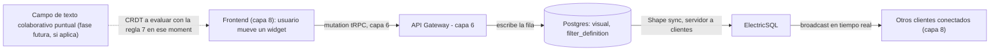

# Capa 10: Colaboración en Tiempo Real

> Esta capa **no tiene equivalente en Power BI** — es una de las piezas donde el proyecto lo supera por diseño, no solo lo iguala.
>
> **Corrección de gobernanza:** ElectricSQL se confirma y se refuerza — fue **adquirida por Databricks el 11 de agosto de 2026**, pasando de startup en etapa temprana a estar respaldada por una de las compañías más grandes de infraestructura de datos. **Yjs no se usa para el caso de uso principal de esta capa** (sincronizar el estado del canvas) por dos razones que apuntan al mismo lado: no hace falta un CRDT completo para eso (concurrencia optimista con `version` alcanza, sección 3.3), y si hiciera falta, su perfil de gobernanza (un mantenedor individual, sin equipo ni sponsor corporativo) no sería la mejor opción disponible — pero no queda vetado para siempre en cualquier función futura de bajo radio de impacto, ver sección 3.1.

---

## 1. Responsabilidad única de esta capa

Permitir que varias personas trabajen sobre el mismo dashboard al mismo tiempo, viendo los cambios del otro en vivo (mover un widget, cambiar un filtro, ver el cursor de otra persona).

**Esta capa NO debe saber:**
- Nada de qué datos de negocio se están mostrando (eso es la capa 4/6) — solo sincroniza el *estado del canvas* (posiciones, filtros seleccionados, quién está mirando qué).
- Nada de permisos (capa 9) — solo sincroniza lo que el usuario ya tiene permitido editar.

---

## 2. Por qué Power BI no puede hacer esto

Power BI Desktop es de un solo editor a la vez; el Service permite ver un reporte compartido, pero no coedición en vivo del mismo canvas — es una limitación de arquitectura, no una función que falte agregar.

---

## 3. El problema de gobernanza en esta capa específica, sin atenuantes

### 3.1 Yjs, para el caso de uso principal de esta capa (sincronizar el estado del canvas): no es la elección correcta

**Corrección de tono, señalada por una revisión externa: la versión anterior de esta sección descalificaba a Yjs de forma absoluta ("nunca Yjs") citando solo gobernanza — eso contradice la regla 7 ya actualizada (criterio, no mecánica) en `CLAUDE.md`.** La razón real para no usar Yjs en el caso de uso *principal* de esta capa nunca fue solo "tiene un mantenedor individual" — es arquitectónica: la sección 3.3 ya explica que sincronizar el estado de un canvas de dashboard (mover un widget, cambiar un filtro) no necesita el aparato completo de un CRDT de texto, la concurrencia optimista con `version` alcanza. Sumado a eso, Yjs sí tiene un perfil de gobernanza débil — su propia página oficial dice **"Yjs is built and managed by Kevin Jahns"**, sin un equipo nombrado de varias personas ni un sponsor corporativo real, a diferencia de tRPC (Capa 6), que sí pasa ese mismo checklist.

**Para el caso de uso principal de esta capa, entonces, la decisión es doble y ambas razones apuntan al mismo lado:** no hace falta un CRDT (razón arquitectónica) y, si hiciera falta, Yjs no sería la opción de mejor gobernanza disponible (razón de la regla 7). **Eso no significa que Yjs esté vetado para siempre en cualquier función de este proyecto** — si en el futuro aparece una necesidad acotada y de bajo radio de impacto (por ejemplo, edición colaborativa de texto dentro de un único campo de comentario, sección 9), se evalúa en ese momento con el criterio completo de la regla 7 (licencia, bus factor, forkabilidad, criticidad, radio de impacto) — no se descarta de antemano solo por el perfil de mantenedor.

### 3.2 Las alternativas tampoco pasan limpio

| Librería | Quién la sostiene | ¿Pasa la regla 7? |
| --- | --- | --- |
| Yjs | Un individuo (Kevin Jahns) | 🔴 No pasa el checklist de "adopción sin empresa" — pero eso no la veta para todo uso, solo confirma que no es la opción de mejor gobernanza para esta capa |
| Loro | Equipo de 2 mantenedores (`loro-dev`), sin empresa | 🔴 No — mismo patrón que oRPC/LayerChart |
| Automerge | Ink & Switch, laboratorio de investigación con varios investigadores nombrados (incluye a Martin Kleppmann, académico de Cambridge) — no una empresa ni una fundación, pero tampoco una sola persona | 🟡 Zona gris — múltiples personas, respaldo académico, pero sigue siendo una organización chica sin ingresos ni fundación |

**No existe hoy una librería CRDT de colaboración de texto/estructuras madura, respaldada por una fundación o una empresa grande.** Es la segunda vez que este proyecto se encuentra con esta situación (la primera fue el motor semántico en la capa 4) — y la resolución no es forzar una opción mala, es **reducir dónde hace falta ese tipo de librería en primer lugar**.

### 3.3 La salida: acotar el alcance, no forzar una mala elección

La clave está en preguntarse qué tan sofisticado necesita ser realmente el merge de conflictos para *este* caso de uso. Colaborar en un documento de texto largo (como Google Docs) necesita un CRDT completo porque dos personas pueden editar la misma palabra al mismo tiempo. **Colaborar sobre un dashboard de BI es un problema más chico**: mover un widget, cambiar un filtro, o ver el cursor de otra persona son operaciones que casi nunca chocan de verdad (dos personas rara vez arrastran el mismo widget en el mismo milisegundo), y cuando chocan, **concurrencia optimista con `version`** (rechazar la escritura si alguien más ya cambió esa fila, en vez de sobrescribir en silencio — sección 6.1) es una resolución perfectamente aceptable — no hace falta el aparato completo de un CRDT de texto para eso.

**Decisión para este proyecto: Postgres resuelve la escritura y sus conflictos con su semántica estándar de actualización de fila; ElectricSQL solo distribuye el resultado ya confirmado — nunca al revés.** La presencia en vivo (cursores, quién está mirando) es un subcomponente aparte, todavía sin resolver del todo — ver sección 6.2. Si en el futuro se agrega un campo de **texto colaborativo real** (anotaciones o comentarios editados simultáneamente palabra por palabra), la evaluación de qué librería CRDT usar se hace en ese momento, aplicando la regla 7 actualizada (licencia, bus factor, forkabilidad, criticidad, radio de impacto) — no se descarta ninguna opción de antemano por tener un mantenedor principal, siempre que el uso sea acotado y el radio de impacto sea bajo (ver sección 3.3 para el detalle de por qué Yjs específicamente sí se descartó para el caso de uso *principal* de esta capa, que es distinto).

---

## 4. ElectricSQL, reforzado por la adquisición de Databricks — y con el mecanismo corregido

**Corrección de un mecanismo mal descrito, detectado por dos revisiones externas independientes, verificado contra la documentación oficial.** La versión anterior de este documento decía que ElectricSQL ofrece "escritura optimista, sincronización, reconexión y last-write-wins" como si fuera un mecanismo bidireccional automático. No lo es. La documentación oficial del plugin de sincronización de PGlite dice explícitamente: **"no soportamos todavía que las escrituras locales se sincronicen hacia afuera, ni resolución de conflictos"**. Y la guía de escrituras de Electric es todavía más directa: *"las escrituras son tu responsabilidad"*.

**Lo que ElectricSQL realmente hace es la mitad servidor → clientes, no las dos mitades:**

- **Lectura/broadcast (lo que Electric resuelve)**: sincroniza un "Shape" (un subconjunto de filas de Postgres) hacia cada cliente conectado, en tiempo real, con reconexión automática — cuando una fila de `visual`/`filter_definition` cambia en Postgres, todos los clientes que están mirando ese Shape lo reciben solos, sin tener que hacer polling.
- **Escritura (responsabilidad de la aplicación, no de Electric)**: cuando un usuario mueve un widget, esa escritura **no pasa por Electric** — pasa por una llamada API normal, la misma mutation de tRPC que ya se construyó en la Capa 6 para las "Input Tables" de Sigma. Esa mutation escribe la fila en Postgres, y **recién ahí** Electric hace su trabajo: propaga ese cambio a todos los demás clientes conectados.

Esto no invalida la arquitectura de esta capa — el resultado final (todos los que están mirando el mismo dashboard ven los cambios de los demás en tiempo real) sigue siendo el mismo. Lo que cambia es la explicación de *cómo* se logra: no es "Electric sincroniza todo mágicamente en las dos direcciones", es "la escritura es una mutation común, y Electric se encarga de avisarle al resto".

**El 11 de agosto de 2026, Databricks adquirió Electric** (la empresa detrás de ElectricSQL), con el objetivo explícito de integrar su tecnología de sincronización y su proyecto PGlite (Postgres compilado a WebAssembly) a la plataforma Lakebase de Databricks. Como parte de la adquisición, el servicio gestionado "Electric Cloud" se está discontinuando — pero **los proyectos open source siguen disponibles**, ahora respaldados por una de las compañías más grandes de infraestructura de datos del mercado, no por una startup en etapa temprana. Es el mismo patrón que ya se vio con better-auth (capa 9) y su adquisición por Vercel: lo que empezó como riesgo de "empresa chica" se resuelve por una adquisición hacia una compañía consolidada — con la salvedad honesta de que una adquisición reduce el riesgo de abandono, pero no es una garantía de que el producto no cambie de dirección en el futuro.

**Salvedad honesta:** la parte que se discontinúa (Electric Cloud, el servicio gestionado) nunca fue parte del plan de este proyecto — la regla de "self-hosted primero" ya excluía depender de esa capa comercial. El núcleo open source, que es lo que este proyecto usa, no se ve afectado por esa discontinuación.

---

## 5. Qué agregamos que Power BI no tiene

- **Edición simultánea multi-usuario sobre el mismo dashboard**, sin depender de una librería de gobernanza riesgosa para el caso de uso principal (estado del canvas).
- **Broadcast en tiempo real de cambios confirmados**: cuando alguien escribe (vía la mutation de la capa 6), todos los demás clientes conectados lo ven al instante, sin polling.
- **Broadcast en tiempo real del estado persistente del canvas**, sin necesitar infraestructura de WebSockets propia construida desde cero para esa parte — la presencia en vivo (cursores) sigue siendo un subcomponente aparte, pendiente (sección 6.2).

---

## 6. Arquitectura interna de esta capa



### 6.1 Qué sincroniza ElectricSQL, en concreto — con la granularidad correcta, no un blob completo

**Corrección de diseño, señalada por una revisión externa: guardar todo el reporte como una sola fila (con el JSON completo del canvas) haría que dos usuarios editando partes *distintas* del mismo reporte se pisen entre sí** — si A mueve un visual y B cambia un filtro casi al mismo tiempo, con un solo campo JSON por reporte, la segunda escritura confirmada sobrescribe a la primera entera, perdiendo el cambio de A aunque ni siquiera tocara lo mismo que B.

**La corrección: una tabla por unidad de estado, no un blob por reporte.** Así los conflictos ocurren sobre unidades chicas, y dos personas editando cosas distintas del mismo reporte nunca generan un conflicto real, porque cada una escribe una fila distinta.

**Corrección estructural más importante, señalada en una revisión posterior: esta capa NO define su propia tabla `dashboard_widget`/`dashboard_filter` — sincroniza directo las tablas canónicas del Report Document Model (`report`/`page`/`visual`/`filter_definition`), definidas en `19-operabilidad-runtime.md` sección 8.** Tener una tabla propia acá, más otra tabla "de verdad" en el Report Document Model, es exactamente el tipo de duplicación de fuentes de verdad que este proyecto evita en todas las demás capas — se corrigió antes de crear las migraciones, que es cuando hubiera salido más caro arreglarlo.

`visual.version` (definida en `19-operabilidad-runtime.md`) es la misma columna que habilita undo con detección de conflicto en `14-interaction-state-engine.md` — no hay una versión distinta por documento.

La escritura en sí ocurre por la mutation de la Capa 6 (la misma que ya existe para Input Tables) contra la fila específica que cambió (`visual` para mover/reconfigurar un visual, `filter_definition` para un filtro guardado por el autor) — nunca contra un documento completo. **Electric no participa en ese paso** — su trabajo empieza después: sincroniza esas tablas como "Shapes" hacia cada cliente conectado, así que todos ven el cambio sin tener que refrescar ni hacer polling.

**Corrección de una contradicción real, señalada en una revisión posterior: esta sección decía "gana la escritura que confirmó último" (last-write-wins ciego), pero `14-interaction-state-engine.md` ya diseñó algo mejor para el mismo problema — concurrencia optimista con `version` y `UPDATE ... WHERE version = expected`.** No tiene sentido tener dos mecanismos de resolución de conflicto distintos para el mismo tipo de fila — **toda mutación del canvas usa concurrencia optimista, siempre, no solo la de undo**:

```
Svelte ──mutation { ..., expectedVersion }──► tRPC (Capa 6)
                                                  │
                                                  ▼
                              UPDATE visual SET position = ..., version = version + 1
                              WHERE id = ? AND version = $expectedVersion
                                                  │
                        0 filas ──────────────────┴────────────────── 1 fila
                        (conflicto: alguien              (confirmado)
                         más escribió primero,                │
                         el cliente recarga/reconcilia)        ▼
                                                          ElectricSQL
                                                                │
                                                                ▼
                                                    Svelte A, B, C (broadcast)
```

**Electric sigue sin resolver ningún conflicto — solo distribuye el estado ya confirmado por Postgres.** Lo que cambia es que Postgres ya no resuelve el conflicto con "el último que llega gana" a ciegas: si la versión que el cliente esperaba (`expectedVersion`) ya no coincide con la real (porque alguien más escribió esa misma fila en el medio), el `UPDATE` devuelve cero filas, la mutation le informa el conflicto al cliente, y **recién ahí** el cliente decide (recargar el estado actual, o reintentar con la versión nueva) — nunca se sobrescribe en silencio. Con la granularidad por widget/filtro (no un blob por dashboard), este escenario sigue siendo la excepción real, no la regla — pero cuando ocurre, se resuelve con la misma lógica ya validada en `14-interaction-state-engine.md`, no con una regla distinta.

### 6.2 Presencia (cursores, quién está mirando) — subcomponente pendiente, no resuelto todavía

**Corrección honesta, señalada por una revisión externa: esta sección decía "un canal efímero transmite la posición del cursor" sin especificar qué canal — ElectricSQL no resuelve esto de fábrica.** El propio ecosistema de Electric separa deliberadamente los dos problemas en sus propios ejemplos: sincronización de estado relacional persistente (lo que Electric + Postgres ya resuelve, sección 6.1) por un lado, y estado de colaboración en vivo tipo presencia/awareness (para lo que sus propios ejemplos usan otras piezas, como Yjs combinado con un mecanismo de streams en tiempo real) por otro. Son problemas de naturaleza distinta — presencia es información efímera de altísima frecuencia (la posición del mouse cambia constantemente), mientras que el estado del canvas (`visual`/`filter_definition`) es persistente de baja frecuencia (mover un visual es un evento puntual).

**Este proyecto no necesita resolver presencia para tener una plataforma funcional** — es una mejora de experiencia, no un requisito. Queda como subcomponente explícitamente pendiente, para resolver en una fase posterior con un mecanismo dedicado (WebSockets simples, Server-Sent Events, o el mecanismo de streams que el propio ecosistema de Electric vaya publicando) — no se fuerza dentro de ElectricSQL solo porque esa pieza ya está elegida para otra cosa.

---

## 7. Contrato de esta capa (qué consume, qué expone)

- **Consume**: eventos de edición del frontend (capa 8) sobre el estado del canvas.
- **Expone**: estado sincronizado del dashboard a todos los clientes conectados.
- **No decide permisos** (eso es la capa 9) — solo sincroniza lo que el usuario ya tiene permitido editar.

---

## 8. Por dónde empezar a construir (paso a paso concreto)

1. Levantar ElectricSQL apuntando al Postgres ya existente (el mismo que sirve de catálogo DuckLake y estado de Airflow — en un esquema separado, `realtime_state`).
2. Confirmar que la tabla `visual` (`19-operabilidad-runtime.md` sección 8) sincroniza correctamente la posición de un solo visual de prueba — nunca un solo campo JSON con todo el reporte.
3. Sincronizar esa tabla entre dos pestañas del navegador y confirmar que un cambio en una se refleja en la otra en tiempo real.
4. Sumar el canal de presencia (cursores) como capa separada, sin persistencia.
5. Evaluar recién en una fase posterior si aparece una necesidad real de texto colaborativo fino — y en ese caso, elegir la librería CRDT (Automerge, Yjs, u otra) aplicando el criterio completo de la regla 7 en ese momento, no descartando ninguna de antemano.
6. Diseñar presencia/cursores como su propio subcomponente, con su propio mecanismo (sección 6.2) — no asumir que ElectricSQL lo resuelve porque ya está elegido para el estado persistente.

**Nota:** esta sigue siendo la capa menos madura del proyecto en términos de necesidad real — se construye último, sobre una base ya estable, y se evalúa si de verdad hace falta desde el MVP o si es una fase 2.

---

## 9. Idea rescatada de otros líderes de BI: comentarios anclados a un dato

Tableau, Looker, ThoughtSpot y Sigma comparten una función chica pero muy usada: comentar directo sobre un dato específico (una métrica, un punto de un gráfico) — capturar el "por qué" detrás del número, en el momento, sin salir de la plataforma ni depender de un hilo de mensajes suelto por fuera del sistema.

**No hace falta ningún mecanismo nuevo.** Es el mismo patrón que ya sincroniza el estado del canvas (sección 6.1): una tabla más (`comentarios`: recurso al que se ancla — una métrica de Cube o un `visual` — usuario, texto, fecha) sincronizada por ElectricSQL igual que `visual`/`filter_definition`. La única diferencia real es de resolución de conflictos: dos comentarios nunca "chocan" entre sí como sí podría pasar con la posición de un widget — cada comentario es una fila nueva, nunca una actualización de una fila existente, así que ni siquiera hace falta la concurrencia optimista de la sección 6.1 para este caso.

**Una conexión que vale la pena dejar anotada:** un comentario que ya explica una anomalía es contexto que el copiloto de IA (capa 5) puede aprovechar — si alguien ya anotó "esto bajó por el feriado en la región Norte", esa nota es una fuente más de contexto cuando Claude arma la explicación de un hallazgo del job de anomalías, evitando que dos personas (una humana, una IA) lleguen a la misma conclusión de forma separada y potencialmente distinta.

---

**Siguiente documento:** `11-infraestructura.md` — Podman + OpenTofu + WireGuard, dónde y cómo corre todo.
