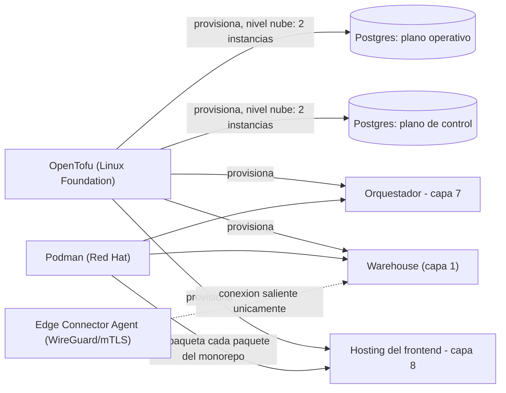

# Capa 11: Infraestructura y Hosting

> Reemplazo: **Power BI Service + capacidad Premium/Fabric + Gateway on-premises → Podman + OpenTofu + Edge Connector Agent (con WireGuard como transporte)**
>
> **Corrección de gobernanza (la más seria de todo el proyecto):** el borrador proponía Terraform y Cloudflare Tunnel/Tailscale sin cuestionarlos. Terraform **ya no es open source** — HashiCorp lo relicenció bajo Business Source License en 2023 (no aprobada por la OSI) y fue adquirida por IBM en 2025. Se reemplaza por **OpenTofu**, el fork bajo la Linux Foundation. Se revisa también Docker (empresa) → **Podman** (Red Hat) y Cloudflare Tunnel/Tailscale (SaaS propietario de control plane cerrado) → **WireGuard** nativo (protocolo del kernel de Linux).

---

## 1. Responsabilidad única de esta capa

Definir dónde y cómo corre cada pieza del sistema — cómputo, redes, secretos — sin contener lógica de ninguna otra capa.

---

## 2. Qué reemplazamos y por qué

Power BI Service ata el costo a licencias por usuario y capacidad Premium/Fabric; el Gateway on-premises es una pieza operativa adicional solo para conectar datos internos a la nube de Microsoft.

---

## 3. Qué eliminamos de Power BI

- Costo de licenciamiento atado a capacidad Premium/Fabric.
- El Gateway como pieza operativa obligatoria separada, atada al ecosistema de un solo proveedor.

---

## 4. Tres correcciones de gobernanza, una por una

### 4.1 Terraform → OpenTofu (la corrección más importante del proyecto)

En agosto de 2023, HashiCorp cambió la licencia de Terraform de MPL 2.0 (open source real, aprobada por la OSI) a **Business Source License 1.1** — una licencia que prohíbe usar el software "de forma competitiva" contra los productos de HashiCorp, y que la OSI no reconoce como código abierto. En febrero de 2025, **IBM adquirió HashiCorp** por USD 6.400 millones — Terraform hoy es, literalmente, un producto de IBM. Es exactamente el mismo patrón que ya se vio con dbt Fusion (capa 2) y Airbyte Core (capa 3), pero más grave: acá no es una función nueva la que quedó cerrada, es **el proyecto entero**.

La comunidad respondió el mismo día del cambio: más de 120 empresas firmaron un manifiesto y forkearon la última versión MPL de Terraform, naciendo **OpenTofu**, adoptado por la **Linux Foundation** en septiembre de 2023 y aceptado como proyecto **CNCF Sandbox** en abril de 2025. Para 2026, OpenTofu no es solo "una alternativa que compila igual" — tiene funciones que el binario abierto de Terraform no tiene (cifrado nativo de estado, `provider for_each`, evaluación temprana de variables) porque HashiCorp mueve su inversión de ingeniería hacia HCP Terraform (el producto pago), no hacia el binario abierto. Corre en producción en Fidelity, Capital One y Boeing.

**Decisión: OpenTofu.** Gobernanza de fundación, licencia MPL 2.0 realmente abierta, compatible con la sintaxis HCL y los providers que ya existen para Terraform (migración de ida y vuelta sin reescritura). No hay trade-off que aceptar — es estrictamente mejor en gobernanza y, en varios aspectos técnicos, también en capacidad.

### 4.2 Docker → Podman

**Docker** como producto es de Docker Inc., una empresa — el runtime de bajo nivel que usa por debajo (`containerd`) sí es un proyecto **CNCF graduado**, pero la experiencia de desarrollo (CLI, Docker Desktop, Docker Hub) es de la empresa. **Podman**, desarrollado por Red Hat, es un reemplazo directo (mismo formato de imagen OCI, compatible con Docker Hub, acepta los mismos archivos `docker-compose.yml`) pero **sin daemon corriendo como root** — cada contenedor es un proceso hijo directo del usuario que lo lanzó, una superficie de ataque menor por diseño, no solo una diferencia de gobernanza.

**Decisión: Podman.** Mismo formato de archivo de composición (el "Compose Spec" es un estándar abierto que ambos implementan, así que el `docker-compose.yml` de la sección 8 no cambia una línea), gobernanza más sólida (Red Hat, no una startup del espacio de contenedores), y una arquitectura más segura por defecto.

**Compose provider — decisión tomada al implementar el Paso 0.** `podman compose` no implementa el Compose Spec por sí mismo: delega en un *provider* externo (`docker-compose` o `podman-compose`). Se fija el **binario standalone de `docker-compose`**, evaluado con la regla 7:

| Criterio | Evaluación |
| --- | --- |
| Licencia | Apache-2.0 — sin letra chica de relicenciamiento |
| Qué es exactamente | Solo el binario de la implementación de referencia del Compose Spec. **No** es Docker Engine ni Docker Desktop: no hay daemon, habla con el socket de Podman |
| Madurez | Implementación de referencia del estándar; es el camino que Podman Desktop soporta oficialmente en Windows (su onboarding lo instala). `podman-compose` (organización `containers`) tiene menos uso real en Windows — los bind mounts con rutas `E:\` quedaban como riesgo a validar — y un bus factor más chico |
| Gobernanza | Docker Inc. (empresa con adopción masiva) — riesgo residual aceptado por lo que sigue |
| Criticidad y radio de impacto | Bajos: herramienta de desarrollo, no toca datos ni lógica de negocio |
| Forkabilidad / salida | Trivial: `compose.yaml` es Compose Spec estándar — cambiar a `podman-compose` es cambiar el provider instalado, sin tocar una línea del archivo |

`pnpm preflight` verifica el provider explícitamente: rechaza el `docker-compose.exe` que viene dentro de Docker Desktop (su ciclo de vida pertenece a un producto que el proyecto no usa) y cualquier provider que no sea `docker-compose`. **Lección de la verificación en vivo del Paso 0:** Docker Desktop instala dos copias (`Docker\Docker\resources\bin` y `Docker\cli-plugins`) que quedan en el PATH del sistema aunque esté detenido, y `podman compose` las elige antes que un standalone instalado por usuario — el preflight las detecta por ruta y por el sufijo `-desktop` de su versión. **La selección es por proceso, nunca global:** la CLI del proyecto descubre el standalone en el PATH (o toma `ATLASBI_COMPOSE_PROVIDER` del `.env` del repo) y le pasa `PODMAN_COMPOSE_PROVIDER` únicamente a los procesos `podman compose` que ella misma lanza — no escribe variables de entorno de usuario/sistema ni `containers.conf`, que cambiarían el comportamiento de cualquier otro proyecto Podman de la máquina. El preflight verifica además que Podman efectivamente usó el provider seleccionado.

### 4.3 El verdadero equivalente del Gateway de Power BI — un Edge Connector Agent, con WireGuard como transporte, no como la solución completa

**Corrección de una confusión real, señalada por una revisión externa: WireGuard y un Gateway empresarial no son la misma cosa, y esta capa los trataba como si lo fueran.** WireGuard resuelve **conectividad de red segura** — un túnel cifrado punto a punto. El Gateway de Power BI (y su equivalente en Tableau, Tableau Bridge) resuelve un problema más grande: **ejecución de conectores dentro de la red del cliente, gestión centralizada de credenciales, programación de refrescos, alta disponibilidad con clústeres, y auditoría** — todo eso, no solo el túnel. Confundir los dos es quedarse con la parte más fácil del problema y llamarla "resuelta".

**La corrección: un Edge Connector Agent propio, con WireGuard como uno de sus transportes posibles — no como el reemplazo completo.**

El Agent es una pieza de software chica y propia (no una dependencia externa de riesgo — se construye con lo que ya está decidido: la misma librería `dlt` de la Capa 3), que corre **dentro de la red del cliente**, cerca de sus fuentes internas, y hace el trabajo real que un Gateway hace:

| Responsabilidad | Cómo la resuelve el Agent |
| --- | --- |
| Ejecutar conectores sin exponer la fuente a internet | Corre los pipelines de dlt (capa 3) localmente, dentro de la red del cliente — la fuente nunca recibe una conexión desde afuera |
| Gestión de credenciales | Las credenciales de las fuentes internas viven **solo** en el Agent, nunca viajan al resto de la plataforma — el Agent extrae y empuja datos ya procesados, no reenvía la conexión cruda |
| Conectividad saliente únicamente | El Agent **inicia** la conexión hacia la plataforma (nunca al revés) — no hace falta abrir puertos entrantes en la red del cliente, sea cual sea el transporte de red usado |
| Transporte de esa conexión saliente | **WireGuard** cuando se necesita un túnel de red completo (ej. conectar a una base que solo acepta conexiones desde una IP conocida); **mTLS/HTTPS saliente simple** cuando alcanza con eso — WireGuard es una opción de transporte, configurable, no la única ni la definición del Agent |
| Programación de refrescos | Coordina con Airflow (capa 7) — el Agent expone un endpoint que Airflow dispara según el cronograma, o el Agent mismo corre su propio scheduler liviano si la red del cliente no permite that conexión entrante |
| Auditoría y salud | El Agent reporta heartbeat y logs de ejecución al catálogo de metadata (capa 12) |

**Lo que se pospone honestamente para una fase posterior, no se finge resuelto:** alta disponibilidad con clústeres de Agents y balanceo de carga — el diseño de un solo Agent por red de cliente cubre el caso inicial (una plataforma con pocos clientes/instalaciones), pero escalar a un Gateway con HA real (como el de Power BI, que sí soporta clusters) es trabajo de una fase posterior, cuando la cantidad de instalaciones lo justifique.

## 4.4 Modos de despliegue: local vs. nube, con flexibilidad real de proveedor

Este proyecto tiene que soportar dos modos de despliegue distintos, y la forma de lograrlo sin duplicar código por cada proveedor es que **cada pieza de infraestructura le hable a un protocolo estándar, nunca a la API propietaria de un proveedor específico**:

| Pieza | Protocolo estándar | Proveedores intercambiables |
| --- | --- | --- |
| Almacenamiento de datos (capa 1) | API S3 | AWS S3, DigitalOcean Spaces, Cloudflare R2, Backblaze B2, o MinIO self-hosteado en modo local |
| Catálogo (Postgres, capas 1/2/7) | Protocolo de cable de Postgres | Cualquier Postgres gestionado (RDS, DigitalOcean, Neon) o un container propio |
| Cómputo (frontend, servicios) | Contenedor OCI (empaquetado por Podman) | Cualquier plataforma que acepte containers, o un servidor propio |

**Modo local:** un solo `podman compose up` — Postgres en un container, **MinIO** (self-hosteado, habla la misma API S3 que cualquier proveedor cloud) en vez de un bucket remoto, y el frontend en otro container. Nada depende de una cuenta en la nube.

**Modo nube:** el usuario elige, pieza por pieza, dónde vive cada componente — porque cada uno habla un protocolo estándar, se pueden combinar proveedores distintos sin fricción (por ejemplo: catálogo en Neon, datos en Cloudflare R2, frontend en DigitalOcean). OpenTofu resuelve esto con **un módulo por proveedor** (uno para "bucket S3 en DigitalOcean", otro para "bucket S3 en AWS", etc.); el usuario solo cambia una variable de configuración para elegir cuál usar, y el resto de la plataforma sigue hablándole a "un endpoint S3 genérico" sin enterarse de cuál es.

**Regla de diseño que se desprende de esto:** ninguna capa de este proyecto puede importar el SDK propietario de un proveedor específico (por ejemplo, el SDK de AWS) directo en su código de aplicación — siempre a través del protocolo estándar (cliente S3 genérico, driver de Postgres estándar). El único lugar donde el nombre de un proveedor concreto aparece es en la configuración de OpenTofu de ese despliegue puntual, nunca en el código de las capas 1 a 10.

### 4.5 Un solo Postgres para cinco consumidores — corrección de un riesgo real

**Hallazgo de una revisión externa, y es justo: "esquemas separados" no es aislamiento real.** El diseño original de este proyecto reutiliza el mismo servidor Postgres como catálogo de DuckLake (capa 1), estado de SQLMesh (capa 2), metadata de Airflow (capa 7), base de usuarios de better-auth (capa 9) y persistencia de `dashboard_state` para ElectricSQL (capa 10) — cinco consumidores, un solo proceso. Separar por esquema evita que uno lea las tablas del otro (responsabilidad única a nivel de datos), pero **no evita que uno tire abajo a los demás**: si ese Postgres se cae, se caen las cinco funciones a la vez, y si uno de los cinco genera una carga pesada (Airflow escribe metadata constantemente; Electric mantiene un slot de replicación lógica activo), los otros cuatro sienten la degradación aunque no tengan nada que ver — el clásico problema del "vecino ruidoso".

**La corrección depende del nivel de despliegue (sección 4.4), no es una regla única para los tres:**

| Nivel | Postgres compartido | Justificación |
| --- | --- | --- |
| **Portátil** | No aplica — catálogo en SQLite, sin Airflow/Electric corriendo | No hay nada que separar |
| **Equipo local** | Uno solo, vía Podman, sigue siendo aceptable | Equipo chico, downtime de todo el stack a la vez es un costo asumible a cambio de simplicidad operativa — el mismo criterio que ya se aplicó en toda esta capa |
| **Nube/producción** | **Separado en al menos dos instancias**: una para el "plano de control" (catálogo DuckLake + estado de SQLMesh + usuarios de better-auth — carga liviana, mayormente por lotes) y otra para el "plano operativo" (metadata de Airflow + replicación de Electric — carga pesada y constante) | Es exactamente donde un fallo compartido o un vecino ruidoso deja de ser un costo aceptable |

**Por qué esto no cuesta rediseñar nada:** cada consumidor ya habla el protocolo estándar de Postgres (regla de la sección 4.4) — nunca asumió que su Postgres era el mismo proceso que el de otro consumidor, solo que existía una connection string. Separar las instancias en producción es, literalmente, cambiar dos variables en OpenTofu (un módulo `postgres_database` llamado dos veces en vez de una) — no se toca una línea de código de aplicación en ninguna de las cinco capas.

```hcl
# infra/main.tf — nivel nube/producción
module "postgres_plano_control" {
  source = "./modules/postgres"
  name   = "control-plane"   # catalogo DuckLake + estado SQLMesh + usuarios better-auth
  region = var.region
}

module "postgres_plano_operativo" {
  source = "./modules/postgres"
  name   = "operational-plane"  # metadata Airflow + replicacion Electric
  region = var.region
}
```

### 4.6 Observabilidad transversal: OpenTelemetry desde el bootstrap

**Corrección de un hueco real, señalado en una revisión posterior: este proyecto mencionaba "logs/observabilidad mínima" (`IMPLEMENTATION.md`, paso 0 del bootstrap) sin elegir nunca un estándar.** Para un sistema poliglota como este — TypeScript (frontend, API Gateway, realtime), Python (dlt, SQLMesh, Airflow), Rust (Cube Core, DataFusion) — no tener un contrato único de instrumentación significa que el día que una consulta tarde 840ms, no hay forma profesional de saber si el problema fue la Gateway, Cube, o DuckDB, más allá de mirar logs sueltos sin correlación.

**Decisión: OpenTelemetry, transversal, desde el bootstrap (paso 0 del orden de construcción) — no una capa que se agrega después.** Gobernanza limpia y verificada: graduó como proyecto CNCF en mayo de 2026, con más de 12.000 contribuidores de más de 2.800 empresas — la misma categoría de confianza que ya aplicamos a Airflow, ADBC y ECharts.

```
Frontend (TS) ──────────────┐
API Gateway (TS) ───────────┤
Copiloto de IA (TS) ────────┤
dlt / SQLMesh (Python) ─────┤
Airflow (Python) ───────────┤
                            ▼
                   OTel Collector
                            │
              ┌─────────────┼─────────────┐
              ▼             ▼             ▼
           traces        metrics        logs
```

**El contrato real es "todo emite OpenTelemetry" — el backend de observabilidad (a dónde van esas trazas) es intercambiable, y es justo esa neutralidad la razón de elegir el estándar en primer lugar:** en modo local/equipo, Prometheus + Grafana (Tempo para trazas, Loki para logs) alcanza; en un despliegue mayor, se cambia el backend sin reinstrumentar una sola línea del código de las 12 capas, porque ninguna de ellas habla directo con Prometheus o Grafana — todas hablan OTel, y el Collector decide a dónde reenviar.

### 4.7 Gestión de secretos: `SecretProvider`, nunca variables de entorno sueltas en producción

**Corrección de otro hueco real: `.env`/`secrets.toml` es correcto para desarrollo, pero nunca se definió qué pasa en producción** — y este proyecto va a manejar tokens de Salesforce, contraseñas de base de datos, el secreto de firma de JWT (`CUBEJS_API_SECRET`), API keys de proveedores de IA, credenciales de S3, y certificados mTLS del Edge Connector Agent (capa 11, sección 4.3). Desperdigar todo eso en variables de entorno manuales no escala ni se auditoría.

**Decisión: una interfaz `SecretProvider` propia, con implementaciones intercambiables según el nivel de despliegue (`11-infraestructura.md`, sección 4.4) — mismo patrón de protocolo-sobre-proveedor que el resto de esta capa:**

| Nivel | Implementación de `SecretProvider` |
| --- | --- |
| Desarrollo / portátil | `.env` / `secrets.toml` — sigue siendo correcto para este nivel |
| Producción self-hosteada | **OpenBao** — fork de Vault bajo gobernanza de la Linux Foundation + OpenSSF (desde junio de 2025), licencia MPL 2.0, con adopción real en producción (GitLab, SAP, NVIDIA) — secretos dinámicos, rotación, PKI, auditoría |
| Producción en nube | El gestor de secretos nativo del proveedor (AWS Secrets Manager, GCP Secret Manager, o equivalente) — coherente con la regla de protocolo-sobre-proveedor: el código nunca importa el SDK específico, solo la interfaz `SecretProvider` |

```ts
// packages/contracts/secret-provider.ts
interface SecretProvider {
  get(key: string): Promise<string>;
}
// Implementaciones: EnvSecretProvider, OpenBaoSecretProvider, CloudSecretProvider
// Ninguna capa de las 12 importa OpenBao o un SDK de nube directo — todas hablan contra esta interfaz.
```

No es trabajo del primer vertical slice implementar OpenBao — es una pieza que se activa al llegar al nivel de despliegue de producción self-hosteada (sección 4.4) — pero la interfaz se define desde ahora, para que ningún código temprano asuma `process.env.X` directo en un lugar que después haya que reescribir.

---

## 5. Qué agregamos que Power BI no tiene
- **Infraestructura versionada y revisable en pull request**, con una herramienta (OpenTofu) que no puede cerrarse de la noche a la mañana.
- **Un túnel de red sin dependencia de un plano de control comercial de terceros.**

---

## 6. Arquitectura interna de esta capa



---

## 7. Contrato de esta capa (qué expone, qué consume)

- **No expone API** — es la capa que hace posible que todas las demás corran, pero no es consumida por ninguna en tiempo de ejecución.
- **Consume**: definiciones de infraestructura como código (OpenTofu), definiciones de contenedores (Podman/Compose Spec), configuración del Edge Connector Agent (transporte WireGuard o mTLS, según el caso).

---

## 8. Por dónde empezar a construir (paso a paso concreto)

1. Un `compose.yaml` mínimo (formato Compose Spec, corrido con `podman compose up`) levantando Postgres local y el frontend, antes de pensar en la nube. **Incluir el OTel Collector desde este primer compose** (sección 4.6) — instrumentar después de tener código corriendo sale mucho más caro que instrumentar desde la primera pieza.
2. Escribir el primer módulo de OpenTofu para un solo recurso (por ejemplo, el bucket de object storage de la capa 1) y confirmar `tofu plan`/`tofu apply`.
3. Construir una primera versión mínima del Edge Connector Agent (un proceso que corre un pipeline de dlt localmente y empuja el resultado hacia afuera) y probar la conexión saliente con una fuente de datos interna de prueba (capa 3) — vía WireGuard si la fuente lo exige, vía mTLS/HTTPS saliente si alcanza con eso.
4. Recién con esos tres elementos probados por separado, ensamblar el pipeline de despliegue completo.
5. Definir la interfaz `SecretProvider` (sección 4.7) desde el día uno, aunque la única implementación real por ahora sea `EnvSecretProvider` — para que ningún código temprano asuma `process.env.X` directo en un lugar que después haya que reescribir.

---

**Fin de las 11 capas originales (hoy son 12, más los documentos de implementación 13-17).** Queda pendiente, cuando lo indiques, actualizar `00-documentacion-general.md` y `MEMORY.md` con: la corrección de nombres de capas 4 y 5, la corrección de MetricFlow→Cube en el mapa de capas, y un resumen de las correcciones de gobernanza aplicadas en las capas 4, 6, 7, 8, 9, 10 y 11.
