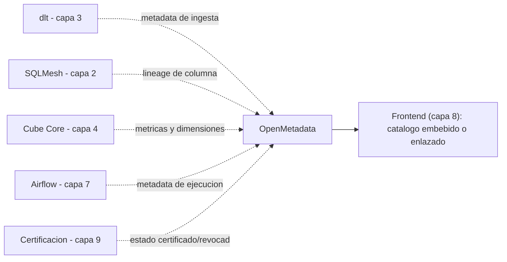

# Capa 12: Metadata, Catálogo y Lineage

> Esta capa no estaba en el diseño original — surgió de una auditoría externa (dos revisiones independientes) y se confirmó con una tercera fuente de análisis de producto: es un hueco real, no una ocurrencia tardía. Reemplaza lo que en Power BI es el Data Catalog/lineage de Fabric, y en Tableau el Data Catalog de Tableau — piezas que este proyecto no tenía en ninguna de las 11 capas anteriores.

---

## 1. Responsabilidad única de esta capa

Responder, de forma consultable y no solo como registro pasivo: ¿de dónde viene este dato?, ¿quién es el dueño?, ¿qué dashboards lo usan?, ¿qué pasa si cambio esta columna?, ¿está certificado?, ¿cuándo se actualizó por última vez?

**Esta capa NO debe saber:**
- Nada de cómo se calcula una métrica (capa 4) — solo registra que existe y de dónde sale.
- Nada de permisos de acceso a los datos en sí (capa 9) — solo puede registrar *quién puede ver el catálogo*, no reemplazar el security context de Cube.
- Nada de renderizado — expone una API/UI propia de catálogo, que el frontend (capa 8) puede embeber o enlazar, nunca al revés.

---

## 2. Qué reemplazamos y por qué

Power BI tiene el Data Catalog de Microsoft Fabric y Tableau tiene su propio Data Catalog — ambos permiten buscar transversalmente qué datasets/reportes existen y ver lineage básico. Este proyecto, hasta esta capa, no tenía nada equivalente: la certificación de datos (capa 9) es una insignia puntual, no un catálogo navegable, y el lineage de columna que ya existe (SQLMesh, capa 2) vive dentro de esa herramienta, sin una vista unificada que cruce ingesta → transformación → semántico → dashboard.

---

## 3. La herramienta — OpenMetadata, con el riesgo de gobernanza corregido y documentado explícitamente

### 3.0 Corrección de un error de gobernanza real, señalado por una revisión externa

**Esta capa afirmaba que "OpenMetadata se unió a la Linux Foundation en marzo de 2026" y la clasificaba, por eso, como gobernanza de fundación neutral. Es un error factual y hay que corregirlo sin vueltas.** Lo que ocurrió el 26 de marzo de 2026, verificado contra el anuncio oficial, es distinto: **Collate Inc. — la empresa detrás de OpenMetadata — se unió a la Linux Foundation como *Silver Member*.** Eso es membresía corporativa de Collate en la fundación (participar del ecosistema, contribuir a estándares abiertos junto a otras empresas) — **no** es que el proyecto OpenMetadata en sí haya sido donado o transferido a gobernanza de la Linux Foundation, como sí ocurrió con SQLMesh o con OpenTofu. Collate Inc. sigue controlando el roadmap, la licencia y la dirección del proyecto por completo.

**Esto cambia la clasificación de riesgo de esta capa: OpenMetadata pasa de "bajo, fundación" a "medio, documentado" — la misma categoría que ya se aceptó en las capas 3 (dlt) y 4 (Cube) cuando no existe una alternativa mejor.** Y es el caso acá: DataHub tiene el mismo perfil (una empresa, Acryl Data) y Amundsen está estancado en su desarrollo — ninguna de las tres opciones de esta categoría está gobernada por una fundación real.

### 3.1 El panorama, corregido

Las tres opciones open source dominantes en esta categoría son **OpenMetadata**, **DataHub** y **Amundsen** — las tres nacieron como proyectos internos de empresas (Uber, LinkedIn y Lyft respectivamente) antes de abrirse, y las tres siguen, hoy, bajo control de una empresa (o sin desarrollo activo, en el caso de Amundsen).

- **Amundsen**: el más liviano, pero su desarrollo se enlenteció notablemente y hoy se lo describe como una herramienta de búsqueda/descubrimiento, no de gobernanza/lineage completo.
- **DataHub**: el más flexible técnicamente (modelo de metadata extensible por "aspectos"), gobernado por Acryl Data, una sola empresa — mismo perfil de riesgo que OpenMetadata, sin la ventaja de completitud de fábrica.
- **OpenMetadata**: gobernado por Collate Inc. (empresa con financiamiento de riesgo, ronda Serie A) — pero con adopción real y verificable (más de 4.000 empresas en producción, más de 130 conectores), diseño "schema-first", lineage a nivel de columna, glosario de negocio, clasificación, tests de calidad de datos nativos, y un modelo de gobernanza (dominios, políticas, "data products") más completo de fábrica que DataHub.

### 3.2 Decisión para este proyecto: OpenMetadata, riesgo residual documentado

1. **No hay alternativa de fundación real en esta categoría** — el mismo patrón ya aceptado en las capas 3 y 4, aplicado con la misma honestidad acá.
2. **Cubre de fábrica lo que DataHub deja para construir a mano** (glosario, clasificación, calidad de datos, dominios) — menos trabajo de integración para este proyecto, y el mismo argumento sigue siendo válido con o sin el error de gobernanza corregido.
3. **La severidad del riesgo, si Collate Inc. desapareciera o cambiara de dirección, es baja para este proyecto específico**: esta capa es de solo lectura de metadata (contrato, sección 6) — nunca es parte del camino crítico de una consulta real (si el catálogo se cae, los dashboards siguen funcionando, como ya establece esa misma sección). Migrar a DataHub, si hiciera falta, es un problema de re-ingesta de metadata, no una reescritura de las demás capas.

**Honestidad sobre los límites, ahora sin el error de origen:** DataHub sigue siendo más extensible si en el futuro este proyecto necesitara modelar tipos de metadata muy particulares. Para el alcance actual, OpenMetadata es la elección correcta — con el riesgo de que es una empresa, no una fundación, documentado como tal, no disimulado.

---

## 4. Qué agregamos que Power BI no tiene (o tiene solo en Fabric, de forma cerrada)

- **Lineage de extremo a extremo**, cruzando las 11 capas ya construidas: fuente → (dlt → landing, cuando la fuente usa ingesta) → SQLMesh → Cube → dashboard, algo que hoy vive fragmentado entre herramientas. En el import directo (`02-transformacion.md` §6.1.2), SQLMesh declara la fuente registrada como modelo externo y el lineage arranca en ella.
- **Certificación conectada a un catálogo navegable** — la certificación de la capa 9 deja de ser una insignia aislada y pasa a ser un atributo consultable en el catálogo.
- **Glosario de negocio compartido**, para que "cliente activo" signifique lo mismo en toda la organización, no una definición distinta por cada analista.
- **Gobernanza sobre impacto de cambios**: antes de borrar una columna, poder preguntar "¿qué se rompe?".

---

## 5. Arquitectura interna de esta capa

### 5.1 Cómo se alimenta, sin duplicar trabajo

OpenMetadata se alimenta por **ingesta programada** (un conector por pieza del stack, orquestado — como todo lo demás — por Airflow, capa 7): lee el lineage de columna que SQLMesh ya calcula, las definiciones de métricas que Cube ya tiene en su YAML, y el estado de certificación que la capa 9 ya registra. No es una segunda fuente de verdad — es una vista unificada de verdades que ya existen, dispersas.

---

## 6. Contrato de esta capa (qué consume, qué expone)

- **Consume**: metadata de lectura de las capas 2, 3, 4, 7 y 9 — nunca escribe en ninguna de ellas, nunca es un intermediario en el camino de una consulta real.
- **Expone**: una API/UI de catálogo, búsqueda, lineage y glosario — consumible por el frontend (capa 8) como una vista embebida o un enlace, nunca como parte del camino crítico de ver un dashboard (si el catálogo está caído, los dashboards siguen funcionando).
- **No expone**: control de acceso a los datos en sí — eso sigue siendo trabajo exclusivo de la capa 9 y del security context de Cube.

---

## 7. Por dónde empezar a construir (paso a paso concreto)

1. Levantar OpenMetadata vía su despliegue oficial (Docker/Podman) apuntando a su propia base de metadata (no reutilizar el Postgres compartido de otras capas — ver la nota de la Capa 11 sobre planos de control separados).
2. Configurar el primer conector: Airflow (capa 7), para ver metadata de ejecución de pipelines ya corriendo.
3. Agregar el conector de la base SQL del warehouse (capa 1) para el inventario básico de tablas.
4. Recién con eso funcionando, conectar el lineage de columna de SQLMesh y las métricas de Cube.
5. Migrar la certificación de la capa 9 para que aparezca como atributo del catálogo, en vez de vivir aislada.

---

**Siguiente documento:** actualización de `00-documentacion-general.md` con el plan de implementación y el mapa de capas ya en 12.
